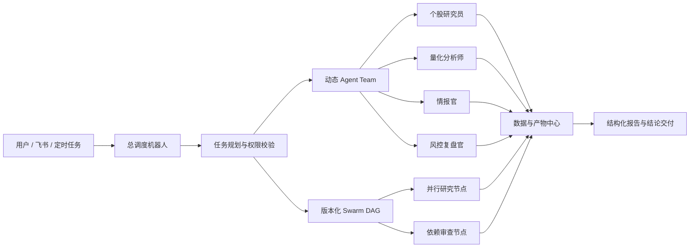

# SixRabbits Stock

## 面向专业投资研究场景的企业级多智能体协同平台

**SixRabbits Stock** 是一套围绕 A 股投研、组合管理、风险控制与知识沉淀构建的智能决策基础设施。平台以 AgentScope 为智能体运行底座，将大模型、市场数据、量化因子、企业知识库、任务编排、受控工具执行与飞书协同统一到一套可治理、可追踪、可持续演进的系统中。

它不是一个只会“回答问题”的聊天机器人，而是一支能够分工、协作、留痕、复核和持续工作的数字化投研团队。

> 产品名称：**SixRabbits Stock**
>
> 产品定位：**AI 驱动的 A 股智能研究与风险控制工作平台**
>
> 核心原则：**数据驱动、流程可控、结果可追溯、数据有边界**

---

## 一、平台价值

SixRabbits Stock 将传统投研过程中分散的人、数据、模型、文档与流程重新组织为一条完整的智能生产链：

- **从提问到研究结论**：自动理解任务、检索证据、调用专业工具并形成结构化结果。
- **从单体 Agent 到数字团队**：总调度机器人可将复杂任务分派给研究、量化、情报、风控等专业数字人。
- **从即时对话到持续执行**：支持持久化任务、并行子任务、失败重试、超时控制、定时调度与运行恢复。
- **从零散查询到标准研究**：以公司研究 Bundle 并行组织行情、财务、估值、事件、技术、资金和反方视角。
- **从数据展示到决策辅助**：连接持仓、自选池、行情、公告、新闻、知识库、因子研究与策略回测。
- **从能力开放到安全治理**：权限、审批、用户数据隔离、执行沙箱和全链路日志共同构成安全边界。

---

## 二、核心能力矩阵

| 能力域 | 平台能力 |
| --- | --- |
| 智能问股 | 面向 A 股标的开展行情、基本面、事件、技术面、风险与知识库联合分析 |
| 数字人中心 | 总调度 PM、盘中哨兵、个股研究员、情报官、风控复盘官、量化分析师等专业角色协同 |
| Agent Teams | 动态派发子任务、并行执行、上下文传递、结果聚合、失败兜底与会话可追踪 |
| Swarm 工作流 | 内置量化策略台、组合复盘委员会、投资决策委员会、基本面研究组、风险委员会五套 DAG 模板 |
| 标准公司研究 | 七维公司研究 Bundle、专业报告结构、数据日期、来源说明与数据局限 |
| 技能系统 | 符合渐进式加载思想的专业技能目录、技能广场、工具契约与按角色授权 |
| 持仓管理 | 多券商账户、持仓快照、买卖流水、成本与盈亏、止损止盈、截图识别和 Agent 录入 |
| 自选池管理 | 手工与 Agent 增删、统一分组、入池理由、K 线联动和研究覆盖 |
| 用户数据隔离 | 持仓、自选、Agent 报告、风控事件、数字人会话与个人定时任务按用户严格隔离；模型和行情数据源共享 |
| 知识库与 RAG | 文档上传、解析、切片、向量检索、重排序、引用与召回测试 |
| 量化研究 | 因子目录、因子研究、策略回测、交易归因、风险指标与可视化报告 |
| 定时任务 | 交易日节律任务、定时研究、定时代码执行、新闻简报与飞书消息卡片推送 |
| 工作空间 | 在受控目录内持续创建、读取、编辑和版本化管理代码、报告、PDF、Word、Excel、PPT 等成果 |
| 飞书协同 | 数字人与飞书机器人绑定，会话入库、群聊任务、卡片推送与定时报告 |
| 模型治理 | 多平台、多模型配置，支持聊天、视觉、Embedding 与 Rerank 服务统一管理 |
| 运维可观测 | Agent 运行记录、工具步骤、审批记录、耗时、错误、日志、健康检查与后台服务状态 |

---

## 三、多智能体协作架构

平台同时支持两种协作模式，既保留动态智能，又提供工程化确定性。

### 1. 动态 Agent Team

总调度机器人根据任务目标选择合适的数字人，将复杂任务拆分为有限、清晰、可验收的专业子任务。每个数字人的任务提示、会话记录、运行状态和最终产物均独立保存。

适合场景：

- 临时重大事件研究
- 多标的并行分析
- 个股、量化、情报与风控联合会诊
- 需要总调度自主判断分工方式的开放任务

### 2. 固化 Swarm / DAG 工作流

对于高频、严肃、需要稳定复用的流程，平台提供版本化 DAG 工作流。节点依赖、并行关系、失败传播、超时、取消、重试和恢复均由运行时控制。

内置五套专业模板：

1. **量化策略台**：标的筛选、因子挖掘、策略回测、风险审计。
2. **组合复盘委员会**：组合诊断、收益归因、风险复核、调整建议。
3. **投资决策委员会**：研究、反方论证、风险审查与决策汇总。
4. **基本面研究组**：公司研究、产业信息、财务质量与估值判断。
5. **风险委员会**：风险识别、压力审查、反方材料和处置建议。



---

## 四、标准研究体系

平台针对公司深研、持仓决策和事件复盘提供标准化研究底稿，降低模型临场发挥导致的遗漏与重复查询。

### 七维公司研究 Bundle

- **行情与时间线**：最新价格、历史走势、涨跌停和异常波动。
- **财务质量**：利润表、资产负债表、现金流量表和趋势摘要。
- **估值状态**：PE、PB、PS、市值与估值口径。
- **事件材料**：公司公告、新闻和内部知识库材料。
- **技术量价**：均线、趋势、波动、成交量与关键位置。
- **资金信息**：资金流、两融、龙虎榜和筹码数据。
- **反方视角**：主动整理与主结论相冲突的事实、风险和失效条件。

### 运行原则

- 高频研究先调用标准 Bundle 并行取数，再按用户问题补充专用查询。
- 数据来源、时间范围、方法和限制条件进入研究结果。
- 工具执行、模型调用、Agent 分工与最终结果可回溯。
- 数据源暂不可用时自然说明局限，不触发重复输出或额外验收流程。
- 研究结论与交易执行严格分离，平台不直接连接券商下单。

---

## 五、数据与量化能力

### 多源数据协同

系统支持通过配置中心接入行情、财务、公告、新闻、搜索、知识库、Embedding 与 Rerank 服务。公共市场数据可以共享复用，用户资产数据保持私有隔离。

### 因子与策略研究

平台具备因子目录、公式描述、适用市场、衰减窗口、策略回测和报告展示能力，可用于：

- 动量、反转、波动率、流动性、质量、价值等多维因子研究
- 标的筛选与横截面对比
- MACD 等策略回测与交易日志分析
- 收益、回撤、Sharpe、Sortino、Calmar、胜率与盈亏比评估
- 交易归因、基准对比、稳健性分析与风险提示

量化结果用于研究与复盘，不构成收益承诺。

---

## 六、企业级安全与治理

SixRabbits Stock 将安全能力放在智能能力之前。

### 用户与权限

- 基于角色与权限范围的访问控制
- Agent 使用、数据读取、数据写入和系统管理分权
- 持仓与自选业务数据按用户隔离
- Agent、飞书会话与定时任务继承真实用户身份
- 服务端决定数据归属，前端不能通过伪造用户参数越权

### 工具审批

工具调用可按风险等级配置审批策略：

- 请求批准
- 替我批准
- 完全访问

高风险文件操作与代码执行进入明确的审批和审计流程。

### 执行安全

- 独立工具执行 Worker
- 受控工作目录
- Python 沙箱服务
- 超时与资源限制
- 文件版本记录
- 工具运行日志与错误留痕

### 数据安全边界

- 公共行情、公告、新闻与基础证券信息可以共享
- 用户账户、资金、持仓、交易流水和自选偏好严格私有
- 密钥采用配置管理，不在代码中硬编码
- 系统不保存券商明文账户密码，不执行真实证券交易

---

## 七、技术架构

```text
Frontend
  Vue 3 + TypeScript + Vite

API & Domain
  FastAPI + Pydantic + SQLAlchemy

Agent Runtime
  AgentScope + Durable Run + Agent Teams + Swarm DAG

Data
  MySQL 8 + Redis + Milvus

Retrieval
  Embedding + Vector Search + Rerank + Evidence Citation

Execution
  Tool Worker + Workspace + Python Sandbox

Integration
  TuShare / Tavily / OpenAI-compatible Models / Feishu

Operations
  Nginx + systemd + Docker + A/B API Instances
```

### 后端领域结构

```text
backend/app/
├── agent_runtime/   # 持久化运行、Agent Teams、Swarm DAG、工具队列与恢复
├── agents/          # 问股、持仓录入、自选录入与工具审批
├── ai/              # 对话、RAG、记忆、经验、文档解析与模型客户端
├── auth/            # 身份认证、角色与权限
├── core/            # 配置、数据库、模型与日志
├── data/            # 持仓、自选、账户、工作台与业务数据访问
├── execution/       # 受控执行后端
├── feishu/          # 飞书机器人、消息卡片与会话
├── market/          # 行情与数字人工具
├── quant/           # 因子目录与量化研究
├── scheduler/       # 节律任务与后台调度
└── skills/          # 技能注册、渐进加载、契约与执行器
```

---

## 八、可靠性设计

- Agent 任务持久化，页面切换不影响后台运行。
- 同一会话限制并发写入，避免重复提交和状态竞争。
- 子任务支持并行执行、依赖解锁、超时、取消与失败传播。
- 工具任务支持租约、心跳、重试和错误编码。
- 服务重启后可恢复未完成上传、后台任务和 Agent 运行。
- API 采用双实例运行，Nginx 统一反向代理。
- 数据库连接池启用连接预检与回收机制。
- 流式输出记录运行时长，结束状态与输入状态解耦。
- 关键写操作具备幂等、预览确认和审计记录。

---

## 九、快速启动

### 环境要求

- Python 3.11+
- Node.js 20+
- MySQL 8
- Redis
- Milvus

### 1. 安装后端

```powershell
python -m pip install -e .
```

在 `backend/.env` 配置数据库、模型和数据源。可参考：

```text
backend/.env.example
```

初始化数据库：

```powershell
python -m backend.app.scripts_init_db
```

启动 API：

```powershell
python -m backend.app.main --host 127.0.0.1 --port 8000
```

健康检查：

```text
http://127.0.0.1:8000/api/health
```

### 2. 启动前端

```powershell
cd frontend
npm install
npm run dev
```

本地访问：

```text
http://127.0.0.1:5173
```

### 3. 测试

```powershell
python -m pytest -q
cd frontend
npm run build
```

### 4. 生产部署

项目提供生产部署脚本、Nginx 配置、systemd 服务、Redis、Milvus 与沙箱运行环境：

```powershell
python scripts/deploy.py --host <server> --user <user> --key <ssh-key> --build
```

部署采用版本目录与 `current` 软链接切换方式，便于发布审计与故障回退。

---

## 十、交付说明

SixRabbits Stock 面向研究、监控、复盘、协作与风险提示场景，不连接券商自动下单，不代替持牌机构或专业人员作出投资决策。

平台输出可能受到数据质量、数据时效、模型能力与外部服务可用性的影响。所有重要结论应结合原始证据、风险约束与人工复核后使用。

---

## 十一、愿景

SixRabbits Stock 的目标不是用一个模型替代所有专业人员，而是把优秀投研团队的分工方式、证据标准、风险纪律和协作流程沉淀为可复用的数字化能力。

**让每一次研究都有依据，让每一个任务都有过程，让每一项结论都经得起复核。**
