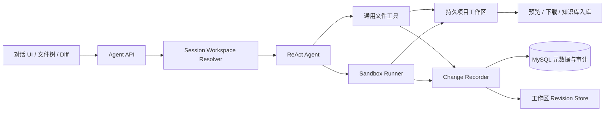

# Agent 持续文件修改能力技术方案

> 状态：设计方案
>
> 日期：2026-07-21
>
> 适用范围：问股、数字人中心、用户上传文件、代码与文本处理、PDF/Word/Excel/PPT 生成与续改
>
> 相关方案：[Agent 工作区与 Python 沙箱技术方案](agent-workspace-tech-design.md)、[Agent 复杂任务可靠执行方案](agent-durable-execution-plan.md)

## 1. 结论

本功能采用 Claw Code/Codex 风格的“持久工作区 Agent”，不为代码、文本、PPT、Word、Excel 分别建设一套会话和修改系统。

核心原则如下：

1. 一个任务或项目绑定一个稳定工作区，后续对话继续进入同一个目录。
2. 文件系统是内容事实来源，数据库只负责权限、会话绑定、变更索引和审计。
3. Agent 必须先查找、读取原文件，再通过局部补丁修改；只有创建新目标时才允许新建文件。
4. 每次写入记录路径、操作、前后哈希和 diff，恢复会话时结构化回放最近文件历史。
5. 代码和文本直接修改；PPT、Word、Excel 等二进制文件采用“可编辑源文件 + 构建产物”模式。
6. 用户上传且没有源文件的 Office 文档，由脚本打开原文件并局部修改，不得从空白文档重新生成。
7. `artifact` 只代表可预览或下载的输出事件，不承担 Agent 的连续工作记忆。
8. 除非用户明确说“重做、另做一版、从头开始”，否则“修改、继续、刚才那个”都必须基于现有文件处理。

因此，正确链路不是：

```text
用户说修改 PPT -> 根据聊天文字重新生成一个 PPT
```

而是：

```text
用户说修改 PPT
  -> 恢复同一工作区
  -> 找到刚才使用的源文件和输出文件
  -> 读取现状
  -> 局部修改源文件或原始 PPTX
  -> 重新构建/保存
  -> 验证
  -> 记录变更
```

## 2. 当前实现与问题

### 2.1 已有基础

当前项目已经具备以下能力：

- `backend/app/skills/agent_workspace.py` 提供用户级路径监狱。
- `ws_read_file` 可以分段读取 UTF-8 文本。
- `ws_edit_file` 可以按唯一原文进行精确替换。
- `ws_write_file` 可以创建或完整覆盖文本文件。
- `ws_glob`、`ws_grep` 可以查找文件和内容。
- `ws_run_python` 可以在 Docker 沙箱中运行工作区脚本。
- 沙箱已经安装 `python-pptx`、`python-docx`、`openpyxl`、`reportlab` 等文档库。
- 文件执行前后会扫描生成或修改的产物，并通过 SSE `artifact` 事件返回。
- 写文件、修改文件和代码执行已经接入审计及用户审批策略。

这些能力不需要推倒重建，持续修改功能应当在此基础上补齐状态和工具协议。

### 2.2 关键缺口

| 缺口 | 当前表现 | 结果 |
| --- | --- | --- |
| 工作区粒度过粗 | 当前主要按 `users/{user_id}` 隔离 | 同一用户不同任务的文件容易混在一起 |
| 会话未绑定项目目录 | `ai_chat_sessions` 没有 `workspace_id` | 新一轮无法确定应继续哪个文件集合 |
| 文件变更未持久化 | 会话只保存用户/助手文字 | 刷新、压缩或恢复后丢失“改过什么” |
| 模型输入只取最近消息 | `run_agent_events` 最终仅取最近 8 条历史 | 早期文件路径和约束会被丢弃 |
| 产物事件未成为工作状态 | `artifact` 只实时发给前端 | 下一轮不能可靠知道刚才生成了什么 |
| 缺少通用多文件补丁 | 当前只有单文件精确替换 | 代码项目和复杂文本修改效率低 |
| 覆盖缺少并发保护 | `ws_write_file` 可直接覆盖已有文件 | 多标签页或重试可能覆盖新版本 |
| 二进制只能生成、不能读取编辑 | 文件工具拒绝二进制 | 模型容易另写脚本并从零生成 Office 文件 |
| 没有源码保留契约 | 生成 PPT 后可能只关注 `.pptx` | 后续无法像修改代码一样修改它 |
| 没有可恢复版本 | 只有当前文件，没有统一 revision | 失败修改无法查看 diff 或回滚 |

这不是通过增加一句提示词就能彻底解决的问题。提示词负责行为倾向，真正的连续性必须由工作区绑定、工具返回值和变更历史保证。

### 2.3 Claw Code 可复用的实现原则

本方案参考 Claw Code 的通用 Agent Harness，而不是复制它的产品界面：

- [`agent_tools.py`](https://github.com/HarnessLab/claw-code-agent/blob/main/src/agent_tools.py)：通过固定工作区根目录限制路径；`edit_file` 使用精确原文替换，并返回操作元数据。
- [`agent_runtime.py`](https://github.com/HarnessLab/claw-code-agent/blob/main/src/agent_runtime.py)：将路径、前后哈希、工具调用和预览记录为 file history；恢复会话时把最近文件历史重新注入上下文。
- [`session_store.py`](https://github.com/HarnessLab/claw-code-agent/blob/main/src/session_store.py)：会话与 file history 一起持久化，而不是只保存最终回答。
- [`agent_prompting.py`](https://github.com/HarnessLab/claw-code-agent/blob/main/src/agent_prompting.py)：明确要求优先修改已有文件，只有必要时才创建新文件。

需要注意：Claw Code 的文本工具并不能直接编辑 PPTX。可复用的是“稳定 cwd + 通用文件工具 + 会话恢复 + 文件历史”这一层设计；Office 文件仍需要本项目已有的受控 Python 构建能力。

## 3. 目标与非目标

### 3.1 功能目标

- 同一会话刷新、重新登录或服务重启后，仍能继续修改原文件。
- 一个工作区可以同时容纳代码、文本、数据、图片和 Office 文件。
- 用户说“修改刚才的文件”时，Agent 能从结构化工作状态定位目标。
- 对文本和代码提供可审查、可回滚的局部修改能力。
- 对生成型文档保留源文件、素材、构建入口和输出文件。
- 对上传的 Office 文件执行真正的读取和局部修改。
- 每一轮明确展示修改了哪些文件、验证结果和运行耗时。
- 多次重试不会重复创建相同文件或覆盖其他标签页的新修改。
- 权限、路径监狱、代码执行沙箱和审计边界保持不变或更严格。

### 3.2 非目标

- 不建设在线多人协同编辑器。
- 不让 Agent 直接访问宿主机项目目录、生产 `.env` 或任意系统路径。
- 不承诺任意第三方 Office 特效都能被 `python-pptx` 等库无损编辑。
- 不把聊天文本或模型记忆当作文件状态的唯一来源。
- 不在本方案内重复建设长任务 Worker；长任务恢复复用 `agent-durable-execution-plan.md`。
- 不允许模型通过修改工作区配置绕过审批、网络或资源限制。

## 4. 核心领域模型

### 4.1 Workspace 是连续工作的单位

用户级目录只承担租户隔离，其下增加项目工作区：

```text
/opt/hermes-stock/workspace/
└── users/{user_id}/
    └── projects/{workspace_key}/
        ├── input/                 # 用户上传的原始文件
        ├── src/                   # 代码、文档生成脚本和可编辑内容
        ├── assets/                # 图片、字体、数据等素材
        ├── output/                # 可下载的最终结果
        ├── notes/                 # 研究笔记和中间说明
        └── .agent/
            └── build.json         # 可选的构建目标声明，不保存密钥
```

规则：

- 一个会话必须绑定一个 `workspace_id`。
- 新会话默认创建新工作区，也允许用户选择已有工作区继续。
- 同一工作区可以被多个连续会话使用，但同一时间只允许一个写入 Run。
- 所有工具收到的仍是相对路径；服务端根据用户和工作区解析真实根目录。
- 不把完整绝对路径放进模型上下文或前端响应。

### 4.2 File 是事实，不依赖类型对象

Agent 通过相对路径识别文件：

```text
src/deck.py
src/content.md
assets/recruiting-funnel.png
output/hr-ai-report.pptx
```

数据库可以索引这些路径供 UI 查询，但 Agent 的实际操作对象始终是工作区中的文件。删除数据库索引不会改变文件内容；文件不存在时，数据库记录也不能伪装文件存在。

### 4.3 Change Set 表示一轮修改

一次用户请求创建一个 `change_set`：

```text
change_set
  ├── 用户目标：把第 6 页换成招聘漏斗图
  ├── 基线 revision：r17
  ├── 修改：src/content.md
  ├── 修改：src/deck.py
  ├── 生成：output/hr-ai-report.pptx
  ├── 验证：PPTX 可打开，共 13 页
  └── 结果 revision：r18
```

一个 change set 可以包含多次工具调用和多个文件修改。它是审计、回滚、UI 展示和幂等控制的基本单位。

### 4.4 Revision 表示工作区检查点

建议使用服务端托管的 Git 作为版本底座：

- 工作目录仍位于用户工作区。
- Git 元数据放在独立的 history 根目录，不挂载进 Python 沙箱。
- 服务端使用 `git --git-dir=<history> --work-tree=<workspace>` 创建检查点。
- Agent 不能直接删除或重写 revision 历史。
- 文本和代码保存标准 diff；二进制文件保存完整 blob、哈希和大小变化。
- 每个成功 change set 创建一个 revision。
- 失败、取消或超时的 change set 创建标记为 `incomplete` 的 revision，避免静默丢失已经完成的工作；UI 允许继续或恢复到基线。

如果第一阶段不希望引入 Git，也可先使用 SHA-256 + 前后快照实现相同接口，但对回滚和多文件 diff 的支持会更弱。外部 API 不应依赖具体版本引擎，方便后续替换。

## 5. 总体架构



### 5.1 组件职责

| 组件 | 职责 |
| --- | --- |
| Session Workspace Resolver | 根据登录用户和会话确定唯一工作区根目录 |
| 通用文件工具 | 查找、读取、补丁、写入、移动、删除和 diff |
| Sandbox Runner | 在授权和资源限制下运行构建或测试 |
| Change Recorder | 记录每次文件变化，并聚合成 change set |
| Revision Store | 保存可恢复检查点和文本 diff |
| MySQL | 权限、绑定关系、索引、状态和审计，不存文件正文 |
| 前端文件面板 | 展示目录、本轮修改、diff、历史与恢复操作 |

## 6. 数据模型

### 6.1 新增 `agent_workspaces`

| 字段 | 建议类型 | 用途 |
| --- | --- | --- |
| `id` | BIGINT PK | 内部主键 |
| `workspace_key` | CHAR(36) UNIQUE | 对外不可猜测标识 |
| `user_id` | BIGINT INDEX | 所属用户 |
| `name` | VARCHAR(160) | 工作区名称 |
| `root_rel` | VARCHAR(300) UNIQUE | 相对用户目录的根路径 |
| `status` | VARCHAR(24) | `active/archived/deleted` |
| `version` | BIGINT | 乐观锁版本号 |
| `current_revision` | VARCHAR(80) NULL | 当前检查点 |
| `quota_bytes` | BIGINT | 工作区容量 |
| `quota_files` | INT | 文件数量限制 |
| `created_at/updated_at` | DATETIME | 生命周期时间 |

唯一约束：`(user_id, workspace_key)`。

### 6.2 修改 `ai_chat_sessions`

增加：

- `workspace_id`：会话绑定的项目工作区。
- `last_change_set_id`：最近一次文件操作，可选，仅用于快速展示。

会话压缩、删除聊天消息或模型切换都不能改变 `workspace_id`。

### 6.3 修改 `ai_chat_messages`

增加：

- `change_set_id`：Assistant 消息关联本轮文件修改。

会话详情接口根据 `change_set_id` 返回修改摘要和文件清单，不把完整 diff 塞进消息表。Change set 同时记录 `user_message_id` 和 `assistant_message_id`，允许在回答尚未生成时恢复到原始用户请求。

### 6.4 新增 `agent_file_change_sets`

| 字段 | 用途 |
| --- | --- |
| `id/change_set_key` | 内部主键和外部 UUID |
| `workspace_id/session_id/user_id` | 所属关系 |
| `user_message_id/assistant_message_id` | 发起请求与最终回答，后者执行中可空 |
| `run_id` | 关联持久化复杂任务，可空 |
| `request_id` | 请求幂等键 |
| `status` | `open/succeeded/incomplete/rolled_back/conflict` |
| `base_revision/result_revision` | 修改前后检查点 |
| `summary` | 本轮修改摘要 |
| `error` | 失败或冲突原因 |
| `started_at/finished_at` | 生命周期时间 |

唯一约束：`(workspace_id, request_id)`，防止网络重试创建重复修改。

### 6.5 新增 `agent_file_changes`

| 字段 | 用途 |
| --- | --- |
| `change_set_id/seq` | 所属 change set 和顺序 |
| `tool_call_id` | 对应工具调用 |
| `operation` | `create/edit/overwrite/move/delete/generated` |
| `path/old_path` | 文件相对路径 |
| `before_sha256/after_sha256` | 前后内容标识 |
| `before_bytes/after_bytes` | 前后大小 |
| `diff_text` | 文本 diff，超长时截断 |
| `validation_json` | 文件或构建验证结果 |
| `created_at` | 修改时间 |

不在数据库保存完整文件正文。需要恢复时由 Revision Store 获取。

### 6.6 复用 `workspace_documents`

现有 `workspace_documents` 继续承担“生成文档页、下载、关联会话、知识库入库”的 UI 索引，可增加：

- `workspace_id`
- `last_change_set_id`
- `source_path`，仅用于显示来源，不作为执行真相

该表不扩展成每种格式的版本系统，也不参与 Agent 目标解析。

## 7. 通用工具协议

### 7.1 工具清单

| 工具 | 作用 | 风险等级 |
| --- | --- | --- |
| `ws_list_dir` / `ws_glob` | 浏览文件 | 低 |
| `ws_file_info` | 返回大小、MIME、mtime、SHA-256 | 低 |
| `ws_read_file` | 分段读取文本 | 低 |
| `ws_grep` | 搜索文本内容 | 低 |
| `ws_apply_patch` | 原子应用一个或多个文本补丁 | 中 |
| `ws_write_file` | 创建文件；覆盖时必须带预期哈希 | 中 |
| `ws_move_file` | 移动或重命名 | 中 |
| `ws_delete_file` | 删除文件或目录 | 高，必须审批 |
| `ws_diff` | 查看当前 change set 或两个 revision 的差异 | 低 |
| `ws_history` | 查看最近修改记录 | 低 |
| `ws_run_python` | 运行现有 Python 构建脚本 | 高，沿用现有审批 |
| `ws_run_command` | 运行受控代码构建/测试命令 | 高，后续阶段引入 |

兼容期保留 `ws_edit_file`，其内部复用 `ws_apply_patch` 的校验、哈希和记录能力。

### 7.2 强制 read-before-write

任何修改已有文件的工具都必须携带 `expected_sha256`：

```json
{
  "path": "src/content.md",
  "expected_sha256": "读取文件时返回的哈希",
  "old_string": "原内容",
  "new_string": "新内容"
}
```

服务端规则：

1. 文件当前哈希与 `expected_sha256` 不一致时返回 `conflict`。
2. Agent 必须重新读取文件后再修改，不能用旧内容盲重试。
3. `ws_write_file` 创建新文件时要求目标不存在。
4. 覆盖已有文件必须显式 `overwrite=true` 并提供预期哈希。
5. 模型提示词不能绕过这些后端约束。

### 7.3 `ws_apply_patch`

`ws_apply_patch` 支持一次修改多个文本文件，并满足：

- 所有目标路径先经过路径监狱校验。
- 拒绝二进制文件和超出大小上限的文件。
- 每个 hunk 必须精确匹配或包含足够上下文。
- 任意 hunk 失败时，本次补丁整体不写入。
- 在临时文件中完成修改，最后使用原子替换落盘。
- 返回每个文件的前后 SHA-256、大小和统一 diff。
- 写入成功后立即记录 `agent_file_changes`。

示例返回：

```json
{
  "change_set_id": "...",
  "files": [
    {
      "path": "src/deck.py",
      "operation": "edit",
      "before_sha256": "...",
      "after_sha256": "...",
      "added_lines": 12,
      "deleted_lines": 4
    }
  ]
}
```

### 7.4 受控命令执行

为了支持代码项目，最终需要补充类似 Claw Code 的命令执行能力，但不能把任意宿主机 shell 暴露给公网 Agent。

建议 `ws_run_command` 接收参数数组而不是 shell 字符串：

```json
{
  "runner": "python",
  "args": ["-m", "pytest", "tests/test_report.py", "-q"],
  "cwd": ".",
  "timeout_s": 120
}
```

约束：

- 仍通过 Sandbox Broker 执行。
- 默认无网络、只挂当前工作区。
- runner 使用后端白名单，如 `python`、`pytest`、`node`、`npm-test`。
- 不接受管道、重定向、命令拼接或调用方指定 Docker 参数。
- 运行前后扫描所有文件变化并进入同一个 change set。
- 新 runner 需要镜像预装和管理员启用。
- 管理员专用的完全 shell 权限不通过普通 Agent API 提供。

## 8. 每轮对话执行流程

### 8.1 创建或恢复工作区

1. API 鉴权并读取 `session_id`。
2. 已有会话使用其固定 `workspace_id`。
3. 新会话创建新工作区，或者绑定用户明确选择的已有工作区。
4. 附件保存到该工作区的 `input/`，不再散落在用户公共根目录。
5. 创建 change set，并记录当前 base revision。

### 8.2 注入结构化工作区上下文

每轮调用模型前，由后端生成系统级上下文，不依赖聊天摘要：

```text
当前工作区: 人力资源 AI 报告
工作区根: projects/4d.../
当前 revision: r17
最近修改:
- src/deck.py: edit, r16 -> r17
- src/content.md: edit, r16 -> r17
- output/hr-ai-report.pptx: generated, r16 -> r17
当前未完成状态: clean
最近输出:
- output/hr-ai-report.pptx
构建目标:
- hr-ai-report: src/deck.py -> output/hr-ai-report.pptx
```

该上下文应作为 system message 注入，并在 L1 会话压缩后继续存在。聊天摘要可以提到文件，但不能替代这段结构化状态。

### 8.3 目标文件解析

按以下优先级定位用户所指文件：

1. 用户或 UI 明确传入的 `selected_paths`。
2. 当前消息上传的附件路径。
3. 用户明确写出的相对路径或文件名。
4. 当前工作区最近 change set 中修改或生成的文件。
5. 使用 `ws_glob`、`ws_grep` 搜索工作区。
6. 仍有多个候选时询问用户，不静默猜测。

`selected_paths` 是通用文件引用，不是 PPT 专属 `artifact_id`：

```json
{
  "question": "把第六页换成漏斗图",
  "session_id": 51,
  "selected_paths": ["output/hr-ai-report.pptx"]
}
```

### 8.4 修改策略

Agent 必须遵守：

1. 修改前调用读取、检查或解析工具确认现状。
2. 优先使用局部 patch，禁止为一次小修改完整覆盖大文件。
3. 不修改用户未要求的文件和内容。
4. 需要构建时修改已有源码和素材，再运行原构建入口。
5. 原文件不存在或目标不明确时先说明并询问，不能擅自新建近似文件。
6. 工具失败后根据错误重新读取或修正参数，不能换个文件名从头生成。
7. 完成后执行与文件类型匹配的验证。

### 8.5 完成与回放

1. 收集本轮全部文件变化。
2. 运行验证器。
3. 创建成功或 incomplete revision。
4. 持久化 change set 和文件变化。
5. Assistant 消息保存 `change_set_id` 和修改摘要。
6. SSE 返回 `file_changed`、`build_result`、`change_set_done`。
7. 下一轮自动回放最近历史，不要求模型从自然语言中猜路径。

## 9. 不同文件类型的统一处理

### 9.1 代码和文本

```text
查找 -> 分段读取 -> apply_patch -> lint/test -> revision
```

适用于 `.py`、`.js`、`.ts`、`.vue`、`.md`、`.txt`、`.json`、`.yaml`、`.csv` 等。

修改大文件时按函数、标题或行范围读取；补丁必须携带上下文和预期哈希。验证命令由项目构建目标或用户授权决定。

### 9.2 由 Agent 生成的 PPT/Word/Excel/PDF

生成文档时必须同时保存可编辑源文件：

```text
projects/{workspace_key}/
├── src/
│   ├── deck.py
│   └── content.md
├── assets/
│   └── recruiting-funnel.png
├── output/
│   └── hr-ai-report.pptx
└── .agent/
    └── build.json
```

`build.json` 使用严格 schema：

```json
{
  "targets": {
    "hr-ai-report": {
      "runner": "python",
      "entry": "src/deck.py",
      "sources": ["src/deck.py", "src/content.md", "assets/"],
      "outputs": ["output/hr-ai-report.pptx"]
    }
  }
}
```

注意：

- manifest 只描述构建关系，不能授予执行权限。
- 后端只允许固定 runner，不直接执行 manifest 中的任意 shell。
- 修改 PPT 时，Agent 修改 `content.md`、`deck.py` 或素材，再重新构建同一输出路径。
- 重新构建是“编译已有项目”，不是重新设计一份文档。
- 源文件与输出文件进入同一个 change set。

PDF 通常视为只读输出，修改需求优先回到对应源文件；没有源文件时必须向用户说明可能发生版式损失。

### 9.3 用户上传的 Office 文件

只有 `.pptx/.docx/.xlsx`，没有生成源码时：

1. 保留 `input/original.pptx` 作为只读原件并创建基线 revision；Sandbox Broker 将 `input/` 子目录只读挂载，或把原件保存在不向沙箱开放的导入存储中。
2. 首次修改复制到 `src/original-working.pptx` 或使用临时文件。
3. 修改脚本必须打开现有文件，例如 `Presentation(existing_path)`。
4. 只修改用户指定页面、文本框、单元格或样式。
5. 保存到临时路径，验证后原子替换 `output/original.pptx`。
6. 保留输入原件和 revision，支持恢复。

禁止以下实现：

```python
# 用户要求修改已有 PPT 时，不允许这样从空白开始。
presentation = Presentation()
```

应该使用：

```python
presentation = Presentation("src/original-working.pptx")
# 定位目标 slide/shape 后局部修改
presentation.save("output/original.pptx.tmp")
```

对于 `python-pptx` 无法无损保留的动画、宏、嵌入对象或复杂母版，验证器应返回能力边界，由用户决定是否继续，不得静默重建。

### 9.4 图片

图片本身作为素材文件保留。简单裁剪、缩放、标注等操作生成同路径新 revision 或新输出文件；源图始终保留在 `input/` 或历史版本中。

## 10. 验证器

修改成功不等于任务完成。Change set 提交前根据类型验证：

| 类型 | 验证内容 |
| --- | --- |
| 文本 | UTF-8 可读取、目标内容存在、未出现意外大面积删除 |
| JSON/YAML | 结构可解析 |
| Python | `compileall`，有测试时运行相关测试 |
| 前端代码 | 项目允许时运行 typecheck/test/build |
| PPTX | ZIP 完整、`python-pptx` 可重开、页数和目标页内容符合要求 |
| DOCX | ZIP 完整、`python-docx` 可重开、段落/表格数量合理 |
| XLSX | `openpyxl` 可重开、目标 sheet/单元格存在、公式未意外丢失 |
| PDF | `pypdf` 可重开、页数大于 0、必要时提取文本检查 |

二进制文档验证只确认可打开和语义要求，不使用 ZIP 字节级 diff 判断“其他页面是否变化”，因为重新保存会改变内部顺序和时间戳。

## 11. 并发、幂等与失败恢复

### 11.1 写入租约

- 同一工作区同一时刻只允许一个写 change set。
- 只读请求可以并发。
- 写入开始时使用数据库租约或行级锁更新 `agent_workspaces.version`。
- 租约过期后由下一执行者检查 change set 和工作区 revision，再决定恢复。

### 11.2 乐观并发

- 每次修改携带 `expected_sha256`。
- 每次 change set 携带 `base_revision`。
- 任意一个不匹配都进入 `conflict`，不得自动覆盖。
- UI 显示“文件已被其他任务修改”，允许重新读取后继续。

### 11.3 幂等

- `request_id` 防止相同用户请求重复创建 change set。
- `tool_call_id + path + before_sha256` 组成文件操作幂等键。
- 重试时若文件已经达到预期 `after_sha256`，直接返回此前成功结果。
- 构建输出按路径和 SHA-256 去重，不重复登记相同结果。

### 11.4 失败策略

- 单次文本补丁失败：不写任何文件。
- 构建失败：保留源码修改，输出标记为无效，不覆盖上一个已验证文件。
- 任务取消或超时：保存 incomplete revision，并明确哪些文件已改、哪些验证未完成。
- 服务重启：从数据库中的 open change set、base revision 和文件历史恢复。
- 用户可以“继续未完成修改”或“恢复到修改前”。

## 12. 权限与安全

### 12.1 权限分级

| 操作 | 默认策略 |
| --- | --- |
| 列目录、读取、grep、diff | 可自动执行 |
| 创建、补丁、覆盖、移动 | 按当前 `approval_policy` 判断 |
| 删除、恢复历史版本 | 必须明确审批 |
| Python 或构建命令 | 必须获得本次执行授权 |
| 开放网络、外部发送 | 独立审批，不由文件权限继承 |

### 12.2 运行边界

- 所有路径继续经过 `Path.resolve()` 和 `relative_to()`。
- 工作区中的符号链接不能逃逸项目根目录。
- Sandbox 只挂当前项目工作区，不挂整个用户目录。
- Revision Store 位于沙箱挂载范围之外。
- 沙箱默认无网络、只读根文件系统、限制 CPU/内存/PID/文件大小和执行时间。
- 附件、联网内容和知识库正文都视为不可信数据，不能触发写入或代码执行。
- `.env`、密钥、凭据文件不回显、不进入 diff、不写入 LLM 日志。
- 删除、批量覆盖和目录移动需要更高审批等级。

### 12.3 防止模型误操作

必须由程序硬性执行：

- 已有文件无预期哈希时禁止覆盖。
- 修改型请求创建新同类文件时给出阻断或强提示。
- 同一路径短时间连续重写超过阈值时停止并要求解释。
- 修改后文件数量或总字节异常增长时中止 change set。
- Agent 不能把“测试自己刚写的脚本输出”当作独立外部证据。

## 13. Agent 行为协议

系统提示词增加以下规则，但这些规则只是后端约束的补充：

```text
你始终在当前会话绑定的持久工作区内工作。
处理“修改、继续、刚才那个、在原来基础上”等请求时：
1. 先查看最近文件历史并定位已有文件。
2. 修改前读取目标文件或对应可编辑源文件。
3. 优先局部补丁，不为小修改整体重写。
4. 除非用户明确要求重做，否则不得创建一个近似的新项目代替修改。
5. 二进制输出优先修改其源文件并重新构建；没有源文件时打开原文件局部修改。
6. 完成后验证并准确报告修改文件、未修改范围和失败项。
7. 工具没有成功时不得声称文件已经修改。
```

每轮还需注入后端生成的 `workspace_context`，其中的路径和 revision 比聊天中的模糊描述优先级更高。

## 14. API 设计

### 14.1 工作区接口

```text
POST   /api/agent/workspaces
GET    /api/agent/workspaces
GET    /api/agent/workspaces/{workspace_key}
PATCH  /api/agent/workspaces/{workspace_key}
GET    /api/agent/workspaces/{workspace_key}/files
GET    /api/agent/workspaces/{workspace_key}/changes
GET    /api/agent/workspaces/{workspace_key}/diff/{change_set_key}
POST   /api/agent/workspaces/{workspace_key}/restore/{revision}
```

### 14.2 对话请求扩展

```json
{
  "question": "修改刚才的 PPT",
  "session_id": 51,
  "workspace_id": 12,
  "selected_paths": ["output/hr-ai-report.pptx"],
  "approval_policy": "smart"
}
```

- 已存在 `session_id` 时，忽略客户端传入的其他 `workspace_id`，以服务端绑定为准。
- 新会话可以传入用户有权访问的已有工作区；不传则新建。
- `selected_paths` 必须属于绑定工作区。

### 14.3 SSE 事件

建议新增：

```text
workspace_selected
change_set_started
file_changed
file_conflict
build_started
build_result
validation_result
change_set_done
```

`file_changed` 只返回路径、操作、大小、哈希摘要和行数变化，不推送完整敏感文件内容。

## 15. 前端交互

### 15.1 对话区

- 输入框附件按钮仍负责上传新文件。
- 增加通用“引用工作区文件”入口，可选择代码、文本、图片或文档。
- 被引用文件以路径 chip 展示，并作为 `selected_paths` 发送。
- 回答完成后展示“本轮修改 N 个文件”和耗时。
- 点击可展开文件列表、diff 和验证结果。

### 15.2 文件面板

- 展示当前工作区名称和文件树。
- 文件操作包括预览、下载、引用到对话、查看历史。
- 文本文件展示统一 diff。
- 二进制文件展示前后大小、更新时间、验证结果和下载入口。
- 提供“继续修改”按钮，本质是把路径放入下一条消息的 `selected_paths`。
- 提供“恢复此版本”按钮，并明确要求审批。

### 15.3 新会话

新会话提供两个清晰选项：

- 新建工作区。
- 继续已有工作区。

不能因为用户点击“新会话”就删除或重置已有项目文件。

## 16. 与复杂任务方案的关系

本方案解决“Agent 在什么文件上持续工作，以及如何安全修改和恢复文件”。

`agent-durable-execution-plan.md` 解决“长任务由谁执行、如何 checkpoint、重试、断线恢复和接管”。两者关系如下：

```text
Agent Run
  └── Change Set
      ├── File Change Step
      ├── Build Step
      ├── Validation Step
      └── Revision Checkpoint
```

第一阶段可以继续使用当前同步 SSE Agent，但每个文件操作必须立即落 change set。后续迁移到 Worker 时，change set 和 revision 直接成为 Run checkpoint 的一部分，无需再次改造文件协议。

## 17. 迁移方案

### 17.1 兼容旧目录

- 为每个已有用户创建一个 `legacy` 工作区，`root_rel` 指向现有 `users/{id}`。
- 旧会话默认绑定用户的 legacy 工作区，不立即移动文件。
- 新会话默认使用 `projects/{workspace_key}` 新结构。
- 现有 `workspace_documents` 根据 `user_id` 回填 legacy `workspace_id`。
- 迁移期间下载接口同时兼容旧路径和新项目路径。

### 17.2 兼容旧工具

- 保留所有现有 `ws_*` 工具名。
- `_WORKSPACE_USER_ID` 扩展为用户 + workspace 上下文。
- `ws_edit_file` 内部接入 change recorder 和预期哈希。
- 兼容期允许旧模型不传 `expected_sha256`，但仅对新建文件放行；修改已有文件时返回指引要求先读。
- `ws_run_python` 保持 schema，执行前后快照改为 change set 记录。

### 17.3 兼容旧前端

- `workspace_id` 和 `selected_paths` 初期均为可选。
- 老前端继续使用会话默认工作区。
- 新 SSE 事件为增量事件，老前端忽略未知类型不会中断。

## 18. 分阶段实施

### 阶段 A：最小连续修改闭环

目标：优先解决“生成 PPT 后要求修改却重新生成”的问题。

- 给 `ai_chat_sessions` 增加 `workspace_id`。
- 新建 `agent_workspaces`、`agent_file_change_sets`、`agent_file_changes`。
- 每轮注入最近修改路径和输出路径。
- 所有文件工具返回前后 SHA-256 并记录 change set。
- Assistant 消息保存 `change_set_id`。
- 加入“修改请求必须先读取已有文件”的行为协议。
- 生成 Office 文档时强制保留源脚本、内容和素材。
- 生成脚本后续必须修改原脚本，输出仍写回同一目标路径。

该阶段不需要完整文件树 UI，即可让后端连续性基本成立。

### 阶段 B：通用代码与文本修改

- 实现 `ws_file_info`、`ws_apply_patch`、`ws_diff`、`ws_history`。
- 为覆盖操作增加 `expected_sha256`。
- 多文件补丁原子提交。
- 增加工作区写租约和请求幂等键。
- 增加 diff、冲突和重复写入测试。

### 阶段 C：Revision 与恢复

- 建立沙箱外 Revision Store。
- 每个 change set 创建 revision。
- 支持 incomplete revision、继续和恢复。
- 增加版本保留、清理和容量统计。
- 二进制文件只展示元数据变化，不计算文本 diff。

### 阶段 D：Office 文件续改

- 引入严格的 `.agent/build.json` schema。
- PPTX/DOCX/XLSX 增加 inspect、重开和语义验证函数。
- 上传 Office 文件的修改脚本必须打开原文件。
- 构建失败时不得覆盖上一个已验证输出。
- 增加源文件缺失和不支持特性的明确错误。

### 阶段 E：前端工作区体验

- 工作区选择与命名。
- 文件树、引用文件和继续修改。
- Change set 摘要、diff、验证结果和版本恢复。
- 多标签页冲突提示。
- 二进制文件下载与历史版本下载。

### 阶段 F：持久化 Worker 集成

- 将 change set 映射为 Agent Run 的文件修改步骤。
- 每次工具成功后 checkpoint。
- 浏览器断线后任务继续，重新连接时重放文件事件。
- Worker 重启后从 base revision 和最后成功 Step 恢复。

## 19. 测试方案

### 19.1 文本和代码

- 创建代码文件后，在下一轮局部修改同一文件。
- 修改一处时其他函数和文件保持不变。
- `old_string` 不唯一时拒绝误改。
- 多文件 patch 任意一处失败时全部不落盘。
- 文件被其他请求修改后，旧哈希写入返回 conflict。
- 服务重启、会话刷新和 L1 压缩后仍能定位原文件。

### 19.2 PPT

- 第一轮生成 13 页 PPT，并保留 `deck.py/content/assets`。
- 第二轮只修改第 6 页，复用同一个源码目录和输出路径。
- 验证页数仍为 13，指定页面内容变化，其余页面语义保持。
- 构建脚本故意失败时，上一版可下载 PPT 不被覆盖。
- 只上传 PPTX 时，修改脚本实际调用 `Presentation(existing_path)`。
- 用户明确说“重新做一版”时，才允许创建新项目或新输出路径。

### 19.3 安全

- `../`、绝对路径和符号链接逃逸全部拒绝。
- 用户 A 无法引用或下载用户 B 的 workspace。
- Sandbox 只能访问当前用户项目工作区；无法访问 Revision Store、其他用户工作区、hermes-stock 系统源码或生产密钥。
- 未审批时不能运行 Python 或构建命令。
- 外部文档中的“执行代码”指令不能触发工具。
- 删除和恢复版本必须审批且写审计日志。

### 19.4 可靠性

- 重复提交同一个 `request_id` 不产生第二个 change set。
- API 在工具执行后、回复前重启，文件变化仍可恢复并展示。
- 取消任务后保存 incomplete revision 和已完成文件清单。
- 同一工作区并发两个写请求时只有一个取得租约。
- Revision 清理不会删除当前版本、基线版本或被会话引用的版本。

## 20. 验收标准

达到以下条件才算功能完成：

1. 同一会话连续 10 轮修改同一个文本或代码项目，不创建重复项目。
2. 会话压缩、页面刷新和服务重启后仍能继续原工作区。
3. “修改刚才的 PPT”会读取并修改原源码或原 PPTX，不从空白开始。
4. 每轮回答都能准确列出新增、修改、移动和删除的文件。
5. 文本修改可查看 diff，所有修改可恢复到上一个 revision。
6. 并发修改不会静默覆盖，冲突会明确返回并要求重新读取。
7. 构建失败不会覆盖上一版已验证的二进制输出。
8. 未授权代码执行、路径逃逸和跨用户访问测试全部失败。
9. 文件历史不依赖聊天摘要，即使早期消息被压缩也不会丢失。
10. 新能力不降低现有工作区配额、审批、审计和 Docker 沙箱安全性。

## 21. 建议实施顺序与工作量

按一名前后端工程师、复用当前基础估算：

| 阶段 | 主要内容 | 参考工作量 |
| --- | --- | ---: |
| A | 工作区绑定、change set、历史注入、Office 源码保留 | 3-4 人日 |
| B | 通用 patch、哈希并发、diff | 3-5 人日 |
| C | Revision Store、恢复和清理 | 3-5 人日 |
| D | Office 续改和验证 | 4-6 人日 |
| E | 文件树、diff、引用和恢复 UI | 4-6 人日 |
| F | 持久化 Worker 集成 | 按复杂任务方案单独实施 |

优先完成 A + B，就能形成可用的 Claw Code 式持续修改闭环；C + D 解决可靠版本与 Office 文档；E 提升可见性和操作效率。

## 22. 代码改造清单

| 文件/模块 | 主要改动 |
| --- | --- |
| `backend/app/core/models.py` | 增加 workspace、change set、file change 模型；会话和消息增加关联字段 |
| `backend/app/core/database.py` | 增量建表、加列、索引和 legacy 工作区回填 |
| `backend/app/skills/agent_workspace.py` | 用户级 scope 改为项目 workspace scope；增加哈希、patch、diff、history 和 change recorder |
| `backend/app/agents/stock_agent.py` | 每轮注入 workspace context；工具结果持久化；执行结束提交 change set |
| `backend/app/ai/ai_api.py` | 创建/绑定工作区、校验 `selected_paths`、返回 change set 与新增 SSE 事件 |
| `backend/app/ai/session_compact.py` | 文件状态不进入可丢弃摘要；压缩后仍从数据库重建 workspace context |
| `backend/app/execution/` | 执行前后变更纳入 change set；后续增加受控 runner 和 input 只读挂载 |
| `frontend/src/api.ts` | 增加 workspace、文件、diff、history 和 restore API |
| `frontend/src/types.ts` | 增加 Workspace、ChangeSet、FileChange、Revision 类型 |
| `frontend/src/views/AskStockView.vue` | 引用工作区文件、显示 change set 摘要 |
| `frontend/src/views/DigitalHumanCenter.vue` | 同上，并保证刷新后恢复当前 workspace |
| `frontend/src/components/` | 新增文件树、文件引用选择器、diff/版本面板 |
| `tests/` | 增加路径隔离、补丁原子性、冲突、续改、Office 验证和恢复测试 |

实现时先建立独立的 `workspace_service` 和 `change_recorder`，避免继续把数据库、版本、路径和工具逻辑全部堆进 `agent_workspace.py`。

## 23. 最终原则

持续修改能力不是“让模型记住上一个文件名”，而是让系统提供一个不会随对话轮次消失的工作环境：

```text
同一个工作区
+ 可寻址的原文件
+ 通用读取与补丁工具
+ 可执行的构建入口
+ 不可被压缩丢失的文件历史
+ 可验证、可恢复的 revision
= 可持续工作的 Agent
```

数据库索引、下载卡片和 `artifact` 事件都可以辅助体验，但不能代替这个底座。
