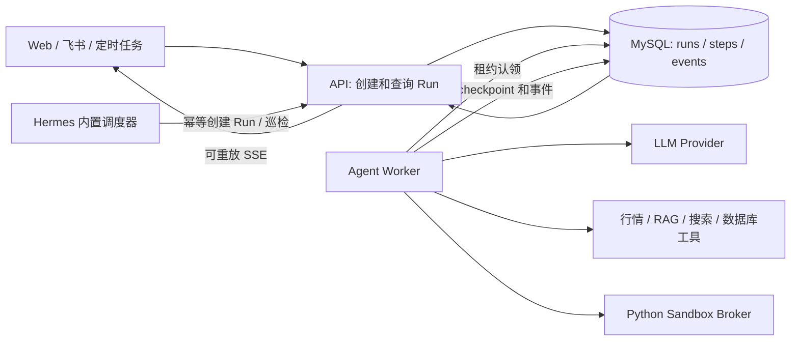

# Agent 复杂任务可靠执行方案

> 状态：设计方案
>
> 日期：2026-07-21
>
> 适用范围：问股、数字人中心、飞书数字人、定时 Agent 报告
>
> 目标：让长、难、复杂任务具备可恢复、可重试、可取消、可审计和可交付能力

## 1. 结论

当前 Agent 已经可以完成多轮检索、行情分析、知识库召回、Python 执行和文档生成，适合中等复杂度的交互任务；但一次执行仍绑定某个 API 进程和一条 SSE 连接，尚不适合作为可靠的长任务执行平台。

本方案不通过简单提高 `max_steps` 解决问题，而是引入一个基于 MySQL 的持久化 Agent Run 状态机和独立 Worker：

1. 所有任务先落库，再由 Worker 执行。
2. 每个模型调用和工具调用都是可持久化的 Step。
3. 每完成一步立即 checkpoint，进程重启后从最后一个安全点恢复。
4. 流式事件带递增序号，浏览器断线后可以续传。
5. 重试、超时、降级、写操作幂等和总预算由程序控制，不能只依赖模型自觉。
6. Hermes 内置调度器负责唯一的定时触发和巡检，不承担 Agent 内部工作流编排。

第一阶段直接复用现有 MySQL 8，不引入 Redis、Celery 或 Temporal。当前规模下，数据库队列加租约已经足够，并且部署和排障成本最低。

## 2. 当前能力与缺口

### 2.1 已有能力

- ReAct Agent 支持连续模型调用和工具调用。
- 生产活跃模型当前配置最多 18 个 ReAct 步骤。
- 模型流式调用有连接和读取超时。
- 工具失败后会向模型注入修正参数或停止重试的提示。
- SSE 每 8 秒发送心跳，Nginx 不会因为静默等待轻易断开。
- 用户可以主动停止，前端保留已经收到的部分内容。
- 用户问题和最终回答写入 MySQL 会话表。
- Python 在独立 Docker 沙箱中执行，最长 120 秒，超时会停止容器。
- API 有两个副本，后台服务独立运行。

### 2.2 关键缺口

| 问题 | 当前表现 | 风险 |
| --- | --- | --- |
| 请求与执行耦合 | Agent 在线程中随一次 SSE 请求执行 | API 重启或连接断开后无法接管 |
| 无任务 checkpoint | 仅保存用户问题和最终回答 | 中间十几个步骤全部丢失 |
| 无硬性重试策略 | 工具失败主要靠提示词引导 | 模型可能不重试或重复空转 |
| 无全局执行期限 | 只有单次模型或部分工具超时 | 长任务可能持续占用线程 |
| 取消是协作式 | 当前模型或工具返回后才检查取消标记 | 卡住的调用不能及时终止 |
| 无 SSE 事件重放 | 前端断线只能重新提问 | 可能重复计算或重复写操作 |
| 两副本不接管任务 | 负载均衡只对新请求有效 | 处理中副本退出仍会失败 |
| 上下文压缩不完整 | Agent 最终只取最近 8 条原始历史 | 中长会话会遗漏早期约束 |
| 写操作缺少统一幂等层 | 各工具自行处理副作用 | 重试可能导致重复写入或推送 |
| 缺少结果验收 | 模型输出即视为完成 | 可能漏需求、缺引用或文件损坏 |

因此，当前状态可以称为“多工具聊天 Agent”，还不能称为“持久化复杂任务执行器”。

## 3. 设计目标

### 3.1 功能目标

- 支持 5 至 30 分钟复杂任务。
- 浏览器关闭或网络断开后，任务继续执行。
- API 或 Worker 重启后，从最后 checkpoint 恢复。
- 用户可以查看计划、步骤、重试、耗时和失败原因。
- 用户可以取消、从失败步骤重试、从超时点继续。
- 任务部分成功时交付已有结果，不丢失产物。
- 所有写操作可审计、可去重，必要时要求再次确认。

### 3.2 可靠性目标

- 已接收任务不因 API 重启丢失。
- 同一个 Step 在同一时刻最多由一个 Worker 执行。
- Worker 异常退出后 60 秒内可重新认领任务。
- SSE 重连不创建重复任务。
- 可重试的外部依赖故障自动恢复，不可重试错误快速失败。
- 超时、取消和失败最终都必须落到明确终态，不能永久显示“运行中”。

### 3.3 非目标

- 不追求无限步骤或无限执行时间。
- 不允许 Agent 静默切换低质量模型并伪装成功。
- 不让模型自行决定绕过权限、预算或写操作确认。
- 第一阶段不建设通用分布式工作流平台。

## 4. 总体架构



### 4.1 组件职责

| 组件 | 职责 |
| --- | --- |
| API 副本 | 鉴权、创建任务、返回 Run ID、查询状态、推送持久化事件 |
| Agent Worker | 规划、执行、重试、checkpoint、校验和收口 |
| MySQL | 任务队列、租约、步骤状态、事件、产物和审计的事实来源 |
| Sandbox Broker | 受限执行 Python，不负责任务编排 |
| 内置调度器 | 唯一定时触发、补偿扫描和运营级重跑；通过数据库 `fire_key` 防重 |

API 不再持有长任务的真实执行状态，因此任何 API 副本都可以为同一个 Run 提供查询和 SSE。

## 5. 任务状态机

### 5.1 Run 状态

```text
queued
  -> planning
  -> running
  -> verifying
  -> succeeded

running/planning/verifying
  -> waiting_retry
  -> running

running
  -> waiting_user
  -> running

任意非终态
  -> cancelling
  -> cancelled

任意执行态
  -> timed_out | failed
```

终态只有：`succeeded`、`failed`、`timed_out`、`cancelled`。

### 5.2 Step 状态

每次模型调用、工具调用、校验和最终生成都记录为一个 Step：

```text
pending -> running -> succeeded
                   -> waiting_retry -> running
                   -> failed
                   -> timed_out
                   -> cancelled
```

Run 只能从已经成功提交的 Step 之后恢复。正在执行但没有 checkpoint 的 Step，必须根据工具的幂等等级决定是重放、核验还是等待人工处理。

## 6. 数据模型

### 6.1 `agent_runs`

建议字段：

| 字段 | 用途 |
| --- | --- |
| `run_id` | UUID，贯穿日志、事件和产物 |
| `user_id` / `session_id` | 所属用户和会话 |
| `source` | `web`、`feishu`、`scheduler` |
| `status` | Run 状态 |
| `priority` | 交互、飞书、定时任务优先级 |
| `request_json` | 原始请求快照 |
| `plan_json` | 结构化任务计划 |
| `state_json` | 已确认事实、约束、待办和结果摘要 |
| `model_snapshot_json` | 创建时的模型配置快照，不受运行中配置变更影响 |
| `permission_snapshot_json` | 本次任务授权快照及过期时间 |
| `current_step_no` | 当前步骤 |
| `retry_budget_used` | 任务级重试消耗 |
| `deadline_at` | 总执行期限 |
| `lease_owner` / `lease_expires_at` | Worker 租约 |
| `cancel_requested_at` | 用户取消标记 |
| `result_text` / `error_code` / `error_detail` | 最终结果 |
| `created_at` / `started_at` / `finished_at` | 生命周期时间 |

### 6.2 `agent_run_steps`

建议字段：

- `run_id`、`step_no`、`step_type`、`status`。
- `tool_name`、`input_json`、`output_json`。
- `idempotency_key`、`retry_class`、`attempts`、`max_attempts`。
- `timeout_seconds`、`started_at`、`finished_at`、`duration_ms`。
- `error_code`、`error_detail`、`next_retry_at`。
- `checkpoint_json`，保存步骤完成后的最小可恢复状态。

唯一约束建议为 `(run_id, step_no)` 和 `(run_id, idempotency_key)`。

### 6.3 `agent_run_events`

- `run_id`、单调递增 `seq`。
- `event_type`、`event_json`、`created_at`。
- SSE 使用 `id: seq`。
- 客户端重连时提交 `after_seq` 或 `Last-Event-ID`，API 从下一条继续发送。
- 高频 token 可以按 200 至 500 毫秒合并落库，步骤、错误、产物和终态事件必须立即落库。

### 6.4 `agent_run_artifacts`

记录 `run_id`、`step_id`、工作区路径、MIME、大小、SHA-256、验收状态和创建时间。文件仍保存在用户隔离工作区。

## 7. 任务执行流程

### 7.1 创建

1. API 完成用户、数字人、模型和权限校验。
2. 生成 `run_id` 和请求幂等键。
3. 将 Run 写成 `queued` 后立即返回。
4. Web 连接 `/api/agent/runs/{run_id}/events` 接收进度。

同一个请求幂等键重复提交时返回已有 Run，不重复创建任务。

### 7.2 规划

Worker 首先根据请求生成结构化计划：

```json
{
  "goal": "任务最终目标",
  "acceptance_criteria": ["验收条件 1", "验收条件 2"],
  "steps": [
    {"type": "tool", "tool": "search_knowledge", "purpose": "收集内部资料"},
    {"type": "tool", "tool": "market_query", "purpose": "获取行情"},
    {"type": "synthesis", "purpose": "形成结论"},
    {"type": "verification", "purpose": "检查完整性"}
  ]
}
```

简单问题可以生成一个隐式单步骤计划，但仍使用同一套 Run 和事件机制，避免维护两套执行内核。

### 7.3 执行与 checkpoint

1. Worker 通过 `SELECT ... FOR UPDATE SKIP LOCKED` 认领到期 Run。
2. 写入 60 秒租约，每 15 秒续租一次。
3. 执行 Step 前记录输入、超时和幂等键。
4. Step 成功后用一个事务保存输出、checkpoint、事件和下一个步骤。
5. Worker 崩溃后租约过期，其他 Worker 从最后成功 Step 接管。

不能把“调用外部服务”和“标记成功”误认为一个原子事务。对有副作用的工具必须在恢复时先查询外部或本地结果，再决定是否重放。

### 7.4 校验与交付

执行完计划后进入 `verifying`：

- 检查所有验收条件是否有对应结果。
- 检查股票代码、日期、单位和引用是否完整。
- 对 PDF、DOCX、XLSX、PPTX 执行反向解析，确认文件能打开且包含预期内容。
- 检查产物路径仍在当前用户工作区。
- 校验失败时只生成修复 Step，不从头重跑。
- 修复预算耗尽后，以“部分完成”交付已有结果并列出缺口。

## 8. 重试策略

重试必须由错误分类驱动，而不是对所有异常统一重试。

| 错误类型 | 示例 | 策略 |
| --- | --- | --- |
| 瞬时网络错误 | 连接重置、DNS、超时 | 最多 3 次，指数退避加抖动 |
| 服务端临时错误 | HTTP 429、502、503、504 | 最多 3 次，优先遵守 `Retry-After` |
| 参数错误 | 缺字段、格式错误、SQL 校验失败 | 不重复原参数，允许模型修正 1 次 |
| 权限错误 | 401、403、工具未授权 | 不重试，直接失败并说明权限缺口 |
| 数据不存在 | 无行情、知识库无命中 | 不机械重试，换已配置数据源或明确无数据 |
| 写操作结果未知 | 请求超时但可能已写入 | 先用幂等键核验，禁止盲目重放 |
| 模型输出不完整 | 非法 tool arguments、空响应 | 同模型修复 1 次，再进入模型兜底策略 |
| Python 超时或资源超限 | 超过 120 秒、OOM | 不原样重跑，要求拆分脚本或减少数据量 |

建议退避时间为 `2s、8s、30s`，加入 20% 随机抖动。基础设施重试不消耗 ReAct 业务步骤，但消耗 Run 的全局重试预算；单个 Run 建议最多 6 次基础设施重试。

工具连续失败次数必须由执行器硬性限制。当前 `_tool_retry_hint` 只能影响模型行为，不能作为可靠控制机制。

## 9. 模型兜底

模型兜底顺序：

1. 原模型对同一调用进行瞬时错误重试。
2. 对非法工具参数进行一次结构化修复。
3. 若管理员为该模型配置了备用链，切换备用模型继续当前 checkpoint。
4. 无可用模型时，保存已完成结果并明确失败，不伪造结论。

切换模型必须产生 `model_switched` 事件，界面展示原模型、备用模型和原因。金融分析场景禁止静默降低数据完整性或隐瞒缺失证据。

建议给模型配置增加：

- `fallback_model_config_id`
- `max_provider_retries`
- `circuit_breaker_threshold`
- `circuit_breaker_seconds`

同一供应商连续失败达到阈值后短暂熔断，避免所有任务一起重复撞击故障服务。

## 10. 分层超时

| 层级 | 建议上限 | 超时动作 |
| --- | ---: | --- |
| 模型 TCP 连接 | 15 秒 | 按瞬时网络错误重试 |
| 模型首 token | 60 秒 | 取消本次调用并重试 |
| 模型流式空闲 | 60 秒 | 取消本次调用并重试 |
| 单次模型 Step 总时长 | 180 秒 | 标记 Step 超时，进入修复或兜底 |
| 普通只读工具 | 30 秒 | 取消并按工具策略重试 |
| 联网搜索工具 | 45 秒 | 重试或切已配置搜索源 |
| RAG 检索 | 30 秒 | 报告向量、重排具体失败原因 |
| 写操作 | 30 秒 | 进入“结果未知待核验”，不盲重放 |
| Python 沙箱 | 最大 120 秒 | 强制停止容器，保留标准输出和已有产物 |
| 普通交互 Run | 5 分钟 | 软收口后进入 `timed_out` |
| 深度任务 Run | 30 分钟 | 保存 checkpoint，允许用户继续 |
| 定时报告 Run | 45 分钟 | 失败落库并由巡检告警 |

在总期限达到 80% 时触发软超时：停止扩展新分支，要求 Agent 基于已有证据收口。达到硬期限后停止当前可取消调用，持久化已有结果并进入 `timed_out`。

超时必须由 Worker 的 deadline 控制，不能依赖 Nginx。Nginx 的 `proxy_read_timeout` 是连接空闲超时，SSE 心跳会不断重置它，并不等于任务总时限。

## 11. 取消与断线恢复

### 11.1 浏览器断线

- 断线不自动取消持久化任务。
- 用户重新进入页面后读取 Run 状态，并从最后事件序号续传。
- 终态事件必须包含结果、错误、产物和未完成步骤。

### 11.2 用户取消

- `POST /api/agent/runs/{run_id}/cancel` 写入取消请求。
- Worker 每次模型 token、工具阶段边界和租约续期时检查取消状态。
- HTTP 工具使用可取消客户端；Python 由 Broker 强制停止容器。
- 不支持立即取消的第三方 SDK 应放入独立子进程，超时后终止子进程。
- 已提交的写操作不回滚时必须明确展示；支持补偿的工具记录补偿动作。

## 12. 写操作安全与幂等

工具注册信息增加：

```python
ToolPolicy(
    side_effect="read" | "write" | "external_send",
    retry_safe=True | False,
    default_timeout_seconds=30,
    requires_confirmation=True | False,
)
```

规则如下：

- 只读工具可以按策略自动重试。
- 数据库写工具使用 `run_id + step_id + tool_name` 作为幂等键。
- 飞书推送记录消息幂等键和返回消息 ID。
- 持仓、自选和删除操作继续要求人在环确认。
- 确认令牌与 Run、Step、参数哈希绑定，并设置有效期；参数变化后必须重新确认。
- 恢复任务时，过期的一次性 Python 授权和写操作确认不能自动继承。

## 13. 上下文管理

复杂任务不能依赖不断增长的聊天记录。Run 应维护结构化工作状态：

- 用户目标和不可违反的约束。
- 已确认事实及来源。
- 已完成步骤和关键输出。
- 当前假设及置信度。
- 待完成事项和失败工具。
- 已生成文件和路径。

每个 Step 完成后更新 `state_json`。模型调用只携带系统规则、当前计划、结构化状态、最近相关消息和本步骤所需证据。

同时修正当前历史链路：会话压缩摘要需要持久化并增量合并，不能在 `run_agent_events` 中再次简单截断为最近 8 条，导致压缩模块与实际模型输入不一致。

## 14. 并发与背压

建议初始配置：

| 项目 | 初始值 |
| --- | ---: |
| Agent Worker 总并发 | 4 |
| 单用户并发 Run | 2 |
| Python 沙箱并发 | 4，沿用当前限制 |
| 定时 Agent 并发 | 2 |
| 单 Run 并行只读工具 | 最大 3 |

队列优先级：Web 交互高于飞书，飞书高于定时报告。为定时任务保留独立配额，防止大量聊天长期挤占收盘报告；同时也要为 Web 保留槽位，避免定时任务执行时整个系统无响应。

超过并发上限时返回 Run ID 和排队位置，不创建无限线程。队列等待超过期限的任务直接标记 `timed_out`，不能开始后再假装正常执行。

## 15. API 与前端

建议新增接口：

```text
POST /api/agent/runs
GET  /api/agent/runs/{run_id}
GET  /api/agent/runs/{run_id}/events?after_seq=123
POST /api/agent/runs/{run_id}/cancel
POST /api/agent/runs/{run_id}/resume
POST /api/agent/runs/{run_id}/retry-step/{step_no}
```

现有 `/api/agent/chat` 在兼容期内可以内部创建 Run 并转发事件，前端迁移完成后再逐步收敛。

前端需要展示：

- 排队、规划、执行、校验、重试和等待确认状态。
- 当前步骤、已完成步骤、总耗时和剩余期限。
- 模型或工具切换原因。
- “停止任务”“从断点继续”“重试失败步骤”。
- 部分完成时的已交付结果和未完成项。
- 断线重连后恢复同一条消息，而不是新增重复消息。

## 16. 可观测性

所有日志必须包含 `run_id`、`step_id`、`session_id`、`user_id`、`worker_id`。

建议指标：

- Run 排队数、运行数、成功率、失败率、超时率、取消率。
- 排队等待时间和端到端 P50/P95/P99。
- 每个模型供应商的首 token、总耗时、429 和 5xx。
- 每个工具的成功率、重试次数和超时率。
- Worker 租约过期数和恢复成功数。
- SSE 重连数和事件积压量。
- Python 沙箱排队、超时、OOM 和磁盘配额失败数。
- 单任务 token、工具调用次数和成本预算。

告警条件至少包括：

- 队列最老任务等待超过 2 分钟。
- 5 分钟内模型 5xx 或 429 超过阈值。
- Worker 60 秒无心跳。
- 出现过期租约且 2 分钟未恢复。
- 任意 Run 在非终态超过其硬期限。

## 17. 内置调度器的边界

内置调度器只负责按日历创建报告 Run、扫描卡死 Run 和过期租约、人工重跑、归档事件与清理过期 checkpoint。它不保存模型上下文和工具结果，不承担 Agent Step 状态机，不向 Web 重放 token，也不处理人在环审批。所有 Agent 任务都以数据库唯一幂等键进入同一个 RunService；API 副本不启动调度器，避免重复计划所有权。

## 18. 部署方案

新增独立服务：

```text
hermes-stock-agent-worker.service
```

建议：

- 使用独立 Linux 用户 `hermes-agent`。
- 不加入 Docker 组，只加入允许访问 Sandbox Broker Socket 的应用组。
- 与 API 使用同一发布目录和 Python 虚拟环境。
- `Restart=always`，停止时给当前 Step 预留有限 checkpoint 时间。
- 初始只运行一个进程、并发 4；压力测试后再增加 Worker 实例。
- Worker 与后台飞书长连接、节律调度器分离，避免一个组件故障拖垮其他组件。

数据库 schema 采用向前兼容迁移。旧 `/api/agent/chat` 保留期间可以通过功能开关切回当前同步执行链路。

## 19. 分阶段实施

### 阶段 A：执行边界补强

改动目标：先让当前链路具备确定的失败行为。

- 增加模型瞬时错误重试、指数退避和熔断。
- 为工具注册硬性重试次数、超时和副作用策略。
- 增加 Run 级 deadline，达到软期限时收口。
- 修正历史压缩后又截断最近 8 条的问题。
- 统一错误码：`provider_timeout`、`tool_timeout`、`permission_denied`、`retry_exhausted` 等。

验收：模拟 429、502、慢工具和非法参数时，行为与策略表一致，不出现无限转圈。

### 阶段 B：持久化 Run 与独立 Worker

- 新增 runs、steps、events、artifacts 四组表。
- 新增 MySQL 队列认领、租约、心跳和 checkpoint。
- 新增 `hermes-stock-agent-worker`。
- API 改为创建 Run，SSE 从持久化事件读取。
- 前端支持断线恢复、取消、超时和部分结果。

验收：执行中强杀 Worker，任务在租约过期后从最后成功 Step 恢复；强杀任一 API 不影响任务。

### 阶段 C：规划、校验与安全重放

- 增加结构化 Planner 和 acceptance criteria。
- 增加结果 Verifier 与定向修复 Step。
- 为写工具增加统一幂等键和确认令牌。
- 增加显式备用模型链和供应商熔断。
- 接入飞书完成通知和内置调度器卡死任务巡检。

验收：复杂报告缺少某项数据时能够定向补齐；重复提交和恢复不会重复写持仓或重复发消息。

## 20. 测试与故障演练

必须覆盖：

1. 模型连续返回 429，第三次恢复。
2. 模型持续 502，切换已配置备用模型并留下事件。
3. 工具参数错误，修正一次后成功。
4. 只读工具超时并重试。
5. 写工具响应超时但实际成功，通过幂等键核验后不重复写。
6. Python 无限循环被 120 秒内强制停止。
7. Worker 在第 5 步被 `kill -9`，新 Worker 从第 4 步 checkpoint 恢复。
8. API 副本在 SSE 中途重启，浏览器连接另一副本后续传。
9. 浏览器关闭后任务继续，重新打开能查看最终产物。
10. 同一请求重复点击两次，只产生一个 Run。
11. 达到总期限后进入 `timed_out`，不会永久保持 `running`。
12. 取消任务后不再开始新 Step。
13. 过期的 Python 一次性授权不会在恢复任务时自动生效。
14. 生成的四类办公文档均能反向解析并通过验收。
15. 定时任务和多个聊天并发时，Web 保留可用槽位且 API 健康接口稳定。

## 21. 上线与回滚

- 使用功能开关 `STOCK_AGENT_DURABLE_RUNS_ENABLED` 灰度。
- 先只对管理员和一个数字人开启。
- 新旧链路同时记录统一指标，比较成功率和端到端延迟。
- 灰度期间新 Run 走 Worker，已有同步会话不迁移。
- 回滚时停止创建新持久化 Run，等待或取消队列，再切回旧链路。
- 数据表和历史 Run 保留，不在回滚时删除，便于审计和后续恢复。

## 22. 最终验收标准

方案完成的判断标准不是“能跑一次”，而是同时满足：

- 正常复杂任务可以完成并交付文件。
- 网络、模型、工具和进程故障都有确定结果。
- 重试不会造成重复副作用。
- 超时后有部分结果和继续入口。
- 浏览器断线与 API 切换不会丢任务。
- Worker 重启可以从 checkpoint 恢复。
- 用户能看懂任务当前在哪里、为什么重试、为什么失败。
- 运维能够通过 Run ID 在日志、数据库和产物之间完整追踪。

达到以上标准后，这套系统才真正具备可交付的长任务和复杂任务处理能力。
