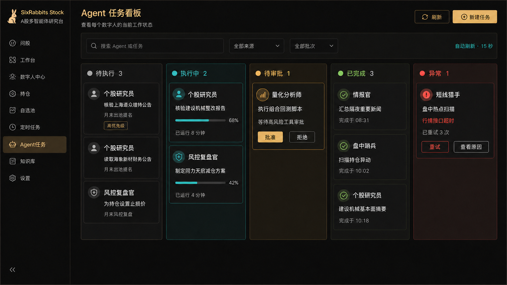
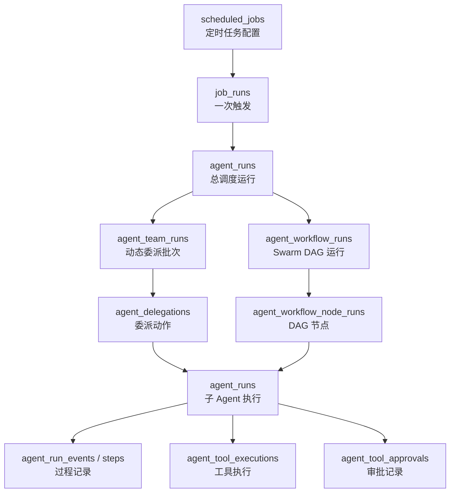
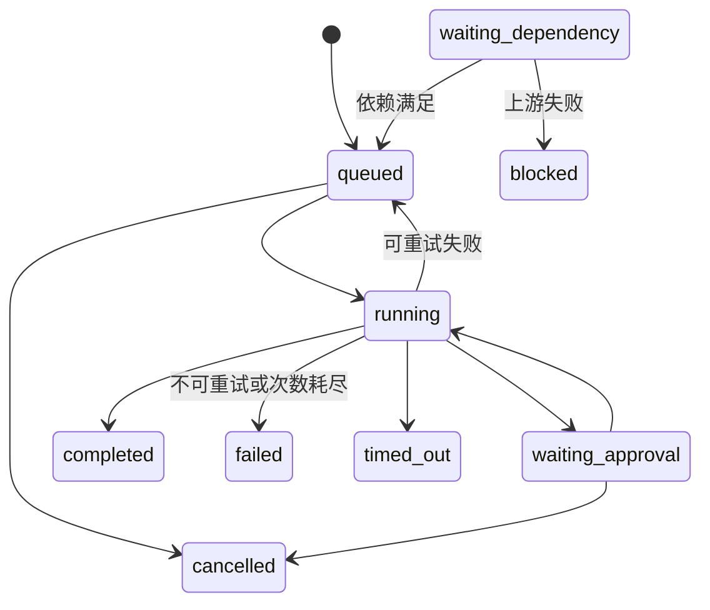

# Agent 任务看板与定时任务委派闭环方案

## 1. 方案摘要

本方案建设一个面向业务人员和系统管理员的 Agent 任务看板，把定时任务报告中的“转交、核验、继续调查、生成方案”等动作，转换为真实、持久化、可排队、可重试、可审计的数字人任务。

系统不再把下面这种内容仅作为报告文字发送出去：

```text
动作：读取建设机械整改报告全文
负责 Agent：个股研究员
状态：待完成
```

而是在生成报告的同时创建真实任务，由指定数字人领取并执行。任务结果写回数据库，总调度等待必要任务完成后再汇总最终报告。

本方案不重新建设一套 Agent 执行框架，而是复用现有能力：

- `AgentRun`：统一的持久化执行实例。
- `Agent Team`：动态任务拆分和父子任务汇总。
- `Swarm Workflow`：预定义 DAG 工作流和依赖编排。
- Redis：任务唤醒，不作为任务状态的唯一存储。
- MySQL：任务、状态、结果和审计记录的唯一可信来源。

## 2. 建设目的

### 2.1 解决报告中的“假待办”

当前报告可以输出“待完成”清单，但这些文字不一定对应数据库任务。用户无法知道任务是否真正派发、什么时候执行、失败后有没有重试。

建设任务看板后，每条待办都必须对应一个真实 `AgentRun`。没有运行记录的待办不能显示为“已派发”。

### 2.2 让定时任务形成业务闭环

定时任务不再以“生成一篇报告”为终点，而是形成完整闭环：

```text
定时触发
  -> 总调度生成报告和行动计划
  -> 创建 Agent 子任务
  -> 指定数字人逐项执行
  -> 失败重试或等待审批
  -> 总调度汇总结果
  -> 推送最终报告
```

### 2.3 提升系统可交付性

甲方能够直接看到：

- 哪个数字人正在执行任务。
- 每个数字人后面排了哪些任务。
- 哪些任务正在等待审批。
- 哪些任务已完成、失败或超时。
- 每条任务来自哪一个定时任务和哪一次触发。
- 任务使用了哪些工具、产出了哪些报告或文件。

### 2.4 保持高内聚、低耦合

看板不负责执行 Agent，也不复制一份任务状态。它只读取 `AgentRun` 和 Team、Workflow、Scheduler 的关联数据。

职责划分如下：

| 模块 | 职责 |
|---|---|
| Scheduler | 决定什么时候触发 |
| 总调度 Agent | 决定是否需要委派、委派给谁 |
| Team / Workflow | 描述任务之间的组织和依赖关系 |
| Agent Worker | 领取和执行任务 |
| AgentRun | 保存执行状态、重试、耗时和结果 |
| 任务看板 | 查询、展示和执行管理操作 |

## 3. UI 原型



### 3.1 页面结构

看板采用五个状态框，不建设复杂的监控大屏：

| 状态框 | 包含的运行状态 |
|---|---|
| 待执行 | `queued`、`waiting_dependency` |
| 执行中 | `running` |
| 待审批 | `waiting_approval` |
| 已完成 | `completed` |
| 异常 | `failed`、`timed_out`、`blocked` |

取消任务通过筛选条件单独查看，不占用主要状态框。

### 3.2 Agent 卡片

每张卡片至少展示：

- 数字人名称。
- 任务标题。
- 来源定时任务或批次。
- 当前状态。
- 排队时间或运行耗时。
- 当前步骤或最近工具。
- 审批、重试、查看原因等必要操作。

### 3.3 进度显示原则

普通 ReAct Agent 无法准确判断“已完成 68%”。生产系统不应伪造精确百分比。

- 普通 Agent 显示“正在检索公告”“已调用 3 个工具”“已运行 8 分钟”。
- Swarm DAG 显示真实的“已完成节点数 / 总节点数”。
- 确定性脚本任务可以显示实际步骤进度。

## 4. 现有能力与数据基础

### 4.1 统一执行记录

现有 [`AgentRun`](../backend/app/core/models.py) 已经保存：

- 会话和用户。
- 来源类型和来源标识。
- 父运行、根运行和 Team ID。
- 状态、优先级和幂等键。
- 重试次数和最大重试次数。
- Worker、心跳、开始和完成时间。
- 最终消息和错误信息。

因此 `agent_runs` 应继续作为任务执行状态的唯一可信来源。

### 4.2 Team 模式

动态 Team 使用：

- `agent_team_runs`：一次动态委派批次。
- `agent_delegations`：委派给某个数字人的具体任务。
- `agent_runs`：每个委派任务的实际运行。

现有实现位于 [`team_service.py`](../backend/app/agent_runtime/team_service.py)。

当前实现会把同一个数字人的多个任务合并成一个工作包。普通对话可以保留该行为，但定时任务需要支持逐项排队。

### 4.3 Swarm 模式

`swarm_teams.py` 中的五套 Swarm 是前端斜杠菜单预设，不是运行状态存储。

真正的 Swarm DAG 使用：

- `agent_workflow_templates`：工作流模板。
- `agent_workflow_template_versions`：不可变模板版本。
- `agent_workflow_runs`：一次工作流运行。
- `agent_workflow_node_runs`：节点任务。
- `agent_runs`：节点对应的实际运行。

现有实现位于 [`workflow_service.py`](../backend/app/agent_runtime/workflow_service.py)。

### 4.4 不使用旧 `agent_tasks`

旧 `agent_tasks` 表不适合作为新看板的数据源：

- 它关联旧的 `agent_profiles`，不是数字人中心的 `digital_human_profiles`。
- 它没有 `child_run_id`。
- 它无法表达 Team、DAG、审批和断点恢复。
- 当前 Agent Worker 不以它作为任务来源。

继续使用该表会产生两套状态，最终出现看板和真实执行不一致的问题。

## 5. 总体数据模型



## 6. 表结构设计

### 6.1 `agent_runs` 增补字段

不新建重复的看板任务表，只补充公共执行字段：

```sql
ALTER TABLE agent_runs
    ADD COLUMN assignee_profile_id INT NULL,
    ADD COLUMN task_title VARCHAR(240) NULL,
    ADD COLUMN board_visible TINYINT(1) NOT NULL DEFAULT 0,
    ADD COLUMN queued_at DATETIME NULL,
    ADD INDEX ix_agent_run_board
        (board_visible, status, updated_at),
    ADD INDEX ix_agent_run_agent_queue
        (assignee_profile_id, status, priority, created_at),
    ADD CONSTRAINT fk_agent_run_assignee
        FOREIGN KEY (assignee_profile_id)
        REFERENCES digital_human_profiles(id);
```

| 字段 | 说明 |
|---|---|
| `assignee_profile_id` | 指定执行数字人，也是同一 Agent 串行控制依据 |
| `task_title` | 稳定的看板标题，不依赖临时截取提示词 |
| `board_visible` | 普通聊天不展示，委派和工作流任务展示 |
| `queued_at` | 计算等待时间和稳定排序 |

### 6.2 `scheduled_jobs` 增补字段

```sql
ALTER TABLE scheduled_jobs
    ADD COLUMN delegation_mode VARCHAR(24)
        NOT NULL DEFAULT 'execute_and_wait',
    ADD COLUMN task_extraction_mode VARCHAR(24)
        NOT NULL DEFAULT 'structured_tool',
    ADD COLUMN completion_policy VARCHAR(24)
        NOT NULL DEFAULT 'all_required',
    ADD COLUMN child_timeout_seconds INT
        NOT NULL DEFAULT 600,
    ADD COLUMN max_delegated_tasks INT
        NOT NULL DEFAULT 20;
```

| 字段 | 可选值 | 说明 |
|---|---|---|
| `delegation_mode` | `none` | 禁止派发子任务 |
| `delegation_mode` | `execute_and_wait` | 必选子任务完成后再生成最终报告 |
| `delegation_mode` | `enqueue_after_report` | 先发初稿，子任务后台执行后补发终稿 |
| `task_extraction_mode` | `structured_tool` | 总调度通过结构化工具直接提交任务 |
| `task_extraction_mode` | `legacy_report` | 兼容旧报告的结构化提取器 |
| `completion_policy` | `all_required` | 必选任务全部成功才算成功 |
| `completion_policy` | `best_effort` | 到期后汇总已有结果并列出缺口 |

### 6.3 `job_runs` 增补字段

```sql
ALTER TABLE job_runs
    ADD COLUMN leader_agent_run_id VARCHAR(64) NULL,
    ADD COLUMN orchestration_type VARCHAR(24) NULL,
    ADD COLUMN orchestration_id VARCHAR(64) NULL,
    ADD COLUMN handoff_status VARCHAR(24)
        NOT NULL DEFAULT 'none',
    ADD COLUMN handoff_plan_json LONGTEXT NULL,
    ADD COLUMN handoff_error TEXT NULL,
    ADD INDEX ix_job_run_leader (leader_agent_run_id),
    ADD INDEX ix_job_run_orchestration
        (orchestration_type, orchestration_id),
    ADD CONSTRAINT fk_job_run_leader
        FOREIGN KEY (leader_agent_run_id)
        REFERENCES agent_runs(run_id);
```

`handoff_plan_json` 保存提取和校验后的任务计划快照，用于审计“报告为什么创建了这些任务”。

### 6.4 `agent_team_runs` 增补字段

```sql
ALTER TABLE agent_team_runs
    ADD COLUMN execution_mode VARCHAR(24)
        NOT NULL DEFAULT 'merge_by_agent',
    ADD COLUMN completion_policy VARCHAR(24)
        NOT NULL DEFAULT 'all_required';
```

| 执行模式 | 行为 |
|---|---|
| `merge_by_agent` | 同一 Agent 的任务合并成一个工作包，保留当前对话行为 |
| `serial_items` | 每个动作单独建任务，同一 Agent 按顺序执行 |

定时任务默认使用 `serial_items`。

### 6.5 `agent_delegations` 增补字段

```sql
ALTER TABLE agent_delegations
    ADD COLUMN title VARCHAR(240) NULL,
    ADD COLUMN action_key VARCHAR(120) NULL,
    ADD COLUMN priority INT NOT NULL DEFAULT 100,
    ADD COLUMN extraction_source VARCHAR(24)
        NOT NULL DEFAULT 'tool_call',
    ADD UNIQUE INDEX uq_team_action (team_id, action_key);
```

| 字段 | 说明 |
|---|---|
| `title` | 看板卡片标题 |
| `action_key` | 本批次内任务幂等标识 |
| `priority` | 队列优先级 |
| `extraction_source` | `tool_call`、`legacy_report` 或 `manual` |

## 7. 如何从定时任务中抽取 Agent 任务

### 7.1 首选方案：结构化工具提交

新定时任务不从最终 Markdown 中解析任务。Scheduler 在总调度提示中加入强约束：

```text
当报告产生需要其他数字人继续完成的动作时，禁止只在正文中输出“待完成”。
必须调用 create_agent_task_batch，以结构化参数提交任务。
```

工具输入协议：

```json
{
  "objective": "完成月末持仓风险复核",
  "execution_mode": "serial_items",
  "completion_policy": "all_required",
  "tasks": [
    {
      "action_key": "verify-600984-announcement-20260731",
      "title": "核验建设机械 7/31 整改报告全文",
      "agent_code": "research-analyst",
      "instruction": "读取公告全文，核验整改事项、截止期限和未完成风险。",
      "expected_output": "公告事实摘要、整改状态和风险结论",
      "required": true,
      "priority": 200,
      "depends_on": []
    }
  ]
}
```

该工具内部复用现有 `AgentTeamService.start_team()`，不直接操作 Worker。

### 7.2 兼容方案：旧报告结构化提取

旧定时提示词可能仍然输出 Markdown“核验动作清单”。兼容期增加 `ScheduledTaskExtractor`：

1. 读取本次 `JobRun.output_content`。
2. 使用严格 JSON Schema 的模型调用提取候选任务。
3. 不使用正则直接创建任务。
4. 对 Agent、动作标题、指令、重复项和风险等级执行服务端校验。
5. 保存原始提取结果到 `job_runs.handoff_plan_json`。
6. 校验通过后调用同一个 `create_agent_task_batch` 服务。
7. 低置信度、未知 Agent 或高风险写操作进入待审批，不自动执行。

兼容提取结果必须符合：

```json
{
  "has_tasks": true,
  "confidence": 0.96,
  "tasks": [],
  "warnings": []
}
```

### 7.3 为什么不能直接解析 Markdown

直接解析 Markdown 存在以下风险：

- 报告格式变化后任务丢失。
- 普通建议被误判为真实任务。
- 表格被飞书转换或分页后无法恢复结构。
- 无法稳定获得 `agent_code`、依赖关系和幂等标识。
- 无法区分“建议用户做”和“要求 Agent 自动做”。

因此 Markdown 只负责给人阅读，结构化任务计划负责系统执行。

## 8. 任务创建事务

通过一次数据库事务完成：

1. 锁定当前总调度 `AgentRun`。
2. 检查当前运行仍为 `running`。
3. 校验数字人存在、启用且允许委派。
4. 校验任务数量不超过 20。
5. 校验 `action_key` 在当前批次内唯一。
6. 创建一条 `AgentTeamRun`。
7. 每个动作创建一条 `AgentDelegation`。
8. 每个动作创建独立数字人会话和子 `AgentRun`。
9. 将父运行设置为 `waiting_children`。
10. 提交事务后再向 Redis 发送子运行唤醒消息。

如果事务失败，不发送 Redis 消息，防止出现“队列收到任务但数据库没有记录”。

## 9. 同一 Agent 逐项执行

甲方要求“由指定 Agent 一一完成”，队列规则如下：

- 同一个 `assignee_profile_id` 默认并发数为 1。
- 不同数字人可以并行执行。
- 排序规则为 `priority DESC, queued_at ASC, run_id ASC`。
- `waiting_approval` 默认占用该 Agent 的顺序位置，防止后续任务越过关键审批。
- 管理员可以调整优先级，但不能直接修改数据库状态。

Worker 领取任务时增加条件：不存在同一 `assignee_profile_id` 的其他活动运行。

```text
研究员：任务 1 -> 任务 2 -> 任务 3 -> 任务 4
风控官：任务 5 -> 任务 6

研究员和风控官可以并行，但各自内部保持串行。
```

## 10. 状态流转



看板只读取 `agent_runs.status`。`agent_delegations.status` 和 `agent_workflow_node_runs.status` 是编排快照，由 Team/Workflow 服务在同一事务中同步，不作为看板主状态。

## 11. 看板数据来源

主查询：

```sql
SELECT r.*, p.code, p.name
FROM agent_runs r
JOIN digital_human_profiles p
  ON p.id = r.assignee_profile_id
WHERE r.board_visible = 1
ORDER BY r.priority DESC, r.queued_at ASC, r.run_id ASC;
```

| 页面内容 | 数据来源 |
|---|---|
| 状态框和数量 | `agent_runs.status` |
| 数字人名称 | `digital_human_profiles` |
| 任务标题 | `agent_runs.task_title` |
| Team 任务说明 | `agent_delegations` |
| Swarm 节点和依赖 | `agent_workflow_node_runs` |
| 定时任务来源 | `job_runs`、`scheduled_jobs` |
| 当前步骤 | `agent_run_steps` |
| 最近工具 | `agent_tool_executions` |
| 待审批内容 | `agent_tool_approvals` |
| 流式过程 | `agent_run_events` |
| 最终结果 | `agent_runs.result_message_id` 对应消息 |
| 错误和重试 | `agent_runs.error`、`attempts`、`max_attempts` |

## 12. 父任务汇总与飞书推送

### 12.1 `execute_and_wait`

推荐作为定时任务默认策略：

1. 总调度创建子任务后进入 `waiting_children`。
2. 子 Agent 执行并保存结果。
3. Team Service 检测所有必选任务进入终态。
4. 总调度恢复，读取子任务真实结果。
5. 总调度生成最终报告。
6. 飞书只推送最终报告。

### 12.2 `enqueue_after_report`

适用于耗时很长的调查任务：

1. 先推送“初步报告，已创建 6 个后续任务”。
2. 子任务进入后台队列。
3. 全部结束后补发最终报告。

任何飞书卡片中的任务状态都必须查询数据库，不能让模型自行填写“已完成”或“待完成”。

## 13. API 设计

| 方法 | 地址 | 用途 |
|---|---|---|
| `GET` | `/api/agent-board/tasks` | 分页查询看板任务 |
| `GET` | `/api/agent-board/summary` | 查询各状态数量 |
| `GET` | `/api/agent-board/tasks/{run_id}` | 查询任务详情 |
| `GET` | `/api/agent-board/tasks/{run_id}/events` | 查询执行事件 |
| `POST` | `/api/agent-board/tasks/{run_id}/retry` | 重试失败任务 |
| `POST` | `/api/agent-board/tasks/{run_id}/cancel` | 取消任务 |
| `POST` | `/api/agent-board/tasks/{run_id}/priority` | 调整优先级 |
| `GET` | `/api/agent-board/batches/{id}` | 查询 Team 或 Workflow 批次 |

筛选参数包括：

- `status`
- `agent_code`
- `source_type`
- `scheduled_job_key`
- `orchestration_id`
- `created_from`、`created_to`
- `page`、`page_size`

前端默认 15 秒刷新。执行中任务可以复用运行事件接口进行增量更新，不需要整个页面高频全量查询。

## 14. 权限与安全

- 普通用户只能查看自己创建或归属自己的定时任务。
- 系统管理员可以查看全部任务。
- 重试、取消和调优先级需要 `agent:manage` 权限。
- 审批操作继续使用现有工具审批权限。
- 重新指派数字人时必须重新校验目标角色权限和 `delegation_enabled`。
- 看板不得直接提供任意 SQL、任意命令或绕过审批的能力。

## 15. 失败、超时和幂等

### 15.1 失败重试

- 临时网络错误和模型限流允许自动重试。
- 参数错误、权限拒绝和不存在的 Agent 不自动重试。
- 默认最多重试 3 次。
- 重试继续使用同一看板任务，但创建新的执行尝试事件。

### 15.2 超时

- 单任务使用 `child_timeout_seconds`。
- 批次使用 Team 或 Workflow 的 `deadline_at`。
- 到期后 `all_required` 判定父任务失败。
- `best_effort` 汇总已有结果并明确列出缺失任务。

### 15.3 幂等

任务幂等键建议为：

```text
schedule:{job_run_id}:action:{action_key}
```

Scheduler 重启、重复触发或模型重复调用工具，都不能创建第二份相同任务。

## 16. 可观测性

至少记录以下指标：

- 各状态任务数量。
- 每个数字人的队列长度。
- 平均排队时间和最大排队时间。
- 任务成功率、失败率和超时率。
- 自动重试次数。
- 等待审批时长。
- 定时任务从触发到最终报告的总耗时。
- Worker 心跳和陈旧运行恢复数量。

日志必须包含：

- `job_run_id`
- `leader_run_id`
- `team_id` 或 `workflow_run_id`
- `child_run_id`
- `agent_code`
- `action_key`

## 17. 实施阶段

### 阶段一：数据库和任务闭环

- 增加字段和索引。
- 增加结构化任务提交服务。
- Team 增加 `serial_items`。
- Scheduler 显式关联总调度 Run。
- 增加同一 Agent 并发限制。

预计 3 个工作日。

### 阶段二：看板接口和页面

- 新增查询、详情、重试和取消 API。
- 实现五状态框页面。
- 增加分页、筛选和自动刷新。
- 支持跳转数字人子任务会话。

预计 3 个工作日。

### 阶段三：旧报告兼容和飞书闭环

- 增加旧报告结构化提取器。
- 增加初稿和终稿推送策略。
- 飞书任务状态改为数据库真实状态。

预计 2 个工作日。

### 阶段四：恢复与压力测试

- Worker 重启恢复测试。
- Scheduler 重复触发幂等测试。
- 20 个子任务排队测试。
- 多数字人并行和单数字人串行测试。
- 审批、超时、取消和失败重试测试。

预计 2 个工作日。

完整交付预计 8 至 10 个工作日。

## 18. 验收标准

1. 定时任务产生 6 个转交动作时，数据库必须产生 6 条独立委派记录和 6 个子 `AgentRun`。
2. 同一数字人的任务严格逐项执行，不出现并发抢占。
3. 不同数字人可以在全局并发限制内并行执行。
4. 页面刷新、关闭浏览器或 Worker 重启后任务不丢失。
5. Scheduler 重复触发不会重复创建相同任务。
6. 每张看板卡片可以追溯到定时任务、JobRun、父 Run 和完整派发提示词。
7. 失败任务能展示明确错误并按策略重试。
8. 待审批任务不会绕过现有审批机制。
9. 必选子任务未结束时，`execute_and_wait` 模式不能推送最终报告。
10. 飞书中的任务状态必须与 MySQL 状态一致。

## 19. 最终结论

这个功能的本质不是“增加一个好看的看板”，而是把系统从“会生成行动建议”升级为“能把行动建议派发、执行、跟踪并验收”。

最终采用以下原则：

> Scheduler 管触发，Team 和 Swarm 管编排，AgentRun 管执行，MySQL 管事实，看板管呈现和操作。

这样既能复用现有 AgentScope、Team 和 Swarm 能力，又不会产生新的孤立任务系统。
