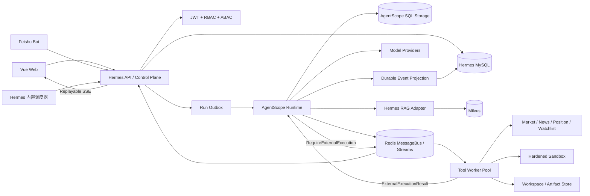
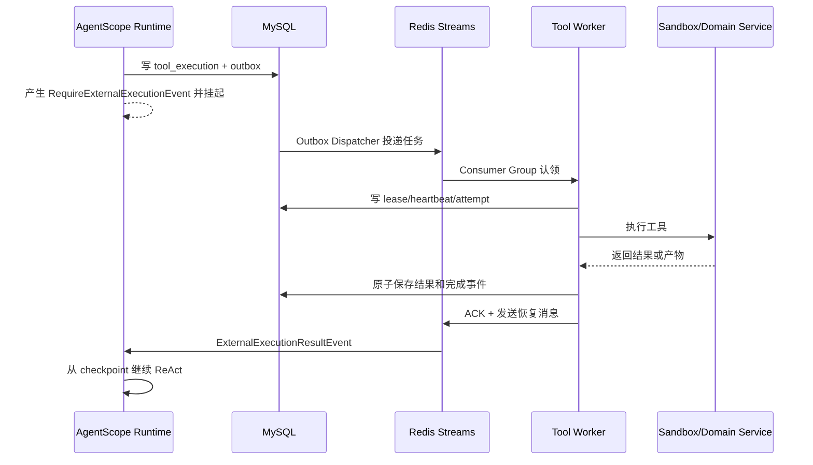

# Hermes Stock 基于 AgentScope 2.0 的 Agent 重构方案

> 状态：阶段 0-4 已实现并通过回归；阶段 5 Agent Team 尚未开始
>
> 日期：2026-07-22
>
> 调研基线：本地 AgentScope `2.0.4.post1`，并核对 AgentScope 官方 `2.0.5dev` 文档
>
> 目标：保留 Hermes Stock 现有业务能力，同时把 Agent 执行升级为可恢复、可审计、可扩展、可控的生产级运行平台

## 1. 结论先行

这次重构不应该把 Hermes Stock 改造成 AgentScope Web UI 的翻版，也不应该把全部业务逻辑搬进一个通用 ReAct Agent。

推荐方案是：

1. 保留现有 Vue 前端、FastAPI 业务 API、MySQL 业务表、Milvus、模型配置、数字人、飞书、定时任务和业务工具。
2. 引入 AgentScope 作为 Agent 运行内核，复用其事件、消息、会话状态、权限决策、HITL、工具调用、上下文管理和 Agent Team 能力。
3. 将 AgentScope 运行时放到独立进程或容器，不再让长任务依附 `/api/agent/chat` 的 HTTP/SSE 请求生命周期。
4. MySQL 是业务、运行记录、审批、产物和审计的事实来源；Redis 用于会话锁、事件回放、Pub/Sub、收件箱、唤醒和工作队列。
5. 长耗时和有副作用的工具使用独立 Tool Worker。利用 AgentScope 的 `RequireExternalExecutionEvent` 挂起 Agent，完成后用 `ExternalExecutionResultEvent` 恢复，而不是仅依赖进程内 `asyncio.Task`。
6. Agent Team 只从受控模板创建，并设置成员数、递归深度、时长、Token、费用和工具权限预算。高风险业务写操作仍走确定性流程和人工审批。
7. 通过兼容层保留现有 `/api/agent/*` 契约；当前尚无真实用户，验收通过后直接切换，异常时通过配置回滚旧执行器。

一句话概括：**AgentScope 负责“怎么运行 Agent”，Hermes 继续负责“谁能做什么、操作哪些业务数据、结果是否可以交付”。**

## 2. 调研范围与关键发现

### 2.1 已阅读的 AgentScope 代码

- `E:/workspace/agentscope-main/agentscope-main/src/agentscope/agent`
- `E:/workspace/agentscope-main/agentscope-main/src/agentscope/app`
- `E:/workspace/agentscope-main/agentscope-main/src/agentscope/permission`
- `E:/workspace/agentscope-main/agentscope-main/src/agentscope/tool`
- `E:/workspace/agentscope-main/agentscope-main/src/agentscope/workspace`
- `E:/workspace/agentscope-main/agentscope-main/examples/agent_service`
- `E:/workspace/agentscope-main/agentscope-main/examples/web_ui`

官方资料：

- [AgentScope 2.0 中文 README](https://github.com/agentscope-ai/agentscope/blob/main/README_zh.md)
- [消息与事件](https://docs.agentscope.io/latest/zh/building-blocks/message-and-event)
- [权限系统](https://docs.agentscope.io/latest/zh/building-blocks/permission-system)
- [智能体服务架构](https://docs.agentscope.io/latest/zh/deploy/agent-service)
- [工作区](https://docs.agentscope.io/latest/zh/building-blocks/workspace)
- [智能体团队](https://docs.agentscope.io/latest/zh/deploy/agent-team)

### 2.2 `examples/web_ui` 最值得学习的内容

示例的 Node 后端只是健康检查，真正的 Agent 服务是 Python `examples/agent_service/main.py`。Web UI 最值得借鉴的不是样式，而是运行协议：

- `POST /chat/` 只触发运行并立即返回，不承担流式输出。
- `GET /sessions/{session_id}/stream` 是跨多次运行保持的 SSE 订阅。
- 前端以 `ReplyStartEvent` 和 `ReplyEndEvent` 驱动输入框状态，不以 POST 请求结束作为完成条件。
- 事件通过 `appendEvent` 重建完整 `Msg`，刷新页面后可从持久化消息和待处理工具状态恢复 UI。
- 工具审批和外部执行是“挂起并恢复”，不是在请求线程里轮询等待。
- Team 中 worker 的审批可投影到 leader 会话处理。

这正好对应 Hermes 目前遇到过的输入框迟迟不能恢复、页面切换丢任务、SSE 断开即取消、审批卡片和后台执行难以接管等问题。

### 2.3 AgentScope 可以直接提供的能力

| 能力 | 可复用内容 | 结论 |
| --- | --- | --- |
| Agent 循环 | `Agent.reply_stream`、ReAct、结构化事件、最大迭代数 | 直接复用 |
| 消息与事件 | 类型化内容块、事件增量、消息重建、终止事件 | 直接复用 |
| 会话运行 | 会话锁、运行注册、状态恢复、最终持久化 | 直接复用并加业务运行账本 |
| HITL | 工具调用挂起、确认事件、继续执行 | 直接复用，替换轮询审批 |
| 权限 | `DEFAULT`、`ACCEPT_EDITS`、`EXPLORE`、`BYPASS`、`DONT_ASK` 和规则 | 作为第二层权限，不能代替 Hermes RBAC |
| 工具 | Schema 校验、参数修复、流式结果、中断、并发安全标识 | 用适配器接入现有技能 |
| 上下文 | 摘要、压缩、工具结果 offload、会话状态 | 直接复用并接入现有记忆 |
| 服务化 | SQL/Redis Storage、Redis MessageBus、多进程会话锁和事件回放 | 直接复用 |
| Team | leader/worker、收件箱、唤醒、模板和 Team 工具 | 受控启用 |
| Workspace | Local、Docker、E2B、K8s、OpenSandbox、Daytona | 接口复用，生产安全策略自定义 |
| 可观测性 | OpenTelemetry 事件与调用链 | 直接接入现有日志和指标 |

### 2.4 不能照搬的部分

1. AgentScope 默认身份只是 `X-User-ID`，官方也明确说明它不提供真实鉴权。生产环境必须覆盖为 Hermes JWT、角色和权限依赖。
2. `ResourceAccessPolicy` 解决资源所有者和共享问题，但不能表达“用户只能修改自己被授权的持仓账户”等业务 ABAC。
3. 示例使用 RedisStorage 和内存 Qdrant，不适合直接替换现有 MySQL 与 Milvus。
4. `ToolOffloadMiddleware` 的后台协程仍属于当前 Python 进程。进程退出时任务会被取消，不能作为长任务的可靠执行底座。
5. 默认 DockerWorkspace 解决运行环境抽象，不等于已经满足生产隔离。CPU、内存、PID、网络、非 root、capabilities、挂载路径和容器回收仍需 Hermes 强化。
6. Agent Team 可以动态创建 worker，但若没有模板白名单和预算，会迅速放大并发、费用、数据访问和审批复杂度。

## 3. Hermes 当前能力与主要缺口

### 3.1 必须保留的能力

| 现有能力 | 当前实现位置 | 重构后归属 |
| --- | --- | --- |
| 问股与多轮 ReAct | `backend/app/agents/stock_agent.py` | AgentScope Agent + Hermes 工具目录 |
| 持仓录入与上下文 | `position_agent.py`、持仓工具 | 确定性意图状态 + AgentScope 会话状态 |
| 自选录入与上下文 | `watchlist_agent.py`、自选工具 | 确定性意图状态 + AgentScope 会话状态 |
| 数字人配置 | `DigitalHumanProfile` | Hermes Agent Profile 适配器 |
| 飞书机器人会话 | `backend/app/feishu/feishu_bot.py` | 同一 RunService 的渠道适配器 |
| 模型数据库配置 | `LlmModelConfig` | AgentScope ModelFactory |
| 知识库、Milvus、重排 | `backend/app/ai/retrieval.py` 等 | Hermes RAG Tool/Middleware，继续使用 Milvus |
| 会话摘要和长期记忆 | `memory.py`、`UserMemory`、经验表 | Hermes MemoryProvider + AgentScope Context |
| 附件、图片和工作区 | `ai_api.py`、`agent_workspace.py` | DataBlock + Artifact/Workspace 服务 |
| Python、PDF、Word、Excel、PPT | sandbox broker 和工作区工具 | 外部 Tool Worker + 强化沙箱 |
| 文件连续修改 | `ws_read_file`、`ws_edit_file` 等 | 会话工作区 + 产物版本和 active artifact |
| 工具审批 | `AgentToolApproval`、`tool_approval.py` | AgentScope HITL + Hermes 审批策略与审计 |
| 定时任务 | `rhythm_scheduler.py` | 内置调度器负责唯一触发，RunService 负责 Agent 执行 |
| SSE 和运行时长 | `ai_api.py`、Vue 流式 UI | 统一 AgentEvent 流和终态事件 |

### 3.2 当前执行链路的结构性问题

当前 `/api/agent/chat` 在 HTTP 请求内部启动线程，线程执行 `run_agent_events`，再通过内存队列把事件送回 SSE。这个设计有以下问题：

- 浏览器断开会设置取消标记，用户网络与任务生命期耦合。
- API 副本重启会丢失进行中的内存队列、线程和取消状态。
- 中间事件没有统一持久化，断线后无法精确续传。
- `wait_for_tool_approval` 轮询数据库期间仍占用执行线程。
- Agent 循环、工具路由、权限、重试、显示事件揉在一个函数中，难以独立测试。
- 工具失败后的重试主要靠提示词引导，不是执行器的硬策略。
- 同一会话缺少跨副本的严格串行锁，重复提交可能产生并发上下文和重复副作用。
- 调度器是进程内循环，多副本和重启场景需要额外主节点约束。
- 已经生成的 PPT、代码或文本虽保存在工作区，但“当前操作对象”和版本血缘没有成为会话的一等状态，后续修改容易重新生成。

## 4. 设计原则

1. **一次请求只创建运行，不承载运行。** HTTP 返回不代表 Agent 完成，SSE 断开也不取消任务。
2. **状态先落库，再产生副作用。** 已接收的 Run、审批和外部工具调用必须可恢复。
3. **一个会话同一时刻只有一个主运行。** 通过 Redis 分布式锁和数据库状态共同保证。
4. **LLM 负责推理，程序负责边界。** 权限、预算、超时、幂等、账户范围、写入确认由代码决定。
5. **默认最小权限。** 没有注入的工具等于不可见；看得见的工具还需权限、业务范围和执行环境三重检查。
6. **写操作不盲目重放。** 超时后先按幂等键查询结果，再决定恢复、补偿或人工处理。
7. **事件可重放，终态唯一。** 每个 Run 最终必须得到且只得到一个终态。
8. **配置快照化。** 模型、RAG、权限和提示词在 Run 创建时快照，运行中修改配置不影响已开始任务，也不要求重启服务。
9. **业务事实不放进 Redis。** Redis 加速协调，MySQL 保存最终事实。
10. **可回滚替换。** 当前无真实用户，不建设灰度和双跑链路；新 Run 全量进入 AgentScope，异常时只切换后续 Run 到旧执行器。

## 5. 目标架构



### 5.1 组件职责

| 组件 | 职责 | 是否可水平扩展 |
| --- | --- | --- |
| Hermes API | 鉴权、业务校验、创建 Run、查询状态、SSE 网关、审批入口 | 是 |
| AgentScope Runtime | Agent 组装、ReAct、上下文、会话锁、HITL、Team、事件发布 | 是 |
| Tool Worker | 执行长工具、有副作用工具和沙箱任务，续租、重试、回传结果 | 是，按工具池扩展 |
| Internal Scheduler | 单实例认领计划，幂等创建 Run，处理补偿扫描和人工重跑 | 由数据库唯一 fire key 防重 |
| MySQL | 业务事实、Run/Step/审批/产物/审计、AgentScope 持久状态 | 主从/备份 |
| Redis | 会话锁、事件回放、Pub/Sub、收件箱、唤醒、Streams 队列、限流 | Sentinel 或集群 |
| Milvus | 知识块向量及租户过滤 | 现有部署继续使用 |
| Artifact Store | 附件、代码、报告和版本文件；初期共享磁盘，后续可迁移对象存储 | 可替换 |
| Sandbox | 不可信 Python 和文档生成执行 | 独立容器池或 K8s Job |

### 5.2 为什么运行时要独立

- API 发布和重启不应中断 Agent。
- 模型并发、Team 并发和文档生成不应占满普通业务 API worker。
- Tool Worker 可以按 CPU、内存、网络权限分别扩缩容。
- 发生故障时可以单独熔断 Agent，而不影响登录、持仓查询等核心业务。
- 单机部署时仍可作为多个 Docker 容器运行；以后迁移 K8s 不改变业务协议。

### 5.3 当前单机的最小生产拓扑

```text
nginx
  -> hermes-api-a / hermes-api-b

private network only
  -> agentscope-runtime-a / agentscope-runtime-b
  -> agent-tool-worker-io
  -> agent-tool-worker-sandbox
  -> agent-outbox-dispatcher

stateful services
  -> mysql8
  -> redis (AOF + 定期 RDB)
  -> milvus + etcd + minio
  -> shared artifact volume
```

两个 Runtime 副本不是重复执行同一个任务。它们共享 AgentScope SQL Storage 和 RedisMessageBus，同一 session 的分布式锁只允许一个副本推进；另一个副本用于接管新 Run 或故障恢复。Tool Worker 按 `io` 与 `sandbox` 分池，避免一个文档任务耗尽全部普通工具并发。

Runtime、Worker、Redis 和 AgentScope 数据库端口只监听 Docker 私网或 `127.0.0.1`，Nginx 只公开 Hermes API。内置调度器运行在唯一后台服务中，并通过 MySQL `fire_key` 防止重复触发。Redis 开启认证、AOF、最大内存告警和备份，但不配置会淘汰队列/锁键的激进 eviction 策略。

## 6. AgentScope 集成边界

### 6.1 运行模式

目标形态为一个仅内网可访问的 `agentscope-runtime` FastAPI 服务。使用 `create_app` 提供基础服务，并覆盖或注入：

- `AsyncSQLAlchemyStorage`：连接独立逻辑库 `hermes_agent_runtime`。
- `RedisMessageBus`：连接现有新增的 Redis 实例。
- `HermesWorkspaceManager`：复用现有工作区和 sandbox broker。
- `HermesAgent` 或 `agent_cls`：统一组装模型、上下文和工具。
- `HermesResourceAccessPolicy`：限制 Agent、凭证、知识库和工作区共享。
- Hermes JWT 依赖覆盖：禁止直接信任 `X-User-ID`。
- `HermesPolicyMiddleware`、`RunLedgerMiddleware`、`AuditMiddleware`、`CostBudgetMiddleware`。
- 受控 `SubAgentTemplate` 列表。

公网不直接暴露 AgentScope 原生管理 API。Hermes API 是唯一入口，并用短时内部令牌传递已验证的 ActorContext。

### 6.2 数据所有权

| 数据 | 事实来源 |
| --- | --- |
| 用户、角色、持仓、自选、数字人、模型配置 | Hermes MySQL |
| Agent、Session、完整 Msg、AgentState | AgentScope SQL Storage |
| Run、Step、ToolExecution、Approval、Artifact、审计 | Hermes MySQL |
| 瞬时锁、事件热回放、队列、唤醒、限流 | Redis |
| 知识文档元数据 | Hermes MySQL |
| 向量 | Milvus |
| 二进制附件和生成文件 | Artifact Store |

旧 `ai_chat_sessions` 保留用户可见元数据，增加 `runtime_agent_id`、`runtime_session_id` 和 `workspace_id` 映射。完整 AgentState 不重复塞入旧表。迁移期间 `ai_chat_messages` 作为兼容投影，最终可改为直接读取 AgentScope 消息。

### 6.3 版本策略

- 第一阶段固定使用本地已审阅的 `agentscope==2.0.4.post1`，制作带 SHA-256 的内部 wheel。
- 不直接依赖 `main` 或 `2.0.5dev` 文档中的未发布行为。
- 所有 AgentScope 类型都经 `agent_runtime/adapters/agentscope_*` 薄层使用，避免业务代码直接散落框架 API。
- 升级必须通过消息事件、权限、状态恢复、Team 和 workspace 契约测试。

## 7. 运行与事件协议

### 7.1 Run 状态机

```text
CREATED -> QUEUED -> RUNNING
RUNNING -> WAITING_APPROVAL -> QUEUED -> RUNNING
RUNNING -> WAITING_EXTERNAL -> QUEUED -> RUNNING
RUNNING -> WAITING_SUBAGENT -> RUNNING
RUNNING -> VERIFYING -> SUCCEEDED

任意非终态 -> CANCELLING -> CANCELLED
任意执行态 -> RETRY_WAIT -> QUEUED
任意执行态 -> FAILED | TIMED_OUT | PARTIAL
```

终态只有 `SUCCEEDED`、`FAILED`、`TIMED_OUT`、`CANCELLED`、`PARTIAL`。每次状态迁移写入 MySQL，并携带版本号做乐观锁。

### 7.2 公共 API

保留 `/api/agent/chat` 作为兼容入口，但内部转换为以下协议：

| API | 用途 |
| --- | --- |
| `POST /api/agent/runs` | 创建 Run，返回 `202`、`run_id`、`session_id` |
| `GET /api/agent/runs/{run_id}` | 查询状态、当前步骤、耗时和错误 |
| `GET /api/agent/sessions/{session_id}/stream?after_seq=N` | 订阅并续传事件 |
| `POST /api/agent/runs/{run_id}/cancel` | 幂等取消 |
| `POST /api/agent/approvals/{approval_id}/decision` | 批准、拒绝或增加作用域规则 |
| `POST /api/agent/tool-executions/{id}/result` | 内部 Worker 回传，禁止公网访问 |
| `GET /api/agent/artifacts/{artifact_id}` | 按权限下载产物 |

创建 Run 必须接受 `Idempotency-Key`。同一用户、会话和键重复请求返回原 Run，不重复执行。

### 7.3 统一事件封装

```json
{
  "event_id": "uuid",
  "seq": 128,
  "run_id": "run_uuid",
  "session_id": "session_uuid",
  "reply_id": "reply_uuid",
  "type": "tool.result.end",
  "created_at": "2026-07-22T10:30:00.123+08:00",
  "payload": {}
}
```

AgentScope 原生事件保存在 `payload` 或映射为稳定的 Hermes 类型。必须覆盖：

- `reply.start`、`reply.end`
- `thinking.start/delta/end`
- `text.start/delta/end`
- `model.start/end/error`
- `tool.call.start/delta/end`
- `tool.result.start/delta/end`
- `approval.required/resolved/expired`
- `external.submitted/progress/completed`
- `team.created/member.started/member.completed/team.completed`
- `artifact.created/versioned/verified`
- `run.retrying/cancelled/timed_out/failed/succeeded`

Redis 保存热回放；MySQL 立即保存状态、审批、工具、产物和终态事件。高频 token delta 每 200 至 500 毫秒合并持久化，避免压垮数据库。SSE 使用 `id: seq`，浏览器通过 `Last-Event-ID` 或 `after_seq` 续传。

前端输入框只由 Run/Reply 状态决定。收到终态后必须立即恢复，无需等待推荐问题、记忆消化或其他后台逻辑。

## 8. Agent 组织方式

### 8.1 三类执行模式

| 模式 | 场景 | 编排方式 |
| --- | --- | --- |
| 对话型 | 普通问股、知识问答、解释 | 单 Agent ReAct |
| 事务型 | 持仓录入、自选增删、通知、计划修改 | 程序状态机 + Agent 参数理解 |
| 研究型 | 深度研究、行业报告、多源比较、复杂文档 | Supervisor + 受控 Agent Team |

不能让一个万能 Agent 同时承担这三种职责。事务型流程尤其不能让 LLM 自由决定是否完成写入。

### 8.2 Agent Profile

现有 `DigitalHumanProfile` 扩展或映射为运行配置：

```text
AgentProfile
  identity: code / name / system_prompt / avatar
  model_policy: primary / fallback / capabilities / limits
  tool_policy: allowed tool groups / scopes / source restrictions
  permission_policy: default mode / rules / approval TTL
  context_policy: max tokens / summary / offload
  memory_policy: user / role / shared experience
  team_policy: allowed templates / max members / budget
  output_policy: schema / citation / artifact verification
```

模型、向量和重排配置由数据库动态读取并缓存，使用配置版本号失效缓存，不重启服务。

### 8.3 领域 Agent

| Agent | 核心职责 | 可写能力 |
| --- | --- | --- |
| AskStockAgent | 路由问股、普通研究、知识问答 | 默认无 |
| PositionEntryAgent | 解析账户、标的、数量、成本并生成确认单 | 仅持仓工具，审批后 |
| WatchlistEntryAgent | 解析标的、分组、增加/删除并生成确认单 | 仅自选工具，审批后 |
| DigitalHumanAgent | 按角色提示词和工具组执行 | 按 profile |
| ScheduledReportAgent | 无人值守生成固定报告 | 只读，默认禁止业务写 |
| ResearchSupervisor | 拆解复杂研究任务并汇总 | 默认无 |
| ArtifactAgent | 修改或生成文档、表格、PPT、代码 | 仅工作区，按策略审批 |

### 8.4 持仓和自选上下文

为避免截图解析后仍反复询问账户或标的，事务 Agent 必须维护结构化槽位，而不是只依赖自然语言历史：

```json
{
  "intent": "position.create",
  "resolved_entities": {
    "account_id": 3,
    "account_name": "方正证券账户",
    "symbol": "600519.SH",
    "quantity": 100,
    "cost_price": 1588.00
  },
  "evidence": ["attachment:abc#ocr-region-2", "message:msg-19"],
  "missing_fields": [],
  "pending_confirmation": true,
  "expires_at": "..."
}
```

图片识别、用户补充和工具查询都更新同一状态。后续轮次优先使用已确认槽位；只有冲突、过期或多义时重新询问。自选 Agent 使用同一机制。

### 8.5 流程编排控制器

每次 Run 先由轻量 Router 选择执行策略，而不是全部进入同一种 ReAct 循环：

```text
RunRequest
  -> deterministic rules（来源、Agent、显式命令、事务类型）
  -> intent classifier（仅处理规则无法判断的输入）
  -> DIRECT | REACT | PLAN_EXECUTE | TEAM
```

| 策略 | 使用条件 | 控制方式 |
| --- | --- | --- |
| `DIRECT` | 查询状态、明确的单一只读工具 | 程序直接执行并格式化 |
| `REACT` | 普通问答和少量动态工具 | AgentScope ReAct |
| `PLAN_EXECUTE` | 多文件、长报告、跨工具任务 | 持久化 Plan/Step + AgentScope 执行 |
| `TEAM` | 可并行且需要多角度验证的研究 | Supervisor + 固定 worker 模板 |

复杂任务计划必须包含 `goal`、`acceptance_criteria`、`steps`、`dependencies`、`side_effect`、`expected_artifacts`、`budget` 和 `verification`。AgentScope 的任务/计划状态负责上下文表达，Hermes `agent_run_steps` 负责持久化执行事实。两者通过 middleware 同步，但数据库状态才是故障恢复依据。

执行器只调度依赖已满足的 Step。独立只读 Step 可以并行；写操作、同一文件编辑和共享账户操作必须串行。完成后进入 Verifier：检查引用、数字、日期、文件可打开性、验收条件和风险披露。验证失败只创建修复 Step，不从头重跑整个任务。

## 9. 工具系统

### 9.1 统一 ToolSpec

每个工具必须登记以下元数据：

```text
name / version / description
input_model / output_model
risk_level
side_effect: none | workspace | business | external
idempotency: pure | key_required | non_retryable
execution_mode: inline | worker | sandbox
timeout_seconds / max_attempts
is_read_only / is_concurrency_safe
required_permissions / allowed_sources
data_scope_resolver
cost_class / output_limit / redaction_policy
```

ToolSpec 生成 AgentScope Toolkit schema，并由 Hermes Policy Engine 在注入前和执行前各检查一次。

### 9.2 工具分组

- `market.read`：行情、财务、技术指标、TuShare。
- `knowledge.read`：Milvus 检索、重排、引用。
- `news.read`：Tavily 和新闻源。
- `portfolio.read/write`：持仓查询和变更。
- `watchlist.read/write`：自选查询和变更。
- `workspace.read/write`：Read、Glob、Grep、Write、Edit。
- `artifact.create/edit/verify`：PDF、DOCX、XLSX、PPTX、图片。
- `code.execute`：Python 沙箱。
- `notification.send`：飞书等外部通知。
- `schedule.manage`：定时任务配置。
- `team.manage`：受控 Team 工具。

只向模型注入本次运行需要的工具组，避免全部 schema 常驻上下文。`run_sql` 应改为受控查询服务，只允许白名单只读视图、AST 校验、行数限制、执行超时和字段脱敏。

MCP 与 A2A 采用“注册后使用”，不允许 Agent 临时连接任意地址：

- MCP Server 必须由管理员登记，固定版本、传输方式、允许工具和网络目标。
- MCP credential 由服务端 Secret Broker 注入，永不进入 prompt、工具参数或工作区。
- 远程 MCP 输出仍执行 schema、大小、敏感信息和恶意内容检查。
- A2A 初期仅用于内网受信 Agent，使用服务身份、双向认证、请求签名和 trace 传播。
- 外部 Agent 返回的内容视为不可信数据，不能借 A2A 绕过本地权限和审批。

### 9.3 内联与外部执行

| 类型 | 示例 | 执行位置 |
| --- | --- | --- |
| 短只读 | 获取 schema、轻量缓存查询 | Runtime 内联 |
| 普通 I/O | 行情、新闻、Milvus | 专用异步客户端或 Worker |
| 长任务 | 深度搜索、批量抓取、文档生成 | Tool Worker |
| 不可信代码 | Python、转换脚本 | Sandbox Worker |
| 有副作用 | 持仓、自选、通知、文件写入 | Worker + 幂等 + 审批 |

## 10. 权限与审批

### 10.1 六层防线

1. **身份层**：Hermes JWT，校验用户、角色、状态和来源渠道。
2. **工具暴露层**：根据 Agent、用户权限和来源动态创建 Toolkit。
3. **AgentScope 权限层**：模式、allow/deny/ask 规则和工作目录规则。
4. **业务 ABAC 层**：按账户、用户、资源所有者、数据级别和参数校验。
5. **执行隔离层**：沙箱、网络策略、配额、只读挂载和 secret broker。
6. **审计层**：记录策略版本、决策、审批人、参数哈希、结果和产物。

### 10.2 风险等级

| 等级 | 示例 | 默认行为 |
| --- | --- | --- |
| R0 | 公共行情、公开知识检索 | 自动允许 |
| R1 | 用户私有持仓读取、昂贵检索 | 权限通过后允许并限额 |
| R2 | 当前用户工作区内编辑 | Web 可按会话授权，后台按白名单 |
| R3 | 持仓/自选写入、发送群消息、修改计划 | 单次审批或严格作用域规则 |
| R4 | Python、联网执行、删除、导出敏感数据 | 明确审批 + 沙箱 + 最小网络 |
| R5 | 读取宿主机密钥、Docker socket、越租户访问 | 永久拒绝，不注入工具 |

### 10.3 渠道策略

- Web 交互默认 `DEFAULT`；用户明确进入连续编辑模式时可使用受限 `ACCEPT_EDITS`。
- 只读研究 worker 使用 `EXPLORE`。
- 定时任务使用 `DONT_ASK`，并只配置显式 allow 规则；禁止使用 `BYPASS`。
- 飞书私聊可通过交互卡片审批；群聊和无法回调的渠道使用 `DONT_ASK` 或转移到 Web 审批中心。
- `BYPASS` 仅允许在完全隔离、无凭证、无业务写工具的临时沙箱中使用。

### 10.4 审批对象

审批记录绑定：

- `user_id`、`session_id`、`run_id`、`reply_id`、`tool_call_id`
- 工具名和工具版本
- 规范化参数及 SHA-256
- 风险等级、命中的规则和策略版本
- 创建时间、过期时间、审批时间和单次消费状态

参数、工具版本或策略版本改变后，旧审批不可复用。审批后 Runtime 从持久化 AgentState 恢复，不占用原 worker。

## 11. 可靠后台执行

### 11.1 为什么不能只用 ToolOffloadMiddleware

AgentScope 的工具卸载适合降低一次交互的等待感，但底层任务仍是当前进程里的 `asyncio.Task`。进程退出会取消本地任务，因此 PDF/PPT、批量检索和长 Python 任务必须使用持久化外部执行。

### 11.2 执行流程



### 11.3 可靠性规则

- `tool_call_id` 和 `idempotency_key` 唯一，重复消息只返回已存在结果。
- Worker 使用 60 秒租约，每 15 秒续租；过期任务可被其他 Worker 认领。
- Redis Streams 消息只有在 MySQL 成功保存结果后 ACK。
- 有副作用工具超时后进入 `UNKNOWN`，先核验外部结果，禁止直接重放。
- 每种工具定义 `retry_class`，仅瞬时网络错误、429 和明确的 5xx 自动重试。
- 默认退避 `2s, 5s, 10s` 加随机抖动；尊重 `Retry-After`。
- 超过次数进入死信队列并生成可操作的错误，不让 Run 永久显示运行中。
- 取消通过数据库标记和 Redis 信号传播；Worker 在安全点检查并终止子进程或容器。

### 11.4 分层超时与预算

| 层级 | 默认上限 | 说明 |
| --- | ---: | --- |
| 模型连接 | 15s | 可按瞬时故障重试 |
| 首 token | 60s | 超时记录 provider 和 request id |
| 流空闲 | 60s | 心跳不视作模型 token |
| 单次模型调用 | 180s | 超时后按策略重试或失败 |
| 普通只读工具 | 30s | 最多 2 至 3 次 |
| RAG + 重排 | 30s | 不允许静默跳过重排 |
| Python 沙箱 | 120s | 强制终止并保留日志和已有产物 |
| 文档生成 | 10min | 外部 Worker 执行 |
| 普通交互 Run | 5min | 可交付部分结果 |
| 深度研究 Run | 30min | checkpoint 后允许继续 |
| Team | 4 workers / 20min | 还受 Token 和费用预算限制 |

模型降级只能使用管理员明确配置的 fallback，并产生可见事件。不得为了“看起来成功”而静默跳过向量、重排、引用或验证。

### 11.5 并发、优先级与背压

运行时必须在创建 Run 时做 admission control，并使用独立优先级队列：

| 队列 | 初始优先级 | 示例 |
| --- | ---: | --- |
| `interactive` | 100 | Web 对话和用户审批后的恢复 |
| `feishu` | 80 | 飞书私聊和群聊 |
| `scheduled` | 40 | 盘前、盘中、收盘报告 |
| `maintenance` | 20 | 记忆消化、索引和离线评估 |

建议初始限制为每个 session 仅 1 个活动 Run、每个用户最多 2 个交互 Run。模型供应商、Tool Worker、Milvus、数据库和 Team 分别配置 semaphore 与速率上限，实际数值通过压测确定。Team worker 必须计入同一用户、模型和系统总额度，不能绕过主 Run 的并发限制。

队列接近上限时，系统应返回排队位置和预计等待；超过硬上限时返回带 `Retry-After` 的 429。定时任务应带随机抖动并受单独配额，不能在开盘时刻挤占全部交互资源。任何组件只扩容而没有限流，最终都会把压力传给模型、MySQL 或外部数据源。

## 12. 工作区、代码执行与产物

### 12.1 工作区模型

- 默认隔离键：`tenant/user/session`。
- 连续编辑项目可显式绑定长期 `project_workspace_id`，不能偷偷复用用户其他会话目录。
- 附件进入 `inputs/`，Agent 编辑区为 `work/`，最终产物进入 `artifacts/`，临时文件进入 `tmp/`。
- 所有路径先规范化并校验根目录，拒绝符号链接逃逸和绝对路径越权。

### 12.2 沙箱安全基线

现有 sandbox broker 可以作为第一版后端，但要继续保持或补齐：

- 非 root UID/GID，`cap_drop=ALL`，`no-new-privileges`。
- 禁止挂载 Docker socket、应用源码、宿主 `.env`、SSH 和云凭证目录。
- 只挂当前工作区；根文件系统只读，临时目录使用限额 tmpfs。
- CPU、内存、PID、磁盘、文件数、进程时间和输出大小限制。
- 默认 `network=none`；确需联网时通过按域名和协议白名单的 egress proxy。
- 每次执行使用短时凭证；模型和数据库密钥不注入沙箱。
- 容器 TTL、僵尸回收、镜像签名和漏洞扫描。
- 产物 MIME、扩展名、大小、SHA-256、恶意文件扫描和下载鉴权。

不要直接用 AgentScope 默认 DockerWorkspace 配置替换现有 broker。应实现 `HermesWorkspaceManager`，把 AgentScope Workspace 接口映射到已经强化的执行平面。

### 12.3 持续修改文件

每次生成或修改文件都创建 ArtifactVersion：

```text
artifact_id
version
parent_version_id
workspace_id
path
mime_type
sha256
created_by_run_id
operation: create | edit | convert | verify
verification_status
```

会话状态保存 `active_artifact_id`。用户说“把这个 PPT 第 5 页改一下”时，必须先解析并修改当前产物，禁止默认创建新文件。代码、Markdown、Word、Excel、PPT 和 PDF 统一使用同一版本模型。

## 13. RAG、记忆和模型

### 13.1 RAG

继续使用现有 Milvus，不迁移到示例中的 Qdrant。封装为 `HermesKnowledgeTool` 或 RAG Middleware：

1. Query rewrite。
2. MySQL 元数据权限过滤。
3. Milvus 向量召回。
4. 关键词或混合召回。
5. 已配置的 reranker 重排。
6. 去重、截断和引用组装。
7. 将检索配置、文档 ID、chunk ID、分数和耗时写入 Step 审计。

向量或重排缺少配置时直接报告配置错误；运行中失败时按明确策略重试，不静默伪装成已使用 RAG。

### 13.2 五层上下文

| 层 | 内容 | 存储 |
| --- | --- | --- |
| L0 | Agent 身份、规则、工具说明 | 配置快照 |
| L1 | 当前消息和 AgentState | AgentScope SQL |
| L2 | 结构化任务事实、槽位、计划、待办 | Run State/MySQL |
| L3 | 用户偏好、历史决策、长期记忆 | `UserMemory` |
| L4 | 知识文档和检索证据 | MySQL + Milvus |
| L5 | 文件、代码、报告和大工具结果 | Workspace/Artifact Store |

上下文压缩时保留：用户目标、已确认约束、账户/标的等实体、审批结果、已完成步骤、产物引用和待办。工具大结果 offload 到工作区，仅在上下文中保留摘要和引用。

### 13.3 模型适配

`HermesModelFactory` 从 `LlmModelConfig` 构建 AgentScope Model，并维护能力表：

- 是否支持工具调用、思考内容、图片、结构化输出。
- 合法 temperature 范围和固定参数。
- 上下文窗口、最大输出、超时和并发限制。
- provider 级重试、熔断和 fallback。

这可以从根上避免某个模型只允许 `temperature=1` 却收到通用参数的问题。每个 Run 保存模型配置快照和实际调用模型。

## 14. Agent Team 设计

### 14.1 可用团队模板

| Worker | 职责 | 权限 |
| --- | --- | --- |
| MarketDataResearcher | 行情、财务和交易数据 | 只读 |
| NewsResearcher | 新闻、公告、政策与知识库 | 只读 |
| FundamentalAnalyst | 财务质量、估值和行业比较 | 只读 |
| QuantAnalyst | 指标、统计和沙箱计算 | 只读数据 + 受限 Python |
| RiskCritic | 反证、风险和引用检查 | 只读 |
| ArtifactWriter | 汇总并修改报告/PPT/表格 | 仅指定工作区 |

`ResearchSupervisor` 只能从上述模板创建成员，不能任意生成系统提示词或扩大权限。

### 14.2 团队硬限制

- 默认最多 4 个 worker，管理员上限 6 个。
- 递归深度固定为 1，worker 不得继续创建团队。
- 同类 worker 默认最多 1 个。
- 共享目标和证据索引，不共享私有用户记忆和密钥。
- worker 默认 `EXPLORE`，只有 ArtifactWriter 可在指定目录编辑。
- 所有业务写工具只属于 leader 的确定性提交阶段。
- Team 达到预算或超时时，leader 汇总已有结果并明确缺口，返回 `PARTIAL`，不能无限等待。
- worker 的 HITL 统一投影到 leader/审批中心，并显示发起成员、工具、参数和风险。

### 14.3 什么时候不用 Team

- 单标的简单问答。
- 持仓和自选增删。
- 只需一次知识库查询的请求。
- 定时健康检查。
- 预估串行执行更快、并发结果没有独立性的任务。

Team 是复杂任务的加速和质量机制，不是所有对话的默认包装。

## 15. 飞书与定时任务

### 15.1 飞书

- 飞书消息、Web 对话和定时任务都调用同一个 RunService。
- `source_type=feishu`、`external_conversation_id` 和机器人/群聊标识写入会话映射。
- 数字人列表展示所有来源会话，并用独特来源标识区分 Web、飞书私聊、飞书群聊和定时任务。
- 图片和文件先进入同一 Attachment/Artifact 服务，再转成 AgentScope DataBlock 或文件引用。
- 高风险审批使用飞书交互卡片回调；签名校验、用户绑定和审批 TTL 必须在 Hermes API 完成。

### 15.2 内置调度器

Hermes 只保留一套计划所有权：后台服务中的节律调度器负责 cron、交易日判断、人工重跑和故障扫描。每次计划先用 `job_key + scheduled_fire_time` 生成唯一 `fire_key`，认领成功后再以 `schedule:{job_run_id}` 为幂等键创建 Agent Run。Agent 内部步骤、审批和工具恢复仍由 AgentScope 与 Worker 管理，API 副本不启动调度循环。

## 16. 数据模型

建议新增或演进以下表：

### 16.1 `agent_runtime_bindings`

映射现有数字人/会话与 AgentScope 资源：`legacy_session_id`、`runtime_agent_id`、`runtime_session_id`、`workspace_id`、`runtime_version`。

### 16.2 `agent_runs`

核心字段：`run_id`、`session_id`、`user_id`、`source`、`status`、`priority`、`request_json`、`state_json`、`model_snapshot_json`、`permission_snapshot_json`、`deadline_at`、`started_at`、`finished_at`、`error_code`、`version`。

### 16.3 `agent_run_steps`

核心字段：`run_id`、`step_no`、`step_type`、`status`、`input_json`、`output_json`、`attempt`、`duration_ms`、`checkpoint_json`、`error_code`。

### 16.4 `agent_run_events`

核心字段：`run_id`、`seq`、`event_type`、`event_json`、`created_at`。唯一键 `(run_id, seq)`。

### 16.5 `agent_tool_executions`

核心字段：`execution_id`、`run_id`、`tool_call_id`、`tool_name`、`tool_version`、`status`、`input_json`、`result_json`、`idempotency_key`、`attempt`、`lease_owner`、`lease_expires_at`、`heartbeat_at`、`error_code`。

### 16.6 `agent_artifacts` 与 `agent_artifact_versions`

保存产物身份、版本血缘、路径、校验和、创建 Run、验证结果和访问范围。

### 16.7 `agent_outbox`

在同一 MySQL 事务中保存待投递的 Run、工具和恢复事件。Dispatcher 成功写入 Redis 后标记已投递，解决 MySQL 与 Redis 双写不一致。

现有 `agent_tool_approvals` 可演进使用，不必另建重复表。

## 17. 代码结构建议

```text
backend/app/agent_runtime/
  contracts/
    commands.py
    events.py
    states.py
  adapters/
    agentscope_events.py
    agentscope_storage.py
    legacy_api.py
    model_factory.py
    rag_adapter.py
    workspace_adapter.py
  agents/
    factory.py
    ask_stock.py
    position_entry.py
    watchlist_entry.py
    scheduled_report.py
    research_supervisor.py
    artifact_agent.py
  tools/
    catalog.py
    metadata.py
    market.py
    knowledge.py
    portfolio.py
    watchlist.py
    workspace.py
    artifacts.py
  policy/
    actor.py
    authorization.py
    permission_mapper.py
    approval.py
    budgets.py
  orchestration/
    run_service.py
    team_factory.py
    checkpoints.py
  persistence/
    models.py
    repositories.py
    outbox.py
  execution/
    dispatcher.py
    worker.py
    retry.py
    leases.py
  channels/
    web.py
    feishu.py
    scheduler.py
  observability/
    tracing.py
    metrics.py
    audit.py

backend/app/agent_runtime_service.py
backend/app/agent_tool_worker.py
```

旧 `stock_agent.py`、`position_agent.py` 和 `watchlist_agent.py` 在迁移期只保留兼容实现，不继续增加新架构逻辑。

## 18. 可观测性与稳定性

### 18.1 Trace 关联

统一记录：`trace_id`、`run_id`、`session_id`、`reply_id`、`step_id`、`tool_call_id`、`user_id`、`agent_code`、`source`、`model_provider_request_id`。

OpenTelemetry span 至少覆盖：

- API 接收和鉴权。
- Run 排队等待。
- 每次模型调用和首 token。
- RAG 的 rewrite、vector、rerank。
- 每次工具执行、排队、重试和审批等待。
- Team worker 生命周期。
- 产物创建和验证。

### 18.2 核心指标

- `agent_runs_total{status,agent,source}`
- `agent_run_duration_seconds`
- `agent_queue_wait_seconds`
- `agent_model_first_token_seconds`
- `agent_tool_duration_seconds{tool,status}`
- `agent_tool_retries_total`
- `agent_waiting_approval`
- `agent_session_lock_wait_seconds`
- `agent_sse_connections`、`agent_event_replay_total`
- `agent_team_workers_active`
- provider 错误率、429、熔断状态和 Token/费用

### 18.3 SLO

- 已返回 `202` 的 Run 不因 API/Runtime 单副本重启而丢失。
- Run 终态落库成功率不低于 99.99%。
- 创建 Run 的 P95 小于 500ms。
- 热事件到达前端的 P95 延迟小于 1s。
- Worker 崩溃后 90s 内任务可重新认领。
- SSE 重连不重复创建 Run，也不重复业务写入。
- 任意非终态超过 deadline 后 60s 内必须进入明确终态或恢复队列。

## 19. 迁移路线

### 阶段 0：基线与依赖

- 固定 AgentScope wheel 和 Python 3.11 运行环境。
- 部署 Redis，启用持久化、密码、内网访问、内存和淘汰策略。
- 新建运行时 schema、Run/Step/Event/Tool/Outbox 表。
- 建立 AgentScope adapter 和契约测试。
- 新项目尚无真实用户，完成契约测试后直接以 AgentScope 为默认；旧执行器仅保留配置回退。

### 阶段 1：问股 Agent 切换

- 将模型配置、现有 skill registry、Milvus RAG 和记忆接入 AgentScope。
- 建立旧事件到新事件的前端兼容层。
- 上线前没有真实用户，测试环境直接切换 AgentScope，执行完整功能和故障演练。
- 保留 `legacy` 配置开关作为快速回滚路径，不维护 shadow 双跑链路。

### 阶段 2：会话、SSE 和审批

- POST 触发与 SSE 订阅分离。
- 将 AgentScope `AgentState` 检查点写入现有 MySQL 运行账本，并用 Redis 实现事件唤醒、任务队列和跨副本会话租约；不另建一套与业务会话割裂的 App 数据库。
- 用 HITL 事件替换数据库轮询等待。
- 完成刷新恢复、页面切换、断线续传、取消和唯一终态。

### 阶段 3：Tool Worker 与工作区

- 建立 Redis Streams、Outbox、租约和死信。
- Python、PDF、Word、Excel、PPT、深度搜索切换外部执行。
- 接入 ArtifactVersion 和 active artifact，完成持续修改。
- 完成 sandbox 安全和故障演练。

### 阶段 4：事务 Agent 和渠道

- 迁移持仓与自选 Agent，使用结构化槽位和幂等写入。
- 迁移飞书所有对话到统一 RunService，并在数字人列表展示来源。
- 内置调度器以唯一 `fire_key` 幂等创建 Run，关闭任何重复的外部计划所有权。

### 阶段 5：Agent Team

- 仅为深度研究启用固定团队模板。
- 增加预算、并发和递归限制。
- 增加 RiskCritic 和交付验证。
- 通过离线题集、并发测试和故障注入后再启用。

运行时保留 `legacy|agentscope` feature flag。回滚只切换新 Run 的路由，已经开始的新 Runtime Run 继续收口，避免中途换内核。

## 20. 测试与验收

### 20.1 功能等价

- 问股、知识问答、模型选择、RAG、引用和重排。
- 数字人角色、会话历史、推荐问题和长期记忆。
- 持仓查询/录入、自选查询/增删及账户上下文。
- 图片、PDF、Word、Excel、PPT、代码附件。
- Python 执行、文件连续修改、产物下载和版本追踪。
- 飞书私聊/群聊、数字人列表来源标识。
- 定时任务、卡片推送和运行历史。

### 20.2 恢复性故障注入

自动化执行以下场景：

1. 模型流式输出中 `kill -9` Runtime。
2. 工具执行到一半 `kill -9` Tool Worker。
3. 审批等待时重启全部 API 和 Runtime。
4. SSE 断开 30 秒后重连。
5. 同一 `Idempotency-Key` 并发提交 20 次。
6. Redis 短时不可用和恢复。
7. MySQL 主连接中断和恢复。
8. 模型 429、502、超时、非法参数和半截流。
9. 工具完成但 ACK 前 Worker 崩溃。
10. 有副作用请求超时但实际已成功。

验收要求：不丢已接收 Run、不重复业务写、不越权、最终状态明确、已有产物可取回。

### 20.3 安全测试

- 越租户会话、知识库、持仓账户、工作区和产物访问。
- 路径穿越、符号链接、压缩包炸弹、伪造 MIME 和超大附件。
- 沙箱读取宿主环境变量、内网探测、Docker socket 和提权。
- 提示词要求 Agent 绕过审批、修改权限或泄漏 secret。
- 篡改审批参数、重复消费审批、过期审批和跨会话审批。
- 飞书回调签名伪造和用户身份冒用。

### 20.4 Team 验收

- worker 数量、递归、时长、Token 和费用上限硬生效。
- worker 故障不阻塞 leader 永久等待。
- 每条关键结论可追溯到 worker 和证据。
- leader 不得借 worker 获得更高权限。
- worker 审批可在统一审批中心处理并正确恢复原 worker。

## 21. 实施优先级与工作量判断

最高优先级不是 Agent Team，而是：

1. Run 与 SSE 解耦。
2. SQL 持久化状态、Redis 会话锁和事件回放。
3. 审批挂起/恢复。
4. 可靠 Tool Worker 和幂等。
5. 权限与沙箱边界。
6. 业务 Agent 迁移。
7. Team 和复杂任务质量升级。

以一名熟悉现有项目的高级后端为主、前端和运维配合，完整迁移通常是 4 至 7 周量级；若只做框架替换而跳过运行账本、外部 Worker、权限和故障演练，时间会短很多，但不会得到用户要求的稳定性和质的飞跃。

## 22. 最终判断

AgentScope 适合此次重构，尤其适合解决 Hermes 当前的事件状态、会话恢复、HITL、权限规则、上下文和 Team 编排问题。但它不是自动获得生产可靠性的按钮。

真正可交付的组合是：

```text
AgentScope 运行语义
+ Hermes 业务权限和领域工具
+ MySQL 事实账本
+ Redis 分布式协调
+ 持久化外部 Tool Worker
+ 强化沙箱
+ 可重放事件和全链路观测
+ 全量切换与故障注入测试
```

按本方案实施后，Hermes 的 Agent 将不再只是“一个能调用很多工具的流式聊天接口”，而会成为能处理中长任务、可恢复、可审批、可并行、可审计并能稳定交付产物的 Agent 平台。
