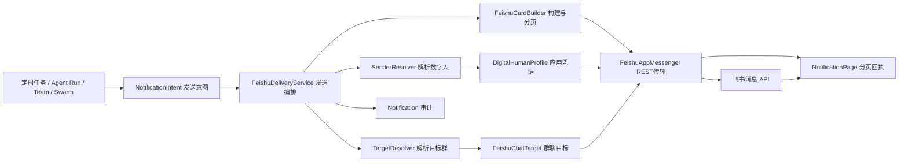
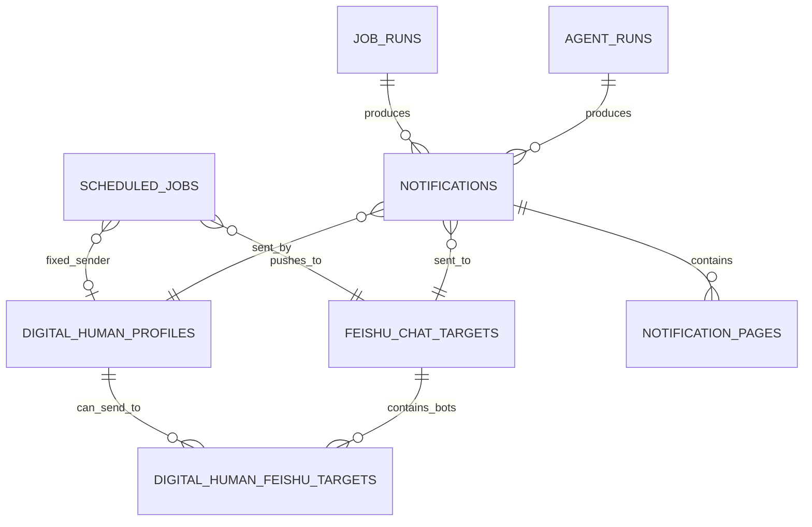
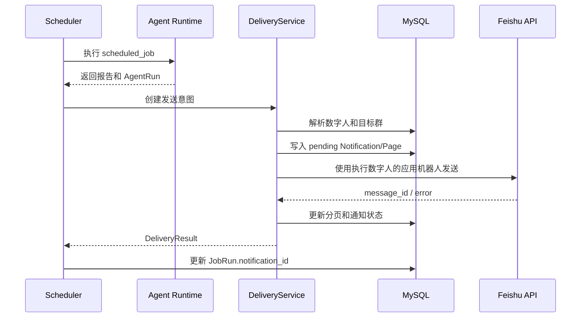
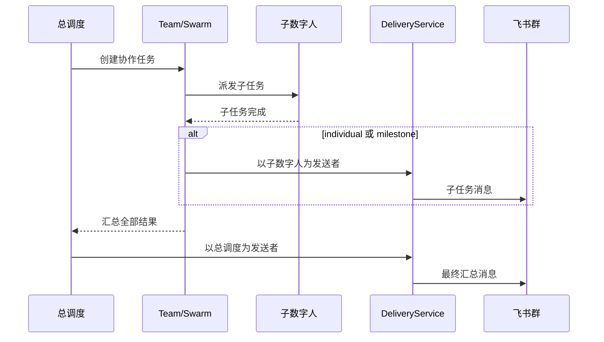

# 数字人飞书应用机器人推送完整设计方案

## 1. 方案摘要

本方案将系统当前的“统一 Webhook 自定义机器人推送”升级为“由任务实际执行数字人绑定的飞书应用机器人主动推送”。

升级后，飞书群内的消息发送者与业务执行者保持一致：

- 情报官生成盘前简报，由“情报官”机器人发送。
- 个股研究员完成公司研究，由“个股研究员”机器人发送。
- 风控复盘官完成风险检查，由“风控复盘官”机器人发送。
- Agent Team 的子任务由各自执行数字人发送，最终汇总由总调度机器人发送。
- 系统健康检查等非业务任务由指定的系统机器人发送。

这不是简单地把 Webhook URL 换成 App ID，而是把消息能力拆成四个清晰层次：

1. **业务事件层**：定时任务、Agent Run、Team、Swarm 只声明“谁、向哪里、发送什么”。
2. **发送编排层**：解析发送数字人、目标群、推送策略、幂等键和失败策略。
3. **消息构建层**：统一完成 Markdown 清洗、移动端适配、卡片分页和元数据展示。
4. **飞书应用传输层**：使用数字人的 App ID/App Secret 获取 Token，通过飞书消息 API 主动发送。

MySQL 保存发送事实和审计记录，Redis 只用于异步唤醒、限流与短期锁，不作为消息状态的唯一来源。

---

## 2. 背景与问题

### 2.1 当前行为

当前定时任务通过 `digital_human_code` 选择执行数字人，但报告生成后统一调用：

```python
send_feishu(session, push_channel_key, title, answer, ...)
```

`send_feishu()` 从 `notify_channels` 读取 Webhook 地址，并向固定的飞书自定义机器人发送。因此：

- “谁生成报告”和“谁发送消息”是割裂的。
- 所有消息在飞书中显示为同一个自定义机器人。
- 用户无法从发送者身份直接判断责任数字人。
- Team 和 Swarm 即使由多个数字人协作，最终仍只显示一个统一机器人。

### 2.2 已有可复用能力

项目不需要从零建设飞书应用机器人能力，现有代码已经具备：

- `DigitalHumanProfile.feishu_app_id`：数字人与飞书应用绑定。
- `DigitalHumanProfile.feishu_app_secret_cipher`：App Secret 加密存储。
- `DigitalHumanProfile.feishu_bot_enabled`：机器人启停状态。
- `fetch_tenant_token()`：获取 `tenant_access_token`。
- `BotWorker._send_card()`：通过 `chat_id` 主动发送互动卡片。
- `BotWorker._patch_card()`：更新已发送卡片。
- `markdown_elements()`：Markdown 清洗、长内容分片和移动端表格降级。
- `notifications`：现有通知状态和错误审计。

真正需要做的是重构职责边界，并补齐目标群管理、发送路由、分页审计、重试和调度配置。

---

## 3. 建设目标

### 3.1 业务目标

1. 飞书消息发送者与任务执行数字人一致。
2. 用户在群里能够一眼识别消息由哪个数字人产生。
3. 定时任务、Agent Team、Swarm、人工执行复用同一套推送机制。
4. 长报告可完整分页发送，不截断、不超过飞书卡片限制。
5. 每次发送可审计、可重试、可追踪到具体任务和 Agent Run。
6. 某个数字人机器人异常时，不拖垮 Scheduler 和 Agent 主流程。

### 3.2 技术目标

1. Scheduler 不直接依赖长连接 `BotWorker` 内存实例。
2. 卡片构建与飞书传输彻底分离。
3. Web 对话回复、飞书会话回复、定时推送共享应用机器人客户端。
4. App Secret 和 Token 不进入日志、不写明文数据库。
5. 支持多进程部署、服务重启和幂等重试。

### 3.3 非目标

本阶段不包含：

- 飞书审批流、飞书文档和云空间能力。
- 通过飞书管理完整 Agent Team DAG。
- 让任意用户自由指定陌生群聊进行推送。
- 让大模型直接读取 App Secret、Token 或群聊凭据。

---

## 4. 核心设计原则

### 4.1 执行者就是默认发送者

对于普通定时任务：

```text
scheduled_jobs.digital_human_code
            ↓
DigitalHumanProfile
            ↓
该数字人绑定的飞书应用机器人
```

不再单独维护一份容易漂移的“发送机器人名称”。

### 4.2 不依赖内存 Worker 发送

长连接 `BotWorker` 负责接收飞书消息和维护会话，但定时推送不能通过 `_workers[profile_id]` 发送，原因是：

- Scheduler 可能运行在另一个进程。
- Worker 可能正在重连，但 REST 消息 API 仍然可用。
- 内存实例不是持久化事实，服务重启后无法恢复。

因此应用机器人传输层必须可以仅凭数据库中的数字人绑定独立完成 REST 发送。

### 4.3 不允许静默冒名代发

数字人未配置、未入群或无权限时，默认将推送标记为失败，不允许由其他机器人无提示冒名发送。

允许的兜底方式只有：

- 配置为“不代发”：记录失败，页面提示管理员处理。
- 配置为“总调度代发”：卡片必须明确显示“代发：原执行者名称”。

### 4.4 MySQL 是事实源

消息状态、发送者、目标群、飞书 `message_id`、分页状态和错误必须落 MySQL。Redis 只承担：

- Token 刷新锁。
- 发送限流。
- 异步任务唤醒。
- 短时幂等锁。

---

## 5. 目标用户体验

### 5.1 定时任务配置

定时任务编辑区新增“消息推送”配置：

```text
消息推送
┌────────────────────────────────────────────┐
│ 推送方式       [数字人应用机器人 ▾]          │
│ 发送者         情报官（跟随任务执行者）       │
│ 目标群         [飞书任务群 ▾]                │
│ 发送时机       [任务成功后 ▾]                 │
│ Team推送策略   [仅最终汇总 ▾]                 │
│ 失败代发       [不代发 ▾]                    │
│              [发送测试消息]                  │
└────────────────────────────────────────────┘
```

当数字人未绑定飞书应用或未加入目标群时，保存前明确提示：

```text
个股研究员尚未验证加入“飞书任务群”，任务可以保存，但推送将被阻止。
```

### 5.2 数字人飞书管理

在现有“数字人中心 -> 飞书机器人”中增加目标群状态：

```text
数字人          飞书应用       长连接      默认推送群       群内状态       操作
情报官          cli_aad...      在线        飞书任务群       已验证         测试
个股研究员      cli_aad...      在线        飞书任务群       已验证         测试
风控复盘官      cli_aad...      在线        飞书任务群       未入群         验证
```

### 5.3 群聊绑定方式

管理员把机器人加入目标群后，在群里发送：

```text
@情报官 /绑定任务群 daily
```

机器人收到事件后取得真实 `chat_id`，创建或更新群聊目标，并返回：

```text
已将当前群绑定为“飞书任务群”。
群标识：daily
机器人：情报官
验证状态：可发送
```

其他数字人加入同一群后，可以分别执行绑定命令，或者在后台点击“验证群成员关系”。

---

## 6. 总体架构



### 6.1 模块职责

| 模块 | 职责 | 不负责 |
|---|---|---|
| `FeishuDeliveryService` | 发送编排、幂等、状态、重试、兜底 | 不拼业务报告内容 |
| `SenderResolver` | 根据任务、Run、策略解析数字人 | 不调用飞书 API |
| `TargetResolver` | 解析目标群并校验机器人群绑定 | 不读取 App Secret |
| `FeishuCardBuilder` | 清洗 Markdown、分页、构建卡片 | 不发送 HTTP 请求 |
| `FeishuAppMessenger` | Token 缓存、发送、更新卡片 | 不决定谁发送 |
| `BotWorker` | 接收飞书事件、维护飞书对话 | 不作为调度推送唯一入口 |

---

## 7. 数据模型设计

### 7.1 新增 `feishu_chat_targets`

保存经过授权的目标群，不允许业务调用直接传入任意 `chat_id`。

```sql
CREATE TABLE feishu_chat_targets (
    id                  BIGINT PRIMARY KEY AUTO_INCREMENT,
    target_key          VARCHAR(80)  NOT NULL,
    name                VARCHAR(120) NOT NULL,
    chat_id             VARCHAR(160) NOT NULL,
    tenant_key          VARCHAR(80)  NULL,
    purpose             VARCHAR(32)  NOT NULL DEFAULT 'task',
    status              VARCHAR(24)  NOT NULL DEFAULT 'pending',
    bind_source         VARCHAR(24)  NOT NULL DEFAULT 'group_command',
    bound_by_user_id    BIGINT       NULL,
    verified_at         DATETIME     NULL,
    last_error          TEXT         NULL,
    created_at          DATETIME     NOT NULL DEFAULT CURRENT_TIMESTAMP,
    updated_at          DATETIME     NOT NULL DEFAULT CURRENT_TIMESTAMP ON UPDATE CURRENT_TIMESTAMP,
    UNIQUE KEY uq_feishu_target_key (target_key),
    UNIQUE KEY uq_feishu_chat_id (chat_id),
    KEY ix_feishu_target_status (status)
);
```

状态定义：

- `pending`：已记录但尚未验证。
- `enabled`：允许推送。
- `disabled`：管理员停用。
- `invalid`：群不存在、应用不在群或权限已失效。

### 7.2 新增 `digital_human_feishu_targets`

同一个群可能加入多个数字人机器人，因此必须记录“某个机器人是否能向某个群发送”。

```sql
CREATE TABLE digital_human_feishu_targets (
    id                  BIGINT PRIMARY KEY AUTO_INCREMENT,
    profile_id          BIGINT      NOT NULL,
    target_id           BIGINT      NOT NULL,
    is_default          TINYINT(1)  NOT NULL DEFAULT 0,
    enabled             TINYINT(1)  NOT NULL DEFAULT 1,
    membership_status   VARCHAR(24) NOT NULL DEFAULT 'pending',
    verified_at         DATETIME    NULL,
    last_send_at        DATETIME    NULL,
    last_error          TEXT        NULL,
    created_at          DATETIME    NOT NULL DEFAULT CURRENT_TIMESTAMP,
    updated_at          DATETIME    NOT NULL DEFAULT CURRENT_TIMESTAMP ON UPDATE CURRENT_TIMESTAMP,
    CONSTRAINT fk_dhft_profile FOREIGN KEY (profile_id) REFERENCES digital_human_profiles(id),
    CONSTRAINT fk_dhft_target FOREIGN KEY (target_id) REFERENCES feishu_chat_targets(id),
    UNIQUE KEY uq_dhft_profile_target (profile_id, target_id),
    KEY ix_dhft_target_status (target_id, membership_status)
);
```

`membership_status`：

- `pending`：尚未验证。
- `verified`：最近一次测试发送成功。
- `not_in_chat`：机器人不在群中。
- `permission_denied`：缺少发送权限。
- `credential_error`：应用凭据异常。

### 7.3 扩展 `scheduled_jobs`

保留 `push_channel_key` 作为旧 Webhook 兼容字段，新链路新增：

```sql
ALTER TABLE scheduled_jobs
    ADD COLUMN push_mode VARCHAR(24) NOT NULL DEFAULT 'none',
    ADD COLUMN feishu_target_id BIGINT NULL,
    ADD COLUMN sender_policy VARCHAR(24) NOT NULL DEFAULT 'executor',
    ADD COLUMN sender_profile_id BIGINT NULL,
    ADD COLUMN team_push_policy VARCHAR(24) NOT NULL DEFAULT 'summary_only',
    ADD COLUMN push_on VARCHAR(24) NOT NULL DEFAULT 'success',
    ADD COLUMN fallback_policy VARCHAR(24) NOT NULL DEFAULT 'none',
    ADD COLUMN fallback_profile_id BIGINT NULL,
    ADD CONSTRAINT fk_sj_feishu_target FOREIGN KEY (feishu_target_id) REFERENCES feishu_chat_targets(id),
    ADD CONSTRAINT fk_sj_sender_profile FOREIGN KEY (sender_profile_id) REFERENCES digital_human_profiles(id),
    ADD CONSTRAINT fk_sj_fallback_profile FOREIGN KEY (fallback_profile_id) REFERENCES digital_human_profiles(id);
```

字段含义：

| 字段 | 可选值 | 说明 |
|---|---|---|
| `push_mode` | `none` / `agent_bot` | 是否使用数字人应用机器人推送 |
| `sender_policy` | `executor` / `orchestrator` / `fixed` | 如何解析发送数字人 |
| `team_push_policy` | `summary_only` / `milestone` / `individual` | Team/Swarm 消息粒度 |
| `push_on` | `success` / `failure` / `both` | 发送时机 |
| `fallback_policy` | `none` / `orchestrator` / `fixed` | 原机器人不可用时的策略 |

### 7.4 扩展 `notifications`

继续使用现有通知表作为逻辑消息主记录，避免重新建设一套审计系统。

```sql
ALTER TABLE notifications
    ADD COLUMN delivery_key VARCHAR(190) NULL,
    ADD COLUMN transport VARCHAR(32) NOT NULL DEFAULT 'feishu_webhook',
    ADD COLUMN sender_profile_id BIGINT NULL,
    ADD COLUMN target_id BIGINT NULL,
    ADD COLUMN job_run_id VARCHAR(120) NULL,
    ADD COLUMN agent_run_id VARCHAR(64) NULL,
    ADD COLUMN external_message_id VARCHAR(160) NULL,
    ADD COLUMN total_pages INT NOT NULL DEFAULT 1,
    ADD COLUMN sent_pages INT NOT NULL DEFAULT 0,
    ADD COLUMN retry_count INT NOT NULL DEFAULT 0,
    ADD COLUMN last_attempt_at DATETIME NULL,
    ADD CONSTRAINT fk_notification_sender FOREIGN KEY (sender_profile_id) REFERENCES digital_human_profiles(id),
    ADD CONSTRAINT fk_notification_target FOREIGN KEY (target_id) REFERENCES feishu_chat_targets(id),
    ADD UNIQUE KEY uq_notification_delivery_key (delivery_key),
    ADD KEY ix_notification_job_run (job_run_id),
    ADD KEY ix_notification_agent_run (agent_run_id),
    ADD KEY ix_notification_status_created (status, created_at);
```

推荐状态：

- `pending`：已创建，尚未开始外部调用。
- `sending`：正在逐页发送。
- `sent`：全部页面发送成功。
- `partial`：部分页面发送成功。
- `retrying`：等待重试。
- `failed`：不可重试或重试耗尽。
- `blocked`：发送者、目标群或权限条件不满足。

### 7.5 新增 `notification_pages`

长报告经常需要多张卡片，必须记录每一页的外部回执，避免重试时重复发送已成功页面。

```sql
CREATE TABLE notification_pages (
    id                  BIGINT PRIMARY KEY AUTO_INCREMENT,
    notification_id     BIGINT       NOT NULL,
    page_no             INT          NOT NULL,
    page_count          INT          NOT NULL,
    content_hash        VARCHAR(64)  NOT NULL,
    status              VARCHAR(24)  NOT NULL DEFAULT 'pending',
    external_message_id VARCHAR(160) NULL,
    attempt_count       INT          NOT NULL DEFAULT 0,
    sent_at             DATETIME     NULL,
    error               TEXT         NULL,
    created_at          DATETIME     NOT NULL DEFAULT CURRENT_TIMESTAMP,
    updated_at          DATETIME     NOT NULL DEFAULT CURRENT_TIMESTAMP ON UPDATE CURRENT_TIMESTAMP,
    CONSTRAINT fk_np_notification FOREIGN KEY (notification_id) REFERENCES notifications(id),
    UNIQUE KEY uq_notification_page (notification_id, page_no)
);
```

### 7.6 关系图



---

## 8. 发送者解析规则

### 8.1 普通定时任务

`sender_policy=executor` 时：

1. 读取 `scheduled_jobs.digital_human_code`。
2. 查询对应 `DigitalHumanProfile`。
3. 校验数字人状态、飞书绑定、Secret 解密和目标群成员状态。
4. 使用该数字人的飞书应用发送。

### 8.2 Agent Team 子任务

每个子任务已经有 `target_profile_id`，发送者直接使用子任务目标数字人：

```text
AgentDelegation.target_profile_id
              ↓
DigitalHumanProfile
              ↓
应用机器人发送
```

`team_push_policy`：

- `summary_only`：子任务不单独推送，只由总调度发送最终汇总。
- `milestone`：只推送待审批、失败、完成摘要和最终汇总。
- `individual`：每个子任务完成后由各自数字人发送完整结果。

默认推荐 `summary_only`，避免一个 Team 产生十几条群消息。需要突出数字人协作过程时使用 `milestone`。

### 8.3 Swarm Workflow

Swarm 节点已经绑定 `agent_code`，节点级通知使用对应数字人；工作流最终结果由工作流入口数字人或总调度发送。

### 8.4 系统任务

健康检查、数据库异常和 Worker 心跳不属于业务数字人，应配置：

```text
sender_policy=fixed
sender_profile_id=系统管理员机器人
```

如果暂时没有系统机器人，可由总调度机器人代发，但卡片标题必须为“系统通知”，不能伪装成研究结果。

### 8.5 兜底解析

```python
def resolve_sender(intent, job, agent_run):
    if intent.sender_profile_id:
        return intent.sender_profile_id
    if job.sender_policy == "fixed":
        return job.sender_profile_id
    if job.sender_policy == "orchestrator":
        return agent_run.orchestrator_profile_id
    return agent_run.digital_human_id or profile_id_from_code(job.digital_human_code)
```

解析失败时创建 `blocked` 通知记录，不进行 HTTP 调用。

---

## 9. 目标群绑定与验证

### 9.1 绑定命令

只允许系统管理员在群聊中执行：

```text
@机器人 /绑定任务群 <target_key>
@机器人 /解绑任务群 <target_key>
@机器人 /测试推送
```

事件处理步骤：

1. 从飞书事件取得 `chat_id`、`chat_type`、操作者身份和当前机器人 `profile_id`。
2. 校验必须为群聊，且操作者映射到系统管理员。
3. 创建或更新 `feishu_chat_targets`。
4. 创建 `digital_human_feishu_targets` 关系。
5. 使用当前机器人立即发送一张验证卡片。
6. 成功后标记 `membership_status=verified`。

### 9.2 为什么不能仅在后台手填 `chat_id`

手填会带来三个问题：

- 容易填错或把测试群当生产群。
- 无法证明当前机器人真的在群内。
- 容易被滥用为向任意群发送消息的入口。

因此后台只展示掩码后的 `chat_id`，绑定必须来自真实群事件或经过显式管理员验证。

### 9.3 多机器人同群

同一个飞书群可以加入多个自建应用机器人。`chat_id` 是目标群标识，但每个应用是否在群内必须单独验证，所以不能只在目标群表记录一个“已验证”。

---

## 10. 消息构建与长内容处理

### 10.1 复用现有能力

现有 Markdown 清洗、表格纵向化、字符分片和卡片页数限制应迁移到独立的 `FeishuCardBuilder`，Webhook 和应用机器人传输层都调用它。

建议目录：

```text
backend/app/feishu/
├── card_builder.py          # 清洗、分页、卡片 JSON
├── app_messenger.py         # 应用机器人 REST API
├── delivery_service.py      # 编排、幂等、状态与重试
├── sender_resolver.py       # 发送数字人解析
├── target_service.py        # 群聊绑定和验证
├── feishu_bot.py            # 长连接接收与会话
└── webhook_transport.py     # 旧 Webhook，迁移期保留
```

### 10.2 卡片统一结构

```text
┌─────────────────────────────────────┐
│ 个股研究员 · 建设机械深度研究          │
├─────────────────────────────────────┤
│ 任务      盘后深研                    │
│ 执行者    个股研究员                  │
│ 生成时间  2026-08-01 19:03:28        │
│ 运行耗时  2分18秒                     │
├─────────────────────────────────────┤
│ 报告正文（自动分页、移动端完整展示）     │
├─────────────────────────────────────┤
│ SixRabbits Stock · Agent应用机器人    │
└─────────────────────────────────────┘
```

### 10.3 长消息分页

1. 先对 Markdown 做飞书兼容清洗。
2. 将宽表转换为纵向信息块，避免移动端单元格裁剪。
3. 根据字符数、组件数、表格数同时分页。
4. 每页生成独立 `notification_pages` 记录。
5. 按页发送并保存每页 `message_id`。
6. 第 N 页失败时，只重试第 N 页及之后未成功页面。

### 10.4 卡片更新

飞书对话中的“正在分析”占位卡仍使用 `PATCH message_id` 更新。定时任务默认直接发送最终卡片，不发送占位卡，避免长任务在群里产生大量“处理中”消息。

对 Team `milestone` 模式，可发送一张进度卡并持续更新：

```text
Agent Team：月末风险复盘
已完成 3/6，执行中 2，待审批 1
```

---

## 11. 应用机器人传输层

### 11.1 接口设计

```python
class FeishuAppMessenger:
    def send_card(
        self,
        *,
        profile_id: int,
        chat_id: str,
        card_json: str,
        request_id: str,
    ) -> SendResult: ...

    def patch_card(
        self,
        *,
        profile_id: int,
        message_id: str,
        card_json: str,
    ) -> SendResult: ...
```

`SendResult` 至少包含：

```json
{
  "ok": true,
  "message_id": "om_xxx",
  "http_status": 200,
  "feishu_code": 0,
  "error": null,
  "retryable": false,
  "latency_ms": 238
}
```

### 11.2 Token 缓存

- 缓存键：`app_id`。
- 过期时间：飞书返回有效期减去 5 分钟安全余量。
- Token 只放进程内存，不能写数据库和普通日志。
- 多进程场景允许各进程独立获取 Token。
- 遇到 Token 失效错误时清理缓存并只重取一次。
- 可使用 Redis 锁防止大量任务同时刷新同一应用 Token，但 Redis 中也不长期保存 Token。

### 11.3 HTTP 策略

- 连接超时：5 秒。
- 单次响应超时：10 秒。
- 网络错误、429 和 5xx：指数退避重试。
- 业务权限错误、机器人不在群、参数错误：不自动重试。
- 单页最多重试 3 次。
- 外部 HTTP 调用期间不持有数据库事务和连接。

---

## 12. 发送编排流程

### 12.1 普通定时任务时序



### 12.2 Team/Swarm 时序



### 12.3 发送意图对象

业务层不直接调用飞书 API，只创建统一意图：

```python
NotificationIntent(
    event_type="scheduled_report.completed",
    title=title,
    content=answer,
    sender_policy="executor",
    sender_profile_id=profile.id,
    target_id=job.feishu_target_id,
    job_run_id=job_run.run_id,
    agent_run_id=agent_run.run_id,
    report_id=report_id,
    card_template="blue",
    idempotency_key=f"job:{job_run.run_id}:final",
)
```

---

## 13. 幂等、重试与故障处理

### 13.1 幂等键

推荐格式：

```text
普通定时任务：job:{job_run_id}:final
子任务结果：delegation:{delegation_id}:result
Team最终汇总：team:{team_id}:final
Swarm节点：workflow:{workflow_run_id}:node:{node_key}
系统告警：alert:{event_id}
```

`delivery_key` 唯一索引确保 Scheduler 重复触发或 Worker 重启不会重复创建同一逻辑消息。

### 13.2 重试分类

| 错误 | 是否重试 | 处理 |
|---|---:|---|
| 网络超时 | 是 | 指数退避，最多 3 次 |
| HTTP 429 | 是 | 尊重限流等待时间 |
| HTTP 5xx | 是 | 指数退避 |
| Token 失效 | 是 | 清缓存、重取一次 |
| App Secret 解密失败 | 否 | `blocked`，要求重新绑定 |
| 机器人不在群 | 否 | `blocked`，提示加入群聊 |
| 权限不足 | 否 | `blocked`，提示开通权限 |
| 卡片超限 | 否 | 构建器缺陷，记录并告警 |
| 部分页已发送 | 是 | 从首个失败页继续 |

### 13.3 主业务与推送解耦

报告生成成功但推送失败时：

- `JobRun` 的业务执行状态保持 `success`。
- 额外记录 `delivery_status=failed/blocked`。
- 页面显示“报告成功，推送失败”，而不是把整个任务标记为业务失败。
- 管理员可以在通知历史中单独重试推送。

这能避免飞书短暂故障导致定时任务被误判为生成失败。

### 13.4 代发策略

如果设置 `fallback_policy=orchestrator`：

```text
总调度机器人发送
卡片顶部显示：代发数字人：个股研究员
代发原因：个股研究员机器人未加入目标群
```

不允许无标识地切换发送者。

---

## 14. API 设计

### 14.1 目标群管理

```text
GET    /api/feishu-bot-targets
GET    /api/feishu-bot-targets/{target_id}
PATCH  /api/feishu-bot-targets/{target_id}
DELETE /api/feishu-bot-targets/{target_id}
POST   /api/feishu-bot-targets/{target_id}/verify
```

### 14.2 数字人与目标群关系

```text
PUT    /api/feishu-bots/{profile_id}/targets/{target_id}
DELETE /api/feishu-bots/{profile_id}/targets/{target_id}
POST   /api/feishu-bots/{profile_id}/targets/{target_id}/test
```

测试请求不允许前端传任意 `chat_id`，只能选择已保存目标。

### 14.3 通知历史

```text
GET  /api/notifications?transport=feishu_app&status=failed
GET  /api/notifications/{notification_id}
POST /api/notifications/{notification_id}/retry
```

### 14.4 定时任务 DTO

```json
{
  "push_mode": "agent_bot",
  "feishu_target_id": 1,
  "sender_policy": "executor",
  "sender_profile_id": null,
  "team_push_policy": "summary_only",
  "push_on": "success",
  "fallback_policy": "none",
  "fallback_profile_id": null
}
```

---

## 15. 权限与安全

### 15.1 凭据安全

- App Secret 继续使用现有加密机制存储。
- API 永不回显 Secret 原文。
- `tenant_access_token` 不落库、不进入日志。
- 错误日志只记录数字人 ID、App ID 掩码、目标 ID 和飞书错误码。
- Agent 工具层禁止查询飞书配置表和密文字段。

### 15.2 群聊授权

- 只有管理员可以绑定和解绑群聊。
- 业务任务只能推送到 `feishu_chat_targets.status=enabled` 的群。
- 不提供“调用 API 时临时传 chat_id”的能力。
- 测试发送和重试操作写入系统审计日志。

### 15.3 发送权限

- 普通数字人只能使用自己的飞书应用身份。
- 总调度可以按配置代发，但必须显式标识。
- 系统机器人不能被业务 Agent 选择为普通研究报告执行者。

---

## 16. 可观测性

### 16.1 关键指标

- 应用机器人发送成功率。
- P50/P95 发送延迟。
- Token 获取失败次数。
- 机器人不在群错误次数。
- 权限拒绝次数。
- 长消息平均页数和部分失败率。
- 各数字人发送量。
- 各目标群发送量。

### 16.2 日志上下文

每次发送日志至少包含：

```json
{
  "notification_id": 1024,
  "delivery_key": "job:run_xxx:final",
  "sender_profile_id": 4,
  "target_id": 1,
  "job_run_id": "run_xxx",
  "page_no": 1,
  "page_count": 3,
  "status": "sent",
  "latency_ms": 238
}
```

不得记录 Secret、Token 和完整 `chat_id`。

### 16.3 健康检查

系统健康检查增加：

- 每个启用数字人的凭据解密状态。
- 最近 Token 获取状态。
- 默认目标群成员验证状态。
- 最近一次发送成功时间。
- 连续失败次数。

---

## 17. 前端页面设计

### 17.1 数字人机器人页面

增加三个统计：

```text
已绑定应用 10   可主动推送 9   群关系异常 1
```

每行展示：

- 数字人名称。
- 飞书应用掩码。
- 长连接状态。
- 默认目标群。
- 群成员验证状态。
- 最近推送时间。
- 配置、测试、停用、解绑操作。

### 17.2 定时任务页面

任务列表“推送”列由原来的“飞书任务群”升级为：

```text
情报官 → 飞书任务群
总调度 → 飞书任务群
不推送
```

鼠标悬停显示发送策略、Team 策略和最近推送状态。

### 17.3 通知历史页面

新增筛选：

- 发送数字人。
- 目标群。
- 状态。
- 关联定时任务。
- 时间范围。

失败记录提供“查看原因”和“重试未成功页”。

---

## 18. 与现有 Team、Swarm 和任务看板的关系

本方案只负责“谁发送、发送到哪里、发送结果如何审计”，不改变 Agent Team 和 Swarm 的任务编排逻辑。

```text
Agent Team / Swarm
        ↓ 产生 AgentRun 和结果
Agent任务看板
        ↓ 展示执行状态
FeishuDeliveryService
        ↓ 推送里程碑或最终结果
飞书群
```

数据来源对应关系：

| 场景 | 发送者来源 | 内容来源 | 关联 ID |
|---|---|---|---|
| 普通定时任务 | `scheduled_jobs.digital_human_code` | `job_runs.output_content` | `job_run_id` |
| Team 子任务 | `agent_delegations.target_profile_id` | 子 `AgentRun.result_json` | `delegation_id` / `agent_run_id` |
| Team 汇总 | 父 Run 数字人 | `agent_team_runs.summary_json` | `team_id` |
| Swarm 节点 | Workflow 节点 `agent_code` | 节点运行结果 | `workflow_run_id` / `node_key` |
| Swarm 汇总 | 入口或总调度数字人 | Workflow 汇总 | `workflow_run_id` |

---

## 19. 代码改造清单

### 19.1 后端新增

```text
backend/app/feishu/card_builder.py
backend/app/feishu/app_messenger.py
backend/app/feishu/delivery_service.py
backend/app/feishu/sender_resolver.py
backend/app/feishu/target_service.py
backend/app/feishu/feishu_target_api.py
```

### 19.2 后端调整

- `core/models.py`：新增目标群、关系、分页表和通知字段。
- `core/database.py`：增加幂等迁移。
- `feishu/feishu_bot.py`：复用 `FeishuAppMessenger`，增加群绑定命令。
- `feishu/feishu.py`：拆出卡片构建；Webhook 标记为兼容传输。
- `scheduler/rhythm_scheduler.py`：生成 `NotificationIntent`，不再直接调用 Webhook。
- `scheduler/rhythm_api.py`：增加应用机器人推送配置字段。
- `agent_runtime/team_service.py`：在里程碑和汇总节点创建发送意图。
- `agent_runtime/workflow_service.py`：按 Swarm 推送策略创建发送意图。

### 19.3 前端调整

- `FeishuBotPanel.vue`：目标群、验证状态和测试推送。
- `RhythmView.vue`：推送方式、目标群、发送者策略和 Team 策略。
- `NotifyChannelSettingsView.vue`：迁移后改为“旧 Webhook 通道”，默认折叠。
- 新增通知历史详情和分页发送状态展示。

---

## 20. 实施阶段

### 阶段 1：底层能力拆分

- 抽取 `FeishuCardBuilder`。
- 实现无 Worker 依赖的 `FeishuAppMessenger`。
- 让现有飞书对话复用新 Messenger。
- 完成 Token、发送、更新卡片的单元测试。

预计 1.5 至 2 个工作日。

### 阶段 2：目标群与发送审计

- 新增目标群和机器人群关系表。
- 实现群聊绑定命令、验证和测试发送。
- 扩展通知主表，增加分页回执。
- 实现幂等、失败分类和按页重试。

预计 1.5 至 2 个工作日。

### 阶段 3：定时任务接入

- 定时任务增加应用机器人推送配置。
- Scheduler 切换到 `FeishuDeliveryService`。
- 分离业务执行状态和消息投递状态。
- 完成健康检查、报告类任务和手动执行测试。

预计 1 至 1.5 个工作日。

### 阶段 4：Team、Swarm 与页面

- 接入 Team/Swarm 三种推送策略。
- 完善数字人机器人、定时任务和通知历史页面。
- 完成移动端飞书卡片、长报告和多数字人并发测试。

预计 1.5 至 2 个工作日。

完整交付预计 6 至 8 个工作日。

---

## 21. 迁移与上线策略

### 21.1 数据迁移

1. 新建表和新增字段，现有 Webhook 配置保持不变。
2. 在飞书任务群中逐个加入数字人机器人。
3. 由每个机器人执行绑定或后台验证。
4. 将定时任务逐项从 `push_channel_key` 转换为 `push_mode=agent_bot`。
5. 全部任务切换成功后停用 `feishu-daily` Webhook 通道。

Webhook 地址无法反推出群 `chat_id`，因此目标群必须通过应用机器人在真实群中重新绑定一次。

### 21.2 功能开关

建议增加：

```text
STOCK_FEISHU_APP_PUSH_ENABLED=true
STOCK_FEISHU_WEBHOOK_COMPAT_ENABLED=false
```

功能开关只控制传输能力，不改变已经生成的业务报告。

### 21.3 回滚

发生严重问题时：

- 暂停应用机器人推送开关。
- 保留所有 `notifications` 和分页审计记录。
- 不自动恢复 Webhook，避免重复发送和发送者身份倒退。
- 修复后通过通知历史重试未发送页面。

---

## 22. 测试方案

### 22.1 单元测试

- 发送者解析策略。
- 未绑定、停用和 Secret 解密失败。
- 目标群状态和成员状态校验。
- Markdown 清洗、表格纵向化和多页卡片。
- 幂等键冲突和部分页面重试。
- Token 失效后自动刷新一次。

### 22.2 集成测试

- 使用模拟飞书 API 测试 200、429、5xx 和业务错误码。
- Scheduler 报告成功、推送失败时状态分离。
- Team 三种推送策略。
- Swarm 节点与最终汇总发送者正确。
- 服务重启后从数据库恢复失败通知并重试。

### 22.3 真实飞书验收

- 10 个数字人机器人加入同一群并逐一测试。
- 飞书显示的发送者名称、头像与数字人一致。
- 30 页以内长报告完整显示。
- 移动端表格不裁剪正文。
- 同一 JobRun 重放不产生重复消息。
- 某个机器人退出群后，只有该机器人的通知被阻止，其他机器人正常发送。

---

## 23. 验收标准

1. 所有启用推送的定时任务均由实际执行数字人的飞书应用机器人发送。
2. Scheduler 主链路不再调用 Webhook `send_feishu()`。
3. 每条消息可追溯到发送数字人、目标群、JobRun/AgentRun 和飞书 `message_id`。
4. Team 子任务和汇总严格遵循配置的推送策略。
5. 长消息不会因卡片字符、组件或表格限制被截断。
6. 部分分页失败可以从失败页继续重试，不重复发送成功页。
7. 推送失败不会把已成功生成的业务报告错误标记为失败。
8. 机器人未入群、权限不足或凭据错误均给出明确中文原因。
9. App Secret 和 Token 不出现在 API 响应、系统日志和 Agent 上下文中。
10. Webhook 通道停用后，系统所有生产消息仍能正常发送。

---

## 24. 最终结论

这次改造的本质是建立“数字人身份与消息责任一致”的企业级通知体系：

> 谁执行，谁署名；谁发送，谁负责；每次投递都有记录，任何失败都可定位和恢复。

最终推荐架构为：

```text
Scheduler / Team / Swarm 负责产生业务结果
        ↓
FeishuDeliveryService 负责解析发送者、目标群和投递策略
        ↓
FeishuCardBuilder 负责内容兼容和分页
        ↓
FeishuAppMessenger 使用数字人应用身份发送
        ↓
MySQL 保存完整发送事实与分页回执
```

这样既充分复用当前数字人飞书绑定和卡片能力，又避免 Scheduler、Agent Runtime 与飞书长连接 Worker 互相耦合，为后续任务看板、审批提醒和 Team 协作消息打下稳定基础。
