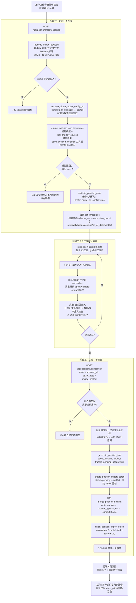
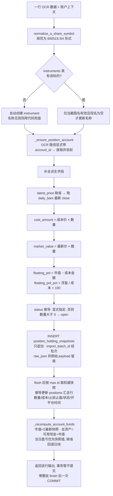
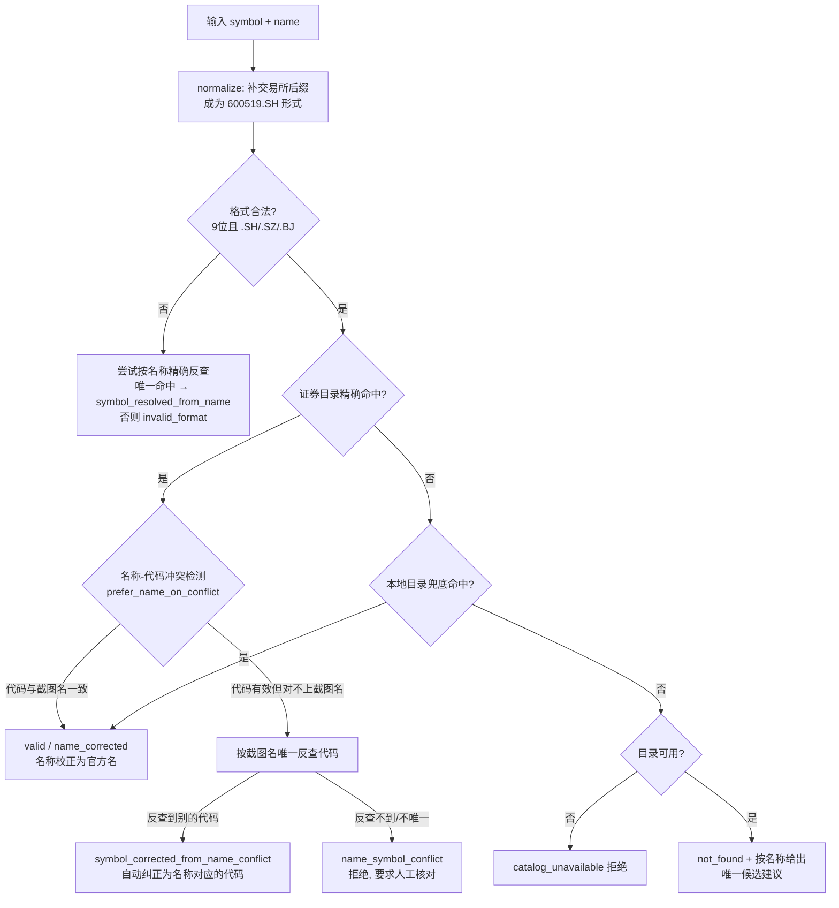

# 持仓 OCR 导入：从截图分析到写表的完整算法路径

> 对象：持仓工作台"截图 OCR 录入"两步式链路（识别 → 人工复核 → 入库）。
> 代码基线：commit `b10dc50`（2026-08-05）。

## 一、总览

链路设计成**两段式人机协作**：视觉模型的输出永远不直接落库，先落成一份可编辑的"草稿"，人工复核后才允许写入。写库时所有 symbol 再经服务端证券目录校验一次，整个批次挂在一条导入批次记录下，可整批撤销。

- 识别段：`POST /api/positions/ocr/recognize` — **只读，不写任何表**
- 复核段：前端可编辑表格 + 逐行代码重校验 + 目标账户必选
- 入库段：`POST /api/positions/ocr/confirm` — 一个事务写完 batch + N 行快照 + positions 汇总 + 账户资金

涉及的表：

| 表 | 本链路中的角色 |
|---|---|
| `position_import_batches` | 导入凭据：图片 sha256、模型原始输出、状态机 pending→done/empty/failed |
| `position_holding_snapshots` | **事实源**，每行持仓追加一条完整快照，`import_batch_id` 挂回批次 |
| `positions` | 汇总行，写完快照后由 max(id) 快照自动推导维护 |
| `position_accounts` | 目标账户，入库后资金字段（市值/总资产/盈亏）被重算 |
| `instruments` | 标的主数据，遇到新代码自动补建 |
| `position_trades` | **本链路不写**（OCR 是整仓快照替换 action=replace，不是买卖流水） |

## 二、完整流程图

### 单行写入细节（`_save_position_holding`，上图中 merge 每一步展开）

## 三、逐步算法说明

### 阶段一：识别（`positions_service.recognize_position_ocr`）

**1. 图片预处理** — `agents/position_import.py::decode_image_payload`
- 剥离 `data:image/...;base64,` 前缀、去除所有空白字符；
- `base64.b64decode(validate=True)` 严格解码，失败即拒绝；
- 大小上限 8MB；
- 计算 **SHA-256**——这是贯穿全链路的指纹：recognize 返回给前端，confirm 必须原样带回，最终存入 `position_import_batches.image_sha256`，把"这批数据"与"这张图"永久绑定。

**2. 视觉模型结构化提取** — `agents/position_agent.py::extract_position_ocr_arguments`
- 模型解析：`resolve_vision_model_config_id`（前端指定 `model_config_id` → 数据源配置页里标记为视觉用途的模型兜底），未配 API Key/Base URL 直接 502；
- 提示词核心纪律（system prompt）：
  - 只提取持仓明细行，**不要**资产汇总、按钮、广告；
  - 每个可见标的只输出一次，`action=replace`（整仓快照语义）；
  - 截图没有代码是常态：此时 symbol 和 name 都填证券名称，交给后端目录反查——**严禁凭记忆猜代码**；
  - 看不清的字段留空，不许猜；
- 结构化手段：不是裸 JSON prompt，而是 `tool_choice="required"` 强制模型调用 `save_position_holdings` 工具，参数即结构化草稿（rows/account/as_of_date）；
- 采样参数：temperature 0（K3 系列模型例外用 1.0），`enable_thinking=False`；
- 模型没吐出可用 rows → `RuntimeError` → HTTP 502。

**3. 逐行代码校验** — `validate_position_rows(prefer_name_on_conflict=True)`，见阶段三第 4 节同一函数；recognize 阶段先跑一遍，把 `validations` 随草稿返回，前端据此显示"已校验 x/y、几条需修正、几条猜码已按名称纠正"。

**4. 返回草稿**（`schema_version: "position_ocr.v1"`）：`image_sha256 / model / account / as_of_date / rows / validations / valid_count / invalid_count`。**到此没有任何表被写入。**

### 阶段二：人工复核（前端 `PositionsWorkbench.vue`）

- 草稿渲染成可编辑表格：数量、成本、代码、名称皆可改，可删行；
- 改过代码的行被打回 `unchecked`，确认前必须重新调 `POST /api/positions/agent-validate-symbol` 校验，通过后回填规范代码与官方名称；
- 点"确认并录入"时前端还做两道闸：
  1. **全部行**再校验一遍，任何一行不过即中止；
  2. `position_quantity ≥ 0`、`cost_price ≥ 0` 数值检查；
- **必须选定目标账户**（`ocrAccountId`），否则拒绝提交——这是"OCR 数据写到哪个券商账户"唯一由人拍板的环节。

### 阶段三：入库（`positions_service.confirm_position_ocr`）

1. **账户验权**：`position_account_exists(account_id)`，不存在/非本人 → 404；
2. **服务端复验**：用与 recognize 完全相同的规则把用户改过的 rows 再验一遍（防止绕过前端直接调 API），仍有非法行 → 400，错误信息精确到"第 n 行 xxx：原因"；
3. 进入统一执行器 `_execute_position_tool("save_position_holdings", trusted_pending_action=True)`：
   - `trusted_pending_action=True` 表示"这是人刚复核过的数据"，跳过 Agent 链路才需要的历史复用拦截；
   - 账户兜底逻辑（含买入动作却无账户 → 追问）因已强制 account_id 而不会触发；
4. **建批次**：`create_position_import_batch`——`status=pending`，存入图片 sha256、mime、模型原始输出 JSON、操作人；
5. **逐行写入**：每行 `merge_position_holding(action="replace", source_type="ai_ocr", import_batch=batch, commit=False)`，展开即上面第二张图；单行抛 `ValueError` 不会中断整批，记为 `{"error": ..., "raw": row}` 继续下一行；
6. **收尾**：`finish_position_import_batch` 按结果置 `done`（至少 1 行成功）/ `empty`（全失败）/ `failed`（整批异常），写 SystemLog；
7. **一次 COMMIT**：批次 + 全部快照 + positions 汇总 + 账户资金在同一事务提交，要么整批可见要么完全不可见；
8. 响应返回 `batch_id / saved_count / error_count / rows`，前端提示"OCR 复核完成，已保存 N 条持仓"并重载列表。

### 代码校验算法（`validate_position_symbol`，三段式裁决）

校验数据源是权威 A 股证券目录（`lookup_a_share_instrument`，目录不可用时返回 `catalog_unavailable` **拒绝放行**，绝不模糊通过）：

要点：**OCR 猜出的代码即使格式合法，只要和截图里的证券名称对不上，就不会静默入库**——能按名称唯一反查就自动纠正并高亮提示，反查不到就打回人工。

## 四、写表清单

| 步骤 | 表 | 操作 |
|---|---|---|
| 建批次 | `position_import_batches` | INSERT（pending），收尾时 UPDATE status |
| 新标的 | `instruments` | INSERT（仅代码不存在时） |
| 每行持仓 | `position_holding_snapshots` | INSERT（只追加，带 batch 外键与 raw_json） |
| 每行持仓 | `positions` | UPDATE/INSERT 汇总行（由 max(id) 快照推导） |
| 每行持仓 | `position_accounts` | UPDATE 资金字段（holding_market_value / total_pnl / day_pnl / total_asset） |
| 收尾 | `system_logs` | INSERT 一条导入完成日志 |

## 五、失败与回退路径

| 场景 | 行为 |
|---|---|
| 非图片 / base64 损坏 / >8MB | 400，链路第一步即拒 |
| 视觉模型未配置 | 502"请先在设置中配置可用模型" |
| 模型没返回可用 rows | 502"请重新上传更清晰的截图" |
| 代码校验不过（recognize 段） | 不阻断，草稿带 invalid 标记交人工修正 |
| 代码校验不过（confirm 段） | 400，逐行列原因，整批不入库 |
| 单行写入失败（如重复持仓冲突） | 该行记 error，其余行正常提交；batch=done 且返回 error_count |
| 整批异常 | batch=failed，事务回滚 |
| 录错想整批撤销 | `rollback_last_position_batch` 按 batch_id 物理删除快照并重建汇总（快照行可删的唯一合法通道） |

## 六、两个变体（同族不同路）

1. **一键 AI 导入** `POST /api/positions/ai-import`（旧路径）：`parse_position_screenshot` 用纯 JSON prompt 解析后**直接建批入库，没有人工复核段**；有 `STOCK_POSITION_AGENT_V2` 开关试点 Pydantic AI 结构化输出+校验重试，失败自动回退旧路径。现在界面主推两步式 OCR。
2. **Agent 自然语言录入** `POST /api/positions/agent-add(/stream)`：多轮对话解析意图，产出待办草稿（pending_action），同样必须经 `agent-confirm` 人工确认才落库，复用同一个 `_execute_position_tool` 执行器。

## 七、设计原则小结

- **模型输出永不直接落库**：人工复核是 OCR 数据唯一的入库闸门；
- **校验三重奏**：recognize 初验（给提示）→ 前端逐行复验（可交互纠正）→ confirm 服务端终验（防绕过）；
- **名称优先于代码**：截图里名称比代码可靠，冲突时按名称纠正代码，反查不唯一就拒绝；
- **指纹留痕**：sha256 贯穿识别→确认→批次表，raw_json 保存原始 payload；
- **快照只追加、max(id) 即当前态**：入库后每分钟价格同步只更新最新快照，与展示、资金重算同一口径（2026-08-05 统一修复后的铁律）。
