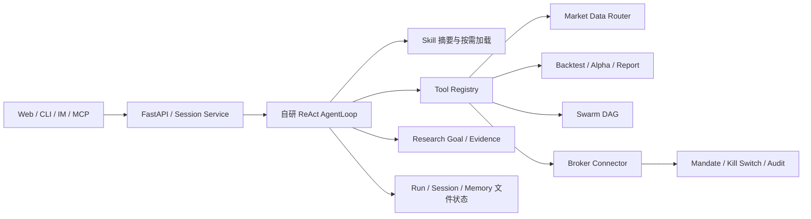
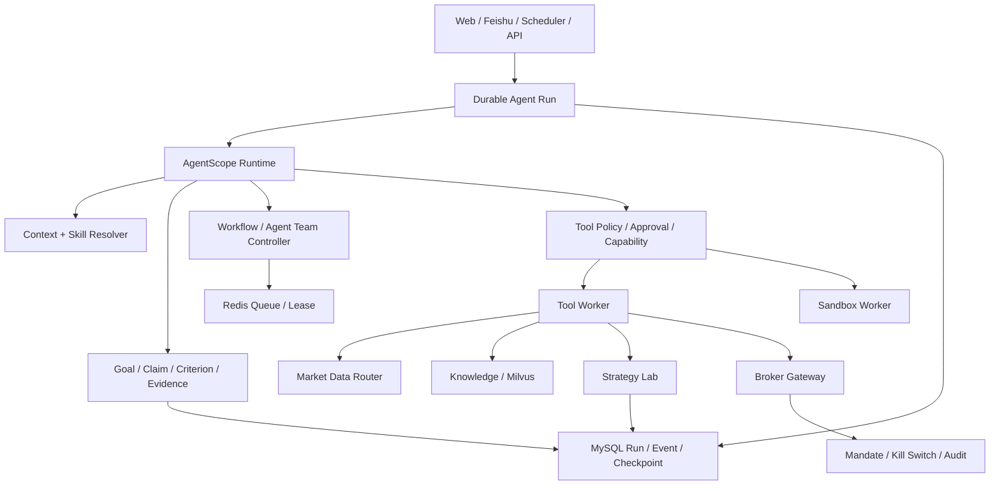

# Vibe-Trading 深度调研与 Hermes Stock 吸收方案

> 调研日期：2026-07-23  
> 上游仓库：`HKUDS/Vibe-Trading`  
> 调研快照：`411bb141ee863d9e0f60e9ab7db3e11199158f1d`  
> 本地源码：`E:\workspace\Vibe-Trading-source\Vibe-Trading-main`

## 1. 结论

Vibe-Trading 最值得学习的不是“88 个技能、30 套团队、462 个 Alpha”这些数量，而是它把金融 Agent 拆成了几个相对清楚的领域部件：

1. 技能目录负责告诉 Agent “会什么”，完整技能说明按需加载。
2. 数据路由器负责决定“从哪里取数”，并按市场执行降级链。
3. Research Goal 与 Evidence Ledger 负责证明“任务为什么算完成”。
4. Swarm Preset 用声明式 DAG 固定专业协作流程。
5. Strategy Store 把策略当作有生命周期的资产，而不是一次性聊天结果。
6. Live Mandate 在交易连接器边界限制写操作，模型无法靠提示词绕过。

Hermes 不应该替换现有 AgentScope 运行时，也不应该照搬 Vibe-Trading 的进程内线程、文件状态库和本地 Shell 模型。Hermes 当前的 MySQL 运行账本、Redis 队列、AgentScope checkpoint、Tool Worker、审批和 Python 沙箱更适合多用户、服务端部署。

正确路线是：

> 保留 Hermes 的“可靠执行控制面”，吸收 Vibe-Trading 的“金融研究领域面”。

## 2. 调研方法

本次没有只看 README，而是核对了以下源码链路：

- Agent 主循环：`agent/src/agent/loop.py`
- 技能加载：`agent/src/agent/skills.py`
- 工具注册：`agent/src/agent/tools.py`、`agent/src/tools/__init__.py`
- 持久记忆：`agent/src/memory/persistent.py`
- 研究目标：`agent/src/goal/`
- Swarm：`agent/src/swarm/`
- 定时研究：`agent/src/scheduled_research/`
- 数据加载器：`agent/backtest/loaders/`
- 回测安全：`agent/backtest/runner.py`
- 策略生命周期：`agent/src/strategy_store/`
- 实盘约束：`agent/src/live/`
- 部署安全：`Dockerfile`、`docker-compose.yml`、`SECURITY.md`
- 测试：源码中共发现 312 个 Python 测试文件

附件提到的 88 个技能、30 套 Swarm Preset、462 个 Alpha 均能在源码目录和注册逻辑中找到对应实现。

## 3. Vibe-Trading 实际架构

它本质上是一个面向个人研究工作站的单体应用。能力覆盖很广，但控制面主要是本地文件、SQLite、进程内线程和后台任务，并不是天然的分布式 Agent 平台。

## 4. 真正值得学习的设计

### 4.1 技能的渐进式披露

`SkillsLoader` 不会把 88 个技能的完整正文全部塞进系统提示词：

- 启动时只注入分类、名称和一句话摘要。
- Agent 确认需要某项技能后，再调用 `load_skill` 读取完整 `SKILL.md`。
- 用户技能目录优先于内置技能，同名时允许覆盖。
- 技能可以带参考文件，主说明与附属资料分离。

这个设计解决了两个问题：

- 技能越多，系统提示词不会线性膨胀。
- 新技能不需要继续修改一个巨型系统提示词。

Hermes 当前 `SkillRegistry` 已具备自动发现、角色过滤和工具注册，但仍倾向于一次性下发工具与规则。下一步应增加 `SkillManifest` 和按需加载，而不是直接复制 88 个 Python 模块。

### 4.2 Research Goal 与证据账本

Vibe-Trading 的长任务不是只靠“多跑几轮”：

- Goal 有状态、目标、风险等级、token/轮次/时间预算。
- 每个 Goal 有验收 criterion。
- Evidence 可关联 criterion、claim、run、tool call、数据时间、来源、产物路径和哈希。
- 更新时带 `expected_goal_id`，防止旧轮次写入已被替换的目标。
- 完成前必须对每个必选 criterion 做 audit。
- 满足项必须存在可验证的 run 或带哈希的本地产物。
- Agent 提前回答但 Goal 未完成时，运行时会继续推进；无新进展或超过续跑预算时停止。

这是对 Hermes 价值最大的部分。它能解决：

- 长任务“说完成了但其实没有完成”。
- 研究结论没有出处。
- 子任务完成了，但总任务不知道缺什么。
- 模型在上下文中忘记验收条件。

注意：Vibe 的“verified”目前主要认可本地 run/产物，对网页、公告、行情快照的可验证性还不够完整。Hermes 应将证据扩展为结构化来源快照，而不是原样复制。

### 4.3 声明式 Swarm 工作流

30 套 Preset 的价值不在数量，而在结构：

- Agent 有独立角色提示词。
- 每个 Agent 有工具白名单和技能白名单。
- 每个节点有超时、最大轮次和重试次数。
- 任务通过 `depends_on` 与 `input_from` 形成 DAG。
- 同一层并行，不同层按依赖顺序执行。
- 风控或最终决策节点可因上游失败而阻断，避免缺数据仍强行给结论。
- `incomplete` 与 `failed` 分开，计划书、伪造结果、缺少数据调用不会被误判为成功。
- 运行前统一抓取 grounding 数据，使多个 Agent 使用同一行情快照。

`investment_committee` 的 Bull、Bear、Risk、PM 四段式流程，比让总调度每次临场自由拆几十个子任务更稳定。

Hermes 当前 Agent Team 的耐久性更强，但编排仍偏“总调度自由派发”。应增加少量高价值模板：

- 个股深度研究：基本面 + 量化 + 情报 -> 风控 -> 研究员汇总
- 持仓复盘：持仓快照 + 个股研究 + 风控 -> PM
- 自选池筛选：情报 + 基本面 + 量化 -> 入池审查
- 盘前简报：市场数据 + 公告新闻 + 持仓风险 -> 总调度
- 收盘复盘：行情归因 + 异动 + 持仓影响 -> 总调度

模板负责稳定流程，自由委派只处理临时任务。

### 4.4 数据源协议与市场降级链

Vibe 将历史行情抽象成 Loader Protocol：

- loader 声明名称、支持市场、是否需要认证、可用性检查。
- `fetch` 返回统一 OHLCV DataFrame。
- 注册表按市场配置 fallback chain。
- `source=auto` 先识别市场，再按风险和可用性依次尝试数据源。
- 历史行情 loader 与实时交易 connector 明确分层。

这比在不同工具里分别写 TuShare、AkShare、EastMoney 的调用更容易治理。

Hermes 应增加 `MarketDataRouter`，但要比 Vibe 多三项生产能力：

- 数据源健康分、熔断、限流与失败原因。
- 返回值必须包含 provider、as_of、timezone、adjustment、request_id。
- 同一研究 run 固定 `data_snapshot_id`，避免子 Agent 使用不同时间点的数据。

### 4.5 Strategy Store 与衰减状态机

策略不是聊天附件，而是持久资产：

- Artifact 区分 factor 与 strategy。
- 状态包含 created、benching、active、monitoring、decayed、disabled。
- 保存来源论文、公式、信号、进出场、仓位、代码路径和回测 run。
- BenchResult 保存 IC、IR、Sharpe、回撤、训练/测试窗口。
- DecayEvaluator 根据连续预警推动状态迁移。

这适合 Hermes 后续的“策略实验室”，也适用于研究报告模板、选股规则和风控规则。关键是版本、实验、评估、上线、监控、下线形成闭环。

### 4.6 实盘安全边界

Vibe 的交易安全不是只写在提示词里：

- 用户先提交不可变、带有效期的 mandate。
- 连接器边界检查 symbol/资产类别白名单、单笔金额、总敞口、日交易次数、流动性和 kill switch。
- 未知交易工具按写操作处理，默认拒绝。
- 数量订单会换算名义金额，无法取得价格时拒绝。
- Paper/Live 由账户、主机、demo 标志或交易环境结构判断，模型不能修改一个布尔配置切到实盘。
- 研究和回测路径不暴露实盘下单工具。
- 直接 SDK 和 MCP 路径都经过同一套 gate。

这是 Hermes 以后接交易券商时必须采用的原则：

> 权限由业务网关和连接器执行，提示词只负责解释，不能负责授权。

## 5. 不能照搬的部分

### 5.1 文件状态库不适合生产多副本

会话、Swarm、记忆和定时任务大量落在本地 JSON、JSONL、Markdown 或 SQLite：

- 适合个人电脑和单容器。
- 不适合多个 API/Worker 同时写。
- 主机故障后只能识别 stale，不能从精确 checkpoint 继续。
- 运行中的取消信号保存在进程内。

Hermes 已经使用 MySQL 持久化 Run/Event/Checkpoint，并用 Redis 做通知、队列和 lease，这部分不要倒退。

### 5.2 Swarm 是线程池，不是耐久任务系统

Vibe 的 Swarm：

- 后台 daemon thread 执行。
- 每层 `ThreadPoolExecutor` 并行。
- 进程退出后无法恢复正在执行的 Python 栈。
- stale run 最终被标记失败，而不是从节点 checkpoint 续跑。
- 取消主要发生在层之间，已运行工具不能保证立即停止。

它的 DAG 语义值得学，执行底座不值得搬。

### 5.3 自研 ReAct 循环不应替换 AgentScope

Vibe 的 AgentLoop 有很多实用补丁：

- 50 轮上限。
- 只读工具最多 8 路并行，写工具串行。
- 多层上下文压缩。
- 流式异常重试一次。
- 重复非幂等工具去重。
- 长目标自动续跑。

但这也是维护成本很高的自研运行时。Hermes 已经接入 AgentScope 的状态、事件、审批和外部执行协议，不应重新走一遍自研框架路线。应把上述策略做成 AgentScope 外围中间件或宿主控制器。

### 5.4 Shell 与生成代码仍有安全缺口

`bash` 工具使用 `shell=True`；虽然默认只在本地交互模式启用，但一旦误配置，权限很大。

回测代码做了 AST 校验、环境变量收窄和低权限用户执行，但官方安全说明明确指出子进程仍可访问网络。容器的只读根文件系统、cap drop 和资源限制是好做法，却不能替代真正的任务级网络隔离。

Hermes 应继续使用独立 sandbox 服务：

- 每次执行独立容器。
- 默认无网络。
- 只挂载当前工作区。
- 非 root、只读基础镜像。
- CPU、内存、PID、磁盘、时间限制。
- 需要联网时只允许经过受控数据代理。
- 不把数据库、LLM、飞书、券商密钥放入沙箱。

### 5.5 数量不能代替质量门

88 个技能中很多是知识说明和流程提示，不等于 88 个独立可靠服务。30 套团队中存在大量长提示词和 Shell 白名单。462 个 Alpha 的工程价值较高，但仍需逐个确认数据字段、复权、点时数据、交易成本和许可声明。

应先做 12 个高频、高可信技能，不以数量作为里程碑。

## 6. Hermes 当前对照

| 维度 | Vibe-Trading | Hermes 当前 | 判断 |
|---|---|---|---|
| Agent 引擎 | 自研同步 ReAct | AgentScope 2.0 | 保留 Hermes |
| Run 持久化 | 文件/SQLite 为主 | MySQL Run/Event/Checkpoint | Hermes 更强 |
| 队列与恢复 | 进程线程 + stale reaper | Redis + DB source of truth + lease | Hermes 更强 |
| 工具执行 | 本进程线程为主 | Inline/Worker/Sandbox 分层 | Hermes 更强 |
| 审批 | 交易 mandate 为强项 | AgentScope permission + 审批记录 | 合并两者 |
| 记忆 | Markdown 关键词检索 | MySQL + Milvus/Chroma + rerank | Hermes 更强 |
| 技能组织 | 88 个 SKILL.md，按需展开 | Python SKILL 注册，规则仍偏静态 | 学习 Vibe |
| 长任务验收 | Goal + criterion + evidence audit | Run 状态与 checkpoint，缺完成契约 | 学习 Vibe |
| Team | 30 套声明式 DAG，运行不耐久 | 耐久 Team，自由委派为主 | 合并两者 |
| 数据路由 | 多市场 loader + fallback | 数据工具较分散 | 学习 Vibe |
| 量化能力 | 回测、Alpha Zoo、策略衰减 | 研究/交易 Agent 为主 | 分阶段补齐 |
| 实盘风控 | mandate + connector gate | 尚未形成完整券商执行网关 | 未来必须学习 |

Hermes 最近实现的“同一 Agent 多项工作合并为一个工作包”，比 Vibe 的通用 DAG 更适合自由委派场景。保留这个规则：

- 一次派发中，一个目标 Agent 只创建一个 child run。
- 同一 Agent 的多个要求合并成结构化 work items。
- 不同 Agent 才并行。
- 只有固定工作流模板允许同一角色出现多个有依赖关系的节点。

## 7. Hermes 目标架构

控制面继续由 Hermes 持有，领域面增加以下六个模块：

1. `research_goal_service`：目标、验收条件、声明、证据、完成审计。
2. `skill_manifest_service`：技能摘要、版本、角色、工具依赖、按需正文。
3. `market_data_router`：统一市场识别、数据源策略、快照和降级。
4. `workflow_template_service`：少量声明式 DAG 模板。
5. `strategy_lab`：策略版本、实验、回测、评估和衰减。
6. `broker_gateway`：未来实盘的 mandate、风控、审计和 kill switch。

## 8. 建议的数据模型

优先复用现有 `agent_runs`、`agent_run_events`、`agent_run_artifacts`，新增：

### 8.1 研究目标

- `research_goals`
- `research_goal_criteria`
- `research_claims`
- `research_evidence`
- `research_completion_audits`

Evidence 至少包含：

- `run_id`、`step_id`、`tool_call_id`
- `provider`、`source_uri`、`source_type`
- `symbol_universe`、`timeframe`
- `data_as_of`、`retrieved_at`
- `artifact_id`、`sha256`
- `verification_status`、`confidence`、`caveat`

### 8.2 技能

- `skill_packages`
- `skill_versions`
- `skill_tool_bindings`
- `digital_human_skill_bindings`

技能 manifest 增加：

- `summary`
- `instructions_ref`
- `allowed_roles`
- `required_tools`
- `required_data_capabilities`
- `risk_level`
- `output_contract`
- `validation_rules`

### 8.3 数据与策略

- `market_data_snapshots`
- `market_data_provider_health`
- `strategy_artifacts`
- `strategy_versions`
- `strategy_experiments`
- `strategy_decay_snapshots`

## 9. 实施顺序

### 阶段 A：证据驱动研究

优先级最高。先让“完成”变得可信：

- 创建 Goal/Criterion/Evidence/Audit 表。
- 总调度和研究 Agent 可创建目标、追加证据、查询缺口、提交完成审计。
- Tool Worker 自动补充 provider、as_of、run、tool call、artifact hash。
- 前端显示“完成度、证据来源、数据时间、缺口”。
- 子 Agent 返回结果时同时返回 evidence refs，不只返回一段文本。

验收：缺少必选证据时，Agent 只能返回 `incomplete`，不能标记完成。

### 阶段 B：技能渐进加载

- 将现有 Python `SKILL` 补成 manifest。
- 系统提示只注入摘要。
- 增加 `list_skills`、`load_skill`，完整规则按需加载。
- 第一批只做 12 个核心技能。
- 工具 schema 与技能说明分开版本化。

验收：技能数量增加时，基础系统提示词大小保持稳定。

### 阶段 C：Market Data Router

- 先覆盖 A 股现有 TuShare、AkShare、东方财富等来源。
- 统一 symbol、字段、复权、时区和交易日历。
- 增加数据质量校验与 provider health。
- 同一 Team 使用一个 `data_snapshot_id`。
- 禁止静默把旧数据当最新数据。

验收：任何研究结论都可追溯到数据源和 `as_of`。

### 阶段 D：专业工作流模板

- 不复制 30 套，只实现 5 套高频流程。
- 模板使用版本化 YAML/JSON，但由后端解析为现有 durable child runs。
- 节点沿用当前“一 Agent 一工作包”原则。
- 增加节点输出契约、依赖门和 `incomplete` 状态。
- 自由派发与模板编排并存。

验收：API 重启、Worker 重启后，未完成节点可继续运行或安全重试。

### 阶段 E：策略实验室

- 先做策略产物、版本、回测 run 和评估。
- 再引入 20 到 30 个已验证 Alpha，不直接搬 462 个。
- 加入点时数据、前视偏差、复权、费用、滑点、样本外和稳定性测试。
- 连续监控后才支持 active -> monitoring -> decayed。

验收：每个策略结论可重放，输入数据、代码版本和参数全部固定。

### 阶段 F：券商网关

最后实施：

- 先 read-only，再 paper，最后 bounded live。
- 实盘密钥只进入 Broker Gateway。
- mandate 由用户提交和签名，Agent 无权修改。
- 下单、撤单、改仓全部幂等并审计。
- kill switch 必须在模型和工具之外生效。

## 10. 第一批 12 个技能

建议从现有产品真实需求出发：

1. A 股行情与交易日历
2. 公司基本面与财务报表
3. 公告、新闻与事件时间线
4. 技术指标与量价分析
5. 资金流、龙虎榜与融资融券
6. 个股深度研究
7. 持仓风险与止损检查
8. 自选池入池/出池审查
9. 组合暴露与集中度
10. 知识库检索与引用
11. 研究报告/PDF/PPT 产物
12. 回测与结果审计

每个技能必须具备：

- 输入契约
- 允许工具
- 数据新鲜度
- 输出结构
- 证据要求
- 失败与缺失数据行为
- 角色权限
- 测试样例

## 11. 安全与许可

- 上游主仓库是 MIT，但复制代码时仍需保留许可声明。
- Alpha Zoo 子目录包含独立 `LICENSE.md` 和 `NOTICE`，不能只看主仓库 MIT。
- 公式虽常被视作数学内容，实现代码和数据仍需单独审查。
- 不允许把 Vibe 的 Shell 工具直接开放到 Hermes HTTP、飞书或定时任务。
- 不允许生成代码直接访问宿主机文件、数据库或内网服务。
- 不允许让模型自己选择是否进入 live trading。

## 12. 最终判断

Vibe-Trading 是一个优秀的“金融 Agent 能力仓库和研究工作站”，它在金融工具广度、技能目录、数据源回退、量化研究、研究证据和实盘边界方面很有参考价值。

Hermes 要做的不是变成 Vibe-Trading 的中文版，而是形成更适合服务端交付的组合：

> AgentScope 提供 Agent 语义，MySQL/Redis 提供耐久执行，Tool Worker/Sandbox 提供安全边界，Vibe-Trading 的领域模式提供金融专业能力。

下一步应直接从“阶段 A：证据驱动研究”开始，而不是先堆技能数量。它会先解决系统最核心的问题：Agent 输出到底有没有完成、依据是什么、数据是哪一天的、失败后从哪里继续。

## 13. 参考资料

- 官方仓库：<https://github.com/HKUDS/Vibe-Trading/>
- 官方 README：<https://github.com/HKUDS/Vibe-Trading/blob/main/README.md>
- 安全说明：<https://github.com/HKUDS/Vibe-Trading/blob/main/SECURITY.md>
- Agent 贡献指南：<https://github.com/HKUDS/Vibe-Trading/blob/main/AGENT_CONTRIBUTOR_GUIDE.md>
- Docker Compose：<https://github.com/HKUDS/Vibe-Trading/blob/main/docker-compose.yml>
